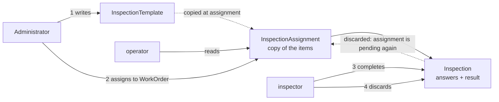
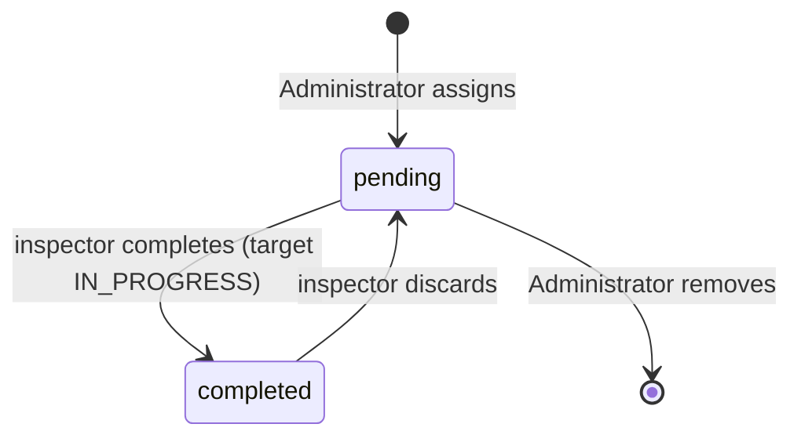
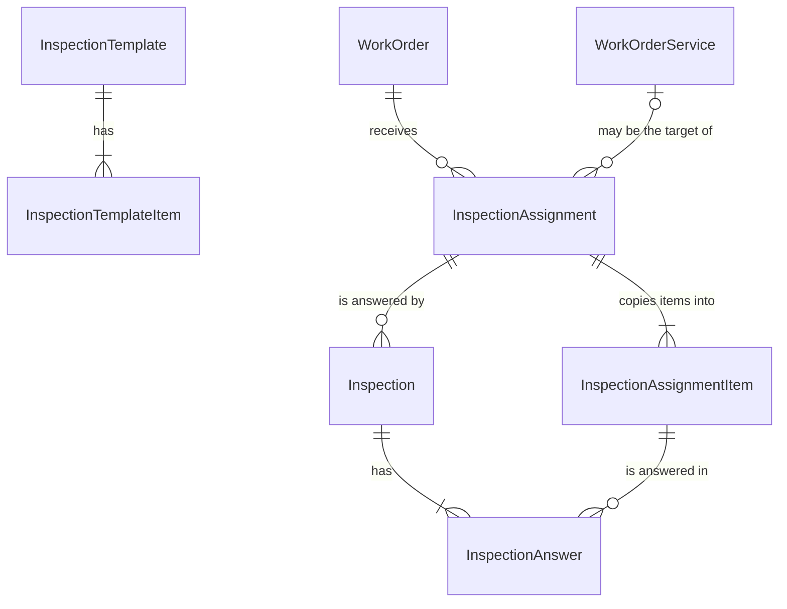
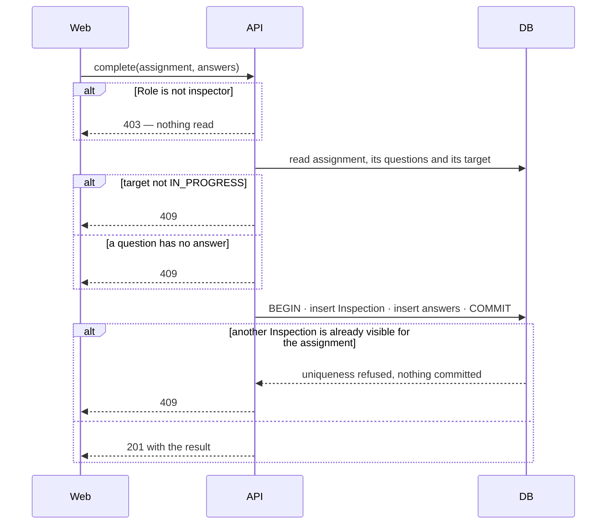

# Inspections

| | |
|---|---|
| **Status** | confirmed by Luciano Sousa, project owner, 2026-11-14, in this document |
| **Ready to plan?** | 5 slices: 1 clear, 4 clear with defaults taken. Nothing blocks a spec. |
| **Review** | First demonstration after the [WorkOrder deletion](#workorder-deletion) slice is built - Luciano Sousa, project owner |

**How to read.** From Summary to Key decisions is the design the team aligns on. Slices cuts the work: one section per slice, with its rules, its contract and the data that matters. The spec of each feature starts from its slice and details the rest against the code.

## Summary

Today a WorkOrder records the services done on a Vessel and the images that document them, and nothing records that somebody checked the work. This design adds inspections: an Administrator writes a checklist once, assigns it to a WorkOrder, and an inspector answers it while the work is in progress. It does not make a failed inspection stop anything: the result is a record, not a gate.

1. An **InspectionTemplate** is a named checklist an Administrator of the Organization maintains.
2. An **InspectionAssignment** puts a copy of that checklist on one WorkOrder, optionally pointing at one of its WorkOrderServices.
3. An **Inspection** is one filled-in answer sheet for an assignment, made by a User with the new Role `inspector`. Its result, approved or reproved, is computed from the answers.
4. An Inspection is never edited or deleted. An inspector may discard it, which hides it from the app and lets the assignment be inspected again.

**What is expensive to get wrong:** the Role `inspector` is the first Role that changes what a User may do inside an ordinary Organization. Every write route that exists today has to take a position on it, and loosening or tightening that later changes what real Users can do.

## Context and problem

**Where the project is.** In active construction. No Organization uses the app yet, so there is no usage to measure and no data to migrate.

**What this piece makes possible.** An auditable history of who checked a piece of work, when, against which questions, and with what result. The roadmap (`ROADMAP.md`, items 1 to 7) does not mention it; the project owner committed to it in this session.

**What stalls without it.** Nothing already built. An Organization would keep its inspection checklists on paper or in a spreadsheet, outside the record of the WorkOrder they refer to.

**Why now.** The project owner chose it as the next piece. The only other pending item, the pagination fix (roadmap item 7), is independent and can land before or after.

**What this reuses.** The rule that a Customer with a Vessel is not deleted is the precedent for refusing a delete. The uncommitted web changes on the WorkOrder detail page stay out of this design; the Inspections section is added to that page as it stands when the slice is specified.

## How we will know it worked

| What to watch | Target | How to measure |
|---|---|---|
| The whole path runs inside the app | An Administrator creates a template and assigns it to a WorkOrder, an inspector completes it, and the result shows on the WorkOrder detail page, at the first demonstration | The project owner walks the path in the running app |

**Signs it is going wrong:**

- An inspector discards and redoes the same assignment several times: discard is being used as edit. Visible as rows in `inspections` with `discardedAt` set.
- An Organization accumulates templates that differ by one question: the checklist needs more than three fixed answers. Visible as rows in `inspection_templates`.

## Scope

**In**

- The Role `inspector`, and Role checks on the write routes of `customer` and `work-order`
- InspectionTemplate: create, list, read, edit, delete
- InspectionAssignment: assign to a WorkOrder, list, remove while it has no Inspection
- Inspection: complete, read, discard, at a desk or on a phone
- Refusing the delete of a WorkOrderService or WorkOrder that has an Inspection
- `CONTEXT.md` gains InspectionTemplate, InspectionAssignment, Inspection and the Role `inspector`, its Role, WorkOrder and WorkOrderService entries are corrected, and `ROADMAP.md` gains an item

**Out**

| Left out | Why / where it lands |
|---|---|
| A reproved Inspection blocking `COMPLETED` | The purpose is history, not a gate. A later design, if the owner wants quality control. |
| Images or typed fields (number, text) as answers | The owner chose a three-answer checklist. See [Heavier alternative](#heavier-alternative). |
| A report or link for the Customer | Not asked for. |
| Reading discarded Inspections in the app | The owner decided they leave the app and stay only in the database. |
| A responsible User on a WorkOrderService | Not needed: who inspects is decided by Role, not by who did the work. |

**Unchanged** (so nobody hunts):

- `WorkOrderStatus` and `WorkOrderServiceStatus`, and the free editing of both
- `InternalAdministratorGuard`, and who may call the internal administration routes
- `CustomerFacade`
- `work_order_service_images` and its cascade delete

## How it works

### Overview

1. An Administrator of the Organization writes an InspectionTemplate: a name and an ordered list of questions.
2. On a WorkOrder, the Administrator assigns a template and may pick one WorkOrderService of that WorkOrder. The questions are copied.
3. While the target is `IN_PROGRESS`, an inspector answers every question with conforming, non-conforming or not applicable. The result is stored.
4. Any inspector of the Organization may discard that Inspection. It disappears from the app and the assignment can be completed again.

Everybody in the Organization reads templates, assignments and Inspections that are not discarded.

### Lifecycle

The state belongs to the InspectionAssignment and is derived from its Inspections; nothing stores it.

`completed` means the assignment has one Inspection that is not discarded. Only a `pending` assignment with no Inspection at all, discarded ones included, can be removed.

### Data model

No line joins InspectionTemplate to InspectionAssignment: the assignment holds a copy (D3).

| Record | Purpose | New? | Detail in |
|---|---|---|---|
| `role` (enum) | What a Membership may do | gains `inspector` | [inspector](#inspector) |
| `inspection_templates`, `inspection_template_items` | The checklist an Administrator maintains | new | [InspectionTemplate](#inspectiontemplate) |
| `inspection_assignments`, `inspection_assignment_items` | The copy placed on a WorkOrder | new | [InspectionAssignment](#inspectionassignment) |
| `inspections`, `inspection_answers` | One answer sheet and its result | new | [Inspection](#inspection) |

### Vocabulary

| Term | Means |
|---|---|
| **InspectionTemplate** | A named, ordered checklist of questions that belongs to one Organization. |
| **InspectionAssignment** | A copy of a template's questions placed on one WorkOrder, with or without a target WorkOrderService. |
| **Inspection** | One complete set of answers to an assignment, with the inspector, the time and the computed result. |
| **inspector** | The third Role: reads everything in its Organization and writes only Inspections. |
| **target** | What an assignment inspects: its WorkOrderService when it has one, otherwise its WorkOrder. |

### Heavier alternative

Inspections as their own context, `inspection`, that reaches WorkOrders through a facade.

- **Why not now:** every assignment targets a WorkOrder, and the delete rule (D5) needs `work-order` to know about Inspections. Two contexts would need a facade in each direction.
- **When it wins:** an inspection of a Vessel or a Customer outside any WorkOrder is asked for.
- **What this design does not survive:** answers that are not one of three fixed values (a number, a text, an image) change `inspection_answers` and the computed result, and existing Inspections would need a migration.

## Key decisions

These are the decisions that are hard to reverse. Slices cite them by code.

| | Decision | Slices it affects |
|---|---|---|
| D1 | Inspections live in `work-order` | InspectionTemplate, InspectionAssignment, Inspection, WorkOrder deletion |
| D2 | Roles gate tenant writes | inspector, InspectionTemplate, InspectionAssignment, Inspection |
| D3 | Assignment copies the template | InspectionTemplate, InspectionAssignment |
| D4 | An Inspection is only added or hidden | Inspection |
| D5 | No delete under an Inspection | InspectionAssignment, Inspection, WorkOrder deletion |
| D6 | Completion needs the target in progress | Inspection |
| D7 | Result is computed and stored | Inspection |

### D1 — Inspections live in `work-order`

**Rule.** InspectionTemplate, InspectionAssignment and Inspection are three aggregates of the `work-order` context. They may hold foreign keys to `work_orders` and `work_order_services`.

**Consequence.** The context gains no facade and imports none beyond `CustomerFacade`.

**Alternative.** A separate context: see [Heavier alternative](#heavier-alternative).

### D2 — Roles gate tenant writes

**Rule.** A write route in `customer` or `work-order` names the Roles that may call it, and any other Role gets 403. `inspector` may only complete and discard Inspections. Only `administrator` writes InspectionTemplates and InspectionAssignments. Only `inspector` completes or discards. Reads stay open to every Role.

**Consequence.** Every write route that exists today refuses `inspector`; `administrator` and `operator` keep what they do today. An Administrator who wants to inspect needs a second User. A page shows a write control only to a Role that may use it. The [inspector](#inspector) slice owns the existing routes and pages; each later slice owns its own.

**Careful.** `InternalAdministratorGuard` checks the internal Organization as well as the Role. Do not reuse it here: these rules apply inside every Organization.

### D3 — Assignment copies the template

**Rule.** Assigning copies the template's name and questions into the assignment. Nothing done to the template afterwards changes an assignment or an Inspection.

**Consequence.** A template can be edited or deleted at any time. An assignment made before an edit keeps the old questions, including when it is inspected again after a discard.

### D4 — An Inspection is only added or hidden

**Rule.** No route edits or deletes an Inspection. Discarding marks it, keeps the row, and no read route returns it again. An assignment has at most one Inspection that is not discarded.

**Consequence.** A discard cannot be undone from the app, and its history is reachable only in the database. Two inspectors completing the same assignment at once produce one Inspection; the other request is refused.

### D5 — No delete under an Inspection

**Rule.** A WorkOrderService that is the target of an Inspection is not deleted, and neither is a WorkOrder that has any Inspection. Discarded Inspections count.

**Consequence.** `DELETE` on both existing routes can now answer 409; the [WorkOrder deletion](#workorder-deletion) slice owns that. An assignment that was never inspected does not protect anything and is deleted with its WorkOrder or WorkOrderService.

**Careful.** `work_order_services` and `work_order_service_images` are deleted by cascade from their parent. Do not copy that for `inspections`: the database itself has to refuse.

### D6 — Completion needs the target in progress

**Rule.** An Inspection is completed only while its target is `IN_PROGRESS`. Assigning, discarding and reading have no status rule.

**Consequence.** The status is checked once, at completion. A target that later moves to another status keeps its Inspections.

### D7 — Result is computed and stored

**Rule.** Every question is answered `CONFORMING`, `NON_CONFORMING` or `NOT_APPLICABLE`. One `NON_CONFORMING` makes the Inspection `REPROVED`; otherwise it is `APPROVED`. The result is stored at completion and never recomputed.

**Consequence.** An inspector cannot approve with reservations; a reservation is a note on a conforming answer.

## Slices

| Slice | Delivers | Status |
|---|---|---|
| [inspector](#inspector) | A User can hold the Role `inspector`, and existing write routes refuse it | clear — 2 defaults taken |
| [InspectionTemplate](#inspectiontemplate) | An Administrator maintains checklists | clear — 2 defaults taken |
| [InspectionAssignment](#inspectionassignment) | A WorkOrder shows the checklists assigned to it | clear — 2 defaults taken |
| [Inspection](#inspection) | An inspector completes and discards; the WorkOrder shows the result | clear — 5 defaults taken |
| [WorkOrder deletion](#workorder-deletion) | Inspected work cannot be deleted | clear |

**Order:** inspector → InspectionTemplate → InspectionAssignment → Inspection → WorkOrder deletion. Nothing runs in parallel: every later slice uses the Role and the Role check the first one builds. Each slice updates `CONTEXT.md` for the terms it introduces. Inspection and WorkOrder deletion are released together: between them, deleting a WorkOrder fails with an unmapped database error instead of 409.

**Already handled by existing code** (not a task):

- A record of another Organization → every read filters by `organizationId` and answers 404

**Left to the spec** (derivable from the repository, all as WorkOrderService does them): the route list held by `api/test/layout.spec.ts`, aggregate folders, repository contracts, one use case per operation with its spec, Zod validation, pagination, the `organizationId` column and index on each new table, list pages with a form in a sheet.

---

### inspector

> **Delivers:** the Role `inspector` exists end to end, and every write route that exists today refuses it.
> **Status:** clear — 2 defaults taken · **Applies:** D2 (Roles gate tenant writes) · **Depends on:** nothing · **Screens:** Organization detail with its Users list and Invitation form, and the write controls on every existing page

**Behaviour**

| Situation | What happens | Response |
|---|---|---|
| An internal Administrator creates a User with Role `inspector`, or an Invitation with that Role is accepted | The Membership is created with that Role | as today |
| An inspector calls any write route of `customer` or `work-order` that exists today | Nothing is written | 403 |
| An inspector calls any read route | As for any other Role | 200 |
| An operator or Administrator calls an existing write route | As today | as today |
| An inspector opens a page that has create, edit or delete controls | The controls are not shown | — |

**Contract**

`POST /users`, `POST /invitations` — `role` accepts `inspector` — internal administration pages
`GET /me` — `role` may be `inspector` — the web layout and every page that hides a control
`GET /organizations/:id/roles` — lists `inspector` with its count — Organization detail
Every `POST`, `PUT` and `DELETE` under `/customers`, `/vessels` and `/work-orders` → `403` for `inspector` — all pages

**Data**

`role` gains `inspector`.

**Open — defaults taken**

1. May the internal Organization have inspectors? **Default: yes, through `POST /users`**, the only way into that Organization. The Role is a property of any Membership; forbidding it needs a rule nobody asked for.
2. Portuguese label of the Role. **Default: "Inspetor".**

---

### InspectionTemplate

> **Delivers:** an Administrator of an Organization creates, edits and deletes checklists, and everybody in it reads them.
> **Status:** clear — 2 defaults taken · **Applies:** D1 (Inspections live in `work-order`), D2 (Roles gate tenant writes), D3 (Assignment copies the template) · **Depends on:** inspector · **Screens:** a new page at `inspection-templates`, with the form in a sheet

**Behaviour**

| Situation | What happens | Response |
|---|---|---|
| An Administrator saves a template with a name and at least one question | Template and questions are stored in the given order | 201 |
| An operator or inspector tries to create, edit or delete | Nothing is written | 403 |
| A template is edited or deleted after it was assigned | Only the template changes; assignments keep their copy | 200 / 204 |
| A second template with the same name in the Organization | Refused | 409 |

**Contract**

`GET /inspection-templates`, `GET /inspection-templates/:id` → `200` template with its questions in order — templates page, assignment form
`POST /inspection-templates` `{ name, items: [{ label }] }` → `201` — templates page
`PUT /inspection-templates/:id` same body, replaces the questions → `200` — templates page
`DELETE /inspection-templates/:id` → `204` — templates page

**Data**

New records `inspection_templates` and `inspection_template_items`.

| Field or constraint | What it means |
|---|---|
| `inspection_templates.name` unique per Organization, compared without case | The name is how an Administrator picks a template when assigning |
| `inspection_template_items.position` | The order questions are asked in |

**Open — defaults taken**

1. A template with no questions. **Default: refused.** It could not produce a result.
2. Editing replaces the whole question list. **Default: yes.** Nothing references a template's questions (D3), so there is no identity to preserve.

---

### InspectionAssignment

> **Delivers:** an Administrator assigns a template to a WorkOrder, and the WorkOrder detail page lists its assignments with their state.
> **Status:** clear — 2 defaults taken · **Applies:** D1 (Inspections live in `work-order`), D2 (Roles gate tenant writes), D3 (Assignment copies the template), D5 (No delete under an Inspection) · **Depends on:** inspector, InspectionTemplate · **Screens:** an Inspections section on the WorkOrder detail page (`work-orders/:id`), with the assignment form in a sheet

**Behaviour**

| Situation | What happens | Response |
|---|---|---|
| An Administrator assigns a template to a WorkOrder, with or without a WorkOrderService | The assignment is stored with a copy of the template's name and questions. The WorkOrder and the WorkOrderService may be in any status. | 201 |
| The WorkOrderService given belongs to another WorkOrder | Refused | 404 |
| An operator or inspector tries to assign or remove | Nothing is written | 403 |
| An Administrator removes an assignment that has no Inspection | Assignment and copied questions are deleted | 204 |
| An Administrator removes an assignment that has an Inspection, discarded or not | Refused. The refusal is delivered by the [Inspection](#inspection) slice, which creates the record. | 409 |
| The same template is assigned twice to the same target | Both exist | 201 |

**Contract**

`POST /work-orders/:workOrderId/inspection-assignments` `{ templateId, serviceId? }` → `201` — WorkOrder detail
`GET /work-orders/:workOrderId/inspection-assignments` → `200` each assignment with its questions and target — WorkOrder detail
`DELETE /work-orders/:workOrderId/inspection-assignments/:id` → `204` — WorkOrder detail

**Data**

New records `inspection_assignments` and `inspection_assignment_items`.

| Field or constraint | What it means |
|---|---|
| `inspection_assignments.workOrderServiceId` nullable | Null means the target is the WorkOrder as a whole |
| `inspection_assignments.templateName` | A copy. There is no reference to the template (D3). |
| `inspection_assignment_items.label`, `.position` | The copied questions, which Inspections answer |
| `inspection_assignments` is deleted with its WorkOrder or its WorkOrderService | D5: an assignment alone protects nothing |

**Open — defaults taken**

1. Who assigned and when. **Default: stored as a plain User id and a timestamp, not shown.** Cheap to keep, and an audit question somebody will ask.
2. A WorkOrderService deleted while its assignment has no Inspection. **Default: the assignment is deleted with it**, as D5 states.

---

### Inspection

> **Delivers:** an inspector completes an assignment and may discard the result; the WorkOrder detail page shows result, inspector, time and answers.
> **Status:** clear — 5 defaults taken · **Applies:** D1 (Inspections live in `work-order`), D2 (Roles gate tenant writes), D4 (An Inspection is only added or hidden), D5 (No delete under an Inspection), D6 (Completion needs the target in progress), D7 (Result is computed and stored) · **Depends on:** inspector, InspectionAssignment · **Screens:** the Inspections section on the WorkOrder detail page (`work-orders/:id`), with the checklist in a sheet

**Behaviour**

| Situation | What happens | Response |
|---|---|---|
| An inspector sends an answer for every question while the target is `IN_PROGRESS` | The Inspection is stored with its answers, the inspector, the time and the computed result | 201 with the result |
| A question has no answer | Nothing is stored | 409 |
| The target is not `IN_PROGRESS` | Nothing is stored | 409 |
| The assignment already has an Inspection that is not discarded, including when a simultaneous request got there first | Nothing is stored, no stray answers | 409 |
| An inspector opens the checklist on a phone. A desk is the main device, and a phone has to work. | Every question, its three answers and its note can be read and answered by touch, with no horizontal scrolling | — |
| An Administrator or operator tries to complete or discard | Nothing is written | 403 |
| Any inspector of the Organization discards an Inspection, in any status of the target | It is marked with who and when, and leaves every read; the assignment is `pending` again | 204 |
| Somebody discards an Inspection already discarded | It is not visible, so it is not found | 404 |
| An Administrator removes an assignment that has an Inspection | Refused | 409 |

**Contract**

`POST /work-orders/:workOrderId/inspection-assignments/:assignmentId/inspections` `{ answers: [{ itemId, answer, note? }] }` → `201` `{ id, result }` — WorkOrder detail
`POST /work-orders/:workOrderId/inspection-assignments/:assignmentId/inspections/:id/discard` → `204` — WorkOrder detail
`GET /work-orders/:workOrderId/inspection-assignments` gains on each assignment its state (`pending` or `completed`) and whether it can be removed, and on a `completed` one its Inspection: `result`, `inspectorName`, `completedAt` and the answers. A discarded Inspection never appears. — WorkOrder detail

**Data**

New records `inspections` and `inspection_answers`.

| Field or constraint | What it means |
|---|---|
| At most one `inspections` row per assignment with `discardedAt` null | The rule of D4, held by the database so a race cannot break it |
| `inspections.discardedAt`, `.discardedBy` | Null means visible. Set means hidden from every read. |
| `inspections.result` (`APPROVED`, `REPROVED`) | Stored at completion (D7) |
| `inspections.inspectorId`, `.inspectorName` | A plain User id, with no foreign key because User belongs to `identity`, and a copy of the name as it was |
| `inspections` → `inspection_assignments` refuses delete | D5: the database refuses to delete an inspected assignment, and so its WorkOrder or target |
| `inspection_answers.answer` (`CONFORMING`, `NON_CONFORMING`, `NOT_APPLICABLE`) | The three answers of D7 |

**Flow**

**Alternatives considered**

- Saving a half-filled checklist as a draft — wins if checklists grow long enough that an inspector cannot finish in one sitting.
- Letting an Administrator see discarded Inspections — wins if discards are disputed; the rows are kept, so it is a read route away.

**Open — defaults taken**

1. Where the inspector's name comes from. **Default: the session gains the User's name**, which it does not carry today, and this slice makes that change. `work-order` may not import `identity`.
2. Every answer `NOT_APPLICABLE`. **Default: `APPROVED`**, as D7 computes it.
3. A note on an answer. **Default: optional on every answer**, including `NON_CONFORMING`.
4. The response to incomplete answers. **Default: 409.** A use case may answer only 404 or 409 today; a 400 decided against stored questions would need a new domain exception.
5. How much of the app has to work on a phone. **Default: the path an inspector walks** - sign in, the WorkOrder detail page and the checklist. The existing layout has not been checked at phone width, and the other pages are not reworked here.

---

### WorkOrder deletion

> **Delivers:** deleting a WorkOrderService or a WorkOrder that has an Inspection answers 409 and deletes nothing.
> **Status:** clear · **Applies:** D1 (Inspections live in `work-order`), D5 (No delete under an Inspection) · **Depends on:** Inspection · **Screens:** the WorkOrder delete confirmation on the Vessel detail page (`vessels/:id`). The web has no control that deletes a WorkOrderService.

**Behaviour**

| Situation | What happens | Response |
|---|---|---|
| Delete a WorkOrderService that is the target of an Inspection, discarded or not | Nothing is deleted | 409 |
| Delete a WorkOrder that has any Inspection, on itself or on one of its WorkOrderServices | Nothing is deleted, images included | 409 |
| Delete a WorkOrderService whose assignments were never inspected | It is deleted with those assignments | 204 |
| Delete a WorkOrder whose assignments were never inspected | It is deleted with its services, images and assignments | 204 |
| The page receives 409 on a delete | It says the record has inspections and cannot be deleted | — |

**Contract**

`DELETE /work-orders/:id` → may now answer `409` — Vessel detail
`DELETE /work-orders/:workOrderId/services/:id` → may now answer `409` — no web caller today

## References

- `ROADMAP.md` — what is built (items 1 to 6) and the one pending proposal (item 7); it has no inspection item yet.
- `CONTEXT.md` — the binding vocabulary this design extends with four terms.
- `AGENTS.md` — the context and aggregate layout, the tenancy rule and the no-foreign-key-across-contexts rule that D1 and the Inspection data follow.
