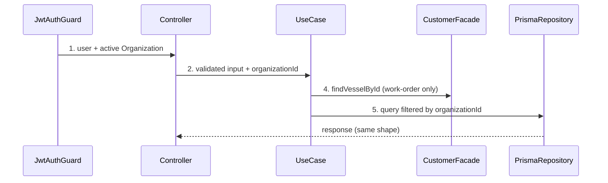
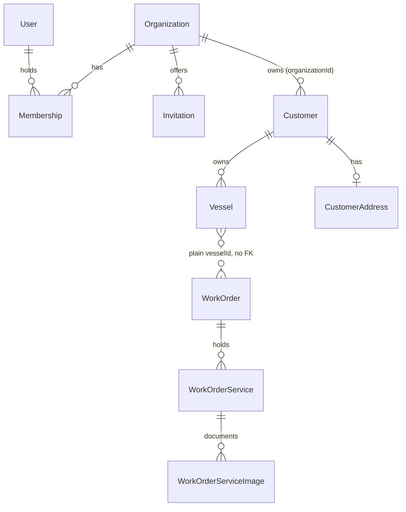

# Acme architecture migration

**Approved**: 2026-11-08 - user: "altera só para utilizar a rota /me ao invés de /whoami e o plano será aprovado."

> Approved with one change: `/whoami` becomes `/me` (AD-015). No open question remains. Build this with **tlc-implement**. Every criterion becomes a check with a proof; nothing under the open questions is settled while building.

## Problem

Request (verbatim, Portuguese): "migrar toda a arquitetura baseada no acme".

Today umbrielship and `acme` (`/home/luciano/workspace/development/apps/acme`) are two NestJS + Prisma + Angular apps with two different architectures, so a developer who moves between them relearns folders, naming, test tooling and error handling. In umbrielship the API is layered per context (`core/`, `http/rest/controller`, `persistence/`), one controller per endpoint (13 in `work-order`, 9 in `customer`), `*Entity` classes, `*Repository` abstract classes in `core/interface`, `work-order` injects the `customer` repository through `CustomerPersistenceModule` and has a foreign key `WorkOrder.vesselId -> Vessel`; Jest is configured with no spec; controllers end in `throw new BadRequestException(error.message)`; NestJS 11, CommonJS, no `strict`; web is Angular 21 with `feature/ui/data-access/util` folders and `httpResource` inside the components. In acme the API is flat by aggregate (`package/<context>/<aggregate>/`), ESM, NestJS 12, TS `strict`, Vitest with in-memory repositories, oxlint, facades between contexts and no cross-context FK; the web is Angular 22 with `package/<context>/<module>/`, `@Service()` services and Signal Forms. The evidence is the two `AGENTS.md` files and the code; the request gives no further evidence.

What is different for a user when this ships: nothing visible if the answers keep behaviour; for a developer, umbrielship follows the acme structure and conventions they pick below, with the same endpoints and screens working.

## Shape

Reuses the existing use cases, Prisma schema and Angular components, moved and renamed; adds the acme tenancy model on top. The rules that change an outcome (organization scoping of every query, scoped uniqueness, 404/409 mapping, pagination) run in use cases and repositories, reached by Vitest specs on in-memory repositories (S1).

1. HTTP request with JWT -> `JwtAuthGuard` (exists) - session payload carries the user; the active Organization is derived from the session, never from the body or URL
2. `Controller` (exists) - validates with Zod, calls one use case, rethrows unknown errors
3. use case (exists) - receives `organizationId`, depends on `I<Plural>Repository` contracts
4. `work-order` use case -> `CustomerFacade` (door 3) - `findVesselById(organizationId, id)` replaces the repository import
5. Prisma repository (exists) - every query filtered by `organizationId`; out: same JSON as today

**Extra scope from AD-010:** the Invitation email goes out through the `InvitationDeliveryQueue` port (BullMQ on Redis), the `InvitationDelivery` adapter and `EmailSender` (Nodemailer over SMTP), 5 s per attempt, 3 attempts with 5 s then 10 s backoff, the third failure records the Invitation `failed`; the outcome lives in PostgreSQL (`deliveryStatus`, `deliveryAttempts`, `lastDeliveryFailureAt`) and `InvitationDeliveryRecovery` requeues every Invitation still `queued` at boot. The API then needs Redis and an SMTP server (Mailpit in development) to start.

**What makes it big (one-way doors first):** (a) tenancy migration with backfill of populated tables, plus citext and the dropped FK (door 2); (a2) new infrastructure the API cannot boot without: Redis, SMTP, 7 env vars (door 7); (b) the runtime change CommonJS -> ESM, Nest 11 -> 12, TS strict (door 4); (c) the session/identity contract the web consumes (door 1); (d) the folder layout across ~110 API files and ~100 web files. Seams that exist, order constraints that cannot be collapsed: S1 tests before S2 moves; the tenancy migration before any code that reads `organizationId`; the API contract before S4. Cut chosen by the user: one plan, four slices (AD-007).

**Changes underneath**

| Front | What changes |
| --- | --- |
| domain | new terms Organization, Membership, Role enter `CONTEXT.md` as acme writes them; `User.role` (`USER`, `MANAGER`, `DEVELOPER`) is replaced by Membership.Role (question 2); Vessel IMO and Customer email compared without case |
| stored data | one new migration set: create `organizations`, `memberships`, `invitations`; `users.activeOrganizationId`; add `organizationId` to `customers`, `customer_addresses`, `vessels`, `work_orders`, `work_order_services`, `work_order_service_images` (backfilled into the default Organization, question 1, then NOT NULL); drop FK `work_orders.vesselId -> vessels.id`; uniqueness `customers.email` and `vessels.imoNumber` become scoped by `organizationId`; citext columns; applied migrations are never edited |
| readers | `AGENTS.md` (running section: Redis, SMTP, env vars, seed, Vitest, oxlint; architecture section: acme layout) and `CONTEXT.md` (Organization, Membership, Role, Invitation); `POST /sessions`, `GET /me`, every list/get controller, the web DTOs and screens, `Dashboard` summary cards |

New: `Organization`, `Membership`, `Invitation` (unique `[userId, organizationId]`), `organizationId` on every tenant table. One-way constraints: `[organizationId, imoNumber]` unique, `[organizationId, email]` unique on customers, no FK across contexts (doors 2, 5).

## Surface

Identity routes are copied from acme (`identity/*/…controller.ts`); the existing umbrielship routes keep their URLs (AD-005) except one: `GET /whoami` is renamed `GET /me`, acme's route (AD-015), and the web calls `/me` (`/api/me`) from the same commit. `POST /sessions` keeps `{ access_token }` and answers 401 on wrong credentials as today (acme answers 400).

| Route | In | Out | Status | Who |
| --- | --- | --- | --- | --- |
| all `/customers`, `/vessels`, `/work-orders` routes (13 + 9, URLs unchanged) | same bodies as today; no `organizationId` in any body, query or path (it comes from the session) | same JSON as today | same codes; `404` for a record of another Organization | member of the active Organization; others `401` |
| `POST /sessions` | `email`, `password` | `access_token` | `201`, `401` | anyone |
| `GET /me` (was `/whoami`) | - | `{ user }` with the active Organization, its `isInternal`, the Role there, and the Memberships | `200`, `401` | signed-in user |
| `POST /organizations/switch` | `organizationId` (uuid) | empty | `204`, `404` not a member, `401` | any signed-in user (the only route that reads an Organization from the request) |
| `GET /organizations` | `page`, `per_page` | `{ organizations, total }` | `200`, `401`, `403` | internal Administrator |
| `POST /organizations` | `name` (1-80), `email` | `{ id, name, email, isInternal }` | `201`, `409` name or email taken, `401`, `403` | internal Administrator |
| `GET /organizations/:id` | - | `{ organization }` | `200`, `404`, `401`, `403` | internal Administrator |
| `GET /organizations/:id/users` | `page`, `per_page` | `{ users, total }` | `200`, `404`, `401`, `403` | internal Administrator |
| `GET /organizations/:id/roles` | - | `{ roles }` (count per Role) | `200`, `404`, `401`, `403` | internal Administrator |
| `GET /organizations/:id/invitations` | `page`, `per_page` | `{ invitations, total }` | `200`, `404`, `401`, `403` | internal Administrator |
| `GET /users` | `not_in_organization` (uuid), `page`, `per_page` | `{ users, total }` | `200`, `401`, `403` | internal Administrator |
| `POST /users` | `name` (1-80), `email`, `password` (8-72), `role` (`administrator` or `operator`), `organizationId` | the user | `201`, `409` email taken, `404` Organization, `401`, `403` | internal Administrator |
| `POST /invitations` | `userId`, `organizationId`, `role` | `{ id, email, organizationName, role, status, deliveryStatus }` (never the secret) | `201`, `404`, `409`, `401`, `403` | internal Administrator |
| `POST /invitations/:id/resend` | - | same as above | `200`, `404`, `409`, `401`, `403` | internal Administrator |
| `POST /invitations/accept` | `secret` | `{ organizationName }` | `200`, `404`, `409` already accepted | anyone with the secret (public route) |

Request bodies lose nothing: umbrielship has no organization field today, so "organization removed from requests" has no instance. Pagination of the new identity routes is acme's (`page`, `per_page`); the existing customer, vessel and work-order list routes keep theirs (ROADMAP item 7 stays separate).

## Landing

| One-way door | Literal shape | Alternative rejected |
| --- | --- | --- |
| 1. Session contract | JWT `sub` = user id; active Organization read from the User and exposed on `/me` | organization in the URL or a header: breaks "URLs preserved" |
| 2. Tenancy schema | `organizationId String` + `@@index([organizationId])` on each tenant table; `@@unique([organizationId, imoNumber])`; `@@unique([organizationId, email])` on `Customer`; `Membership @@unique([userId, organizationId])` | global uniqueness kept: two Organizations could not register the same vessel |
| 3. Cross-context access | `CustomerFacade.findVesselById` exported by `CustomerModule`; nothing else exported | `CustomerPersistenceModule` export: leaks the repository contract |
| 4. Runtime | `"type": "module"`, NestJS 12, TS `strict`, Vitest, oxlint; Prisma generator `moduleFormat = "esm"` | CJS/Nest 11/Jest/ESLint: departs from AD-003 |
| 5. No cross-context FK | `work_orders.vesselId` plain `String` column, FK constraint dropped by a new migration | keeping the FK: contradicts AD-002 |
| 6. Case-insensitive text | citext on `customers.email`, `vessels.imoNumber`, `users.email` (extension created in a migration) | `lower()` in code: unique index would still be case-sensitive |

| 7. New infrastructure | env vars `REDIS_URL` (`redis://` or `rediss://`), `WEB_ORIGIN`, `MAIL_HOST`, `MAIL_PORT`, `MAIL_FROM`, optional `MAIL_USER`, `MAIL_PASS`, validated at boot by the config schema; ports `EmailSender`, `InvitationDeliveryQueue`, `InvitationDelivery` with fakes in `api/test/` | no Invitation: rejected by the user (AD-010) |
| 8. Seed | `prisma db seed` creates Organization "Umbrielship" (`isInternal` true) and the first Administrator | by-hand insert: rejected (AD-011) |

- Nothing else in this change is hard to reverse

## Criteria

### S1: The API has a unit-test tier (P1)

Every use case has a spec on in-memory repositories before anything moves.

**Acceptance Criteria**

1. WHEN `npm run test` runs in `api/` THEN the system SHALL run one spec per use case (24 today: 9 `customer`, 2 `identity`, 13 `work-order`) with exit code 0 and no database
2. IF `CreateWorkOrderUseCase` runs with an unknown `vesselId` THEN it SHALL throw `NotFoundDomainException('Vessel not found')`
3. IF `CreateCustomerUseCase` runs with an existing email THEN it SHALL throw `AlreadyExistsDomainException`
4. The system SHALL NOT keep `test/app.e2e-spec.ts`; in-memory repositories live in `api/test/repositories/` (acme layout)
5. WHEN S1 lands THEN Vitest and oxlint SHALL replace Jest and ESLint in `api/` (`npm run lint`, `npm run test` exit 0)

### S2: The API follows the acme layout and tenancy (P1)

**Acceptance Criteria**

6. WHEN the API builds THEN the system SHALL have `api/src/package/<context>/<aggregate>/` for `customer/{customer,vessel}`, `work-order/{work-order,work-order-service,work-order-service-image}` and `identity/{auth,user,organization,...}` (final identity list: questions 3 and 5), each with `contracts/`, one use case per file, one controller per aggregate and `__test__/`, and no `core/`, `http/` or `persistence/` folders
7. The system SHALL name entities without the `Entity` suffix and repository abstract classes `I<Plural>Repository` in `contracts/`
8. WHEN a signed-in member of Organization A requests a record of Organization B THEN the system SHALL answer 404
   - `GET /vessels/<id of B>` -> 404; `GET /customers` -> only A's customers; `POST /work-orders` with B's `vesselId` -> 404 `Vessel not found`
9. WHEN two Organizations create a Vessel with the same IMO number THEN the system SHALL accept both; IF one Organization repeats it, in any letter case THEN 409
   - `9074729` in A and in B -> 201 and 201; `abc123` then `ABC123` in A -> 409
10. IF a use case throws `NotFoundDomainException` or `AlreadyExistsDomainException` THEN the controller SHALL answer 404 or 409; IF any other error is thrown THEN the controller SHALL rethrow it so Nest answers 500 (ROADMAP item 6)
    - duplicate IMO -> 409; database down -> 500 (was 400)
    - the `POST /sessions` wrong-credentials answer stays 401
11. WHEN `work-order` needs a Vessel THEN the system SHALL read it through `CustomerFacade`, and no `work-order` file SHALL import a `customer` repository, entity or use case
12. WHEN the migrations apply to a database that already has data THEN every existing row of every tenant table SHALL belong to the default Organization (question 1) and `organizationId` SHALL be NOT NULL afterwards
    - 2 customers, 3 vessels, 4 work orders before -> same counts after, all with the default Organization
13. WHEN any pre-existing route is called with the same input and a valid session THEN the system SHALL return the same status and body as before, except 500 for unexpected errors (criterion 10)
    - found while building S1: `PUT /customers/:id` with an unknown id answers 400 today, because `EditCustomerUseCase` throws Nest's `NotFoundException` instead of `NotFoundDomainException` and the controller maps only the latter to 404; S1 makes the use case throw `NotFoundDomainException('Customer not found')`, so the answer becomes 404 (criterion 10's rule), a second exception to "same status"
    - found while building S1: `EditWorkOrderUseCase` copies `vesselId` from the detail entity, which never carries it, so the returned WorkOrder has no `vesselId` today; kept as is so the JSON stays the same (not a check)
    - found while building S1 (not fixed, ROADMAP item 7 and S2 own them): `PrismaCustomersRepository.findMany` counts with `count({ take, skip })`, so `total` is wrong on a paged read; `PrismaVesselsRepository` builds the detail entity without the vessel `id`; `EditCustomerUseCase` cannot clear a phone (`phone ?? stored`). The in-memory fakes implement the contract (full `total`), not these defects
14. WHEN the migrations apply to a database that has Users THEN each User SHALL get one Membership in "Umbrielship" and `activeOrganizationId` set to it: `MANAGER` -> Administrator, `DEVELOPER` -> Administrator, `USER` -> Operator; `users.role` and enum `UserRole` SHALL no longer exist
15. WHEN `npx prisma db seed` runs THEN the system SHALL have the Organization "Umbrielship" with `isInternal` true and one Administrator Membership for the seeded User; running it twice SHALL create no second Organization or User
16. WHEN an internal Administrator calls `POST /organizations` THEN the system SHALL create a non-internal Organization (201); IF the name or email exists in any letter case THEN 409; IF the caller is not an Administrator of the internal Organization THEN 403
17. WHEN an internal Administrator calls `POST /users` THEN the system SHALL create the User and its Membership with the given Role in the given Organization (201); IF the email exists in any letter case THEN 409
18. WHEN an internal Administrator calls `POST /invitations` for an existing User and a non-internal Organization THEN the system SHALL store the Invitation `queued` with a random secret, queue its delivery and answer without the secret; IF the User already holds a Membership there THEN 409; IF the Organization is the internal one THEN 409
19. WHEN a queued delivery runs THEN the system SHALL send one email with the acceptance link `WEB_ORIGIN/...?secret=...` through `EmailSender`; IF an attempt exceeds 5 s or fails THEN it SHALL retry after 5 s then 10 s, and the third failure SHALL record `deliveryStatus` `failed`
20. WHEN the API boots THEN `InvitationDeliveryRecovery` SHALL requeue every Invitation whose `deliveryStatus` is `queued`
    - 2 queued and 1 sent before a restart with Redis empty -> 2 queued again, 1 untouched
21. WHEN anyone calls `POST /invitations/accept` with a valid secret THEN the system SHALL add the Membership with the invited Role, keep the User's other Memberships and active Organization, and answer `{ organizationName }`; IF the secret is unknown THEN 404; IF already accepted THEN 409
22. WHEN a signed-in User calls `POST /organizations/switch` with an Organization it is a member of THEN the system SHALL set it as the active Organization for every session of that User (204); IF it is not a member THEN 404
23. WHEN `npm run lint`, `npm run build` and `npm run test` run in `api/` THEN the system SHALL exit 0

### S3: The API runs on the acme platform (P2)

**Acceptance Criteria**

24. WHEN `npm run start:dev` runs in `api/` THEN the system SHALL boot on `PORT` as ESM on NestJS 12 with TS `strict` and serve `GET /uploads/<file>` for a previously uploaded image
25. WHEN `npm run build` and `npm run start:prod` run THEN the system SHALL boot from `dist/`

24a. WHEN S3 lands THEN `AGENTS.md` SHALL list Redis, SMTP (Mailpit), the new env vars, `prisma db seed`, Vitest, oxlint and the acme layout, and `CONTEXT.md` SHALL define Organization, Membership, Role and Invitation

### S4: The web follows the acme layout (P2)

**Acceptance Criteria**

26. WHEN `npm run build` runs in `web/` THEN the system SHALL compile on Angular 22 with `web/src/package/<context>/<module>/` (page, `components/`, `*.service.ts` using `@Service()`), forms in Signal Forms, selectors `t-` for elements and `t` for attributes (AD-012), and no component CSS
27. WHEN a user signs in, opens Customers and Vessels, and uploads a service image THEN the system SHALL show the same screens in Portuguese, with lists as tables instead of cards
28. WHEN a signed-in user opens a list THEN the web SHALL show only the active Organization's rows
29. WHEN a User with several Memberships uses the Organization switcher in the layout and picks another Organization THEN the web SHALL call `POST /organizations/switch` and reload so every list shows that Organization's rows
30. WHEN an internal Administrator opens Organizations THEN the web SHALL show the table of Organizations with a create form in a `t-sheet`; WHEN they open one THEN the Organization detail SHALL show its Users and Invitations tables, a create-User form and a send-Invitation form, and a resend control on each Invitation; IF the signed-in User is not an internal Administrator THEN the Organizations route SHALL show the forbidden page
31. WHEN a User opens the invitation link with `secret` THEN the web SHALL show the accept page, call `POST /invitations/accept`, and show the Organization name on success or the 404/409 message in Portuguese
32. WHEN a user opens Customers, Vessels or the Work Order detail THEN the web SHALL show tables (no cards) with the same data as today

## Out of scope

| Excluded | Why |
| --- | --- |
| ROADMAP item 7 (pagination fix) | user: stays separate |
| Integration or end-to-end test tier | acme has none |
| Acme's own domain (Item, Stock, Purchase, Staff...) | not umbrielship's |
| Renaming `CONTEXT.md` terms already there | binding vocabulary; only Organization, Membership, Role are added |

## Assumptions

| Assumption | Chosen default | Rationale | Confirmed? |
| --- | --- | --- | --- |
| Order of work | S1 -> S2 -> S3 -> S4 | tests prove the moves; migration before reads | y - AD-007 |
| Portuguese web copy, English identifiers | unchanged | `AGENTS.md` | y |
| Case-insensitive uniques | customers.email, vessels.imoNumber, users.email, organizations name and email | acme: "every name, SKU and email that must be unique is compared without case" | n |
| Identity URLs | `/whoami` renamed `/me` (web updated); `access_token` and 401 on wrong credentials kept; acme's 400 not adopted | AD-005 and AD-015 | y - AD-015 |
| Uploads | unchanged | AD-014 | y - AD-014 |

**Open questions:** none - all resolved or logged above.

## Differences from the source

Acme's own domain (Item, Stock, Purchase, Staff...) is not umbrielship's and is not migrated.

| Source shows | Product shows | Confirmed |
| --- | --- | --- |
| acme: `organizationId` on every tenant table, session-derived Organization | the same, adopted in full | y - AD-001 |
| acme: Angular 22, NestJS 12, ESM, oxlint, Vitest, Signal Forms, `@Service()` | the same, adopted in full | y - AD-003, AD-004 |
| acme: no cross-context FK, citext, scoped uniqueness | the same | y - AD-002 |
| acme: Invitation, Nodemailer SMTP, BullMQ and Redis, delivery recovery | adopted in full | y - AD-010 |
| acme: `acme-` selector prefix | `t-` and attribute prefix `t` | y - AD-012 |
| acme: Organization detail holds Users and Invitations (acme AD-005) | the same, in Portuguese | y - AD-013 |

## Sources

- Request "migrar toda a arquitetura baseada no acme" - binding - scope
- `acme/AGENTS.md`, `acme/docs/coding-standards.md`, `acme/docs/frontend-standards.md`, `acme/docs/integration-patterns.md` - binding for the target conventions, minus what the user excludes in questions 2-11
