# Customer UI redesign after mareos

**Approved**: 2026-11-17 - user: "Aprovo o plano"

> Build this with **tlc-implement**. Every criterion becomes a check with a proof; nothing under
> the open questions is settled while building.

## Problem

The web shows Customers and Vessels in the neutral shadcn look under a top header, ten records per
page with no search. An operator who looks for a Customer by name, city or phone pages through the
list ten at a time; the Customer list does not say how many Vessels each Customer owns; editing a
Customer means opening its detail first; and the Vessel form's "Cliente" select lists only the first
ten Customers (`vessel-list.ts` requests `/api/customers?page=1`), so a Vessel cannot be created for
the eleventh Customer from the Vessel list. Two smaller defects ride along: the Vessel detail's back
link has no destination, and saving a Customer says "Embarcação criada com sucesso". The team has a
prototype of the look it wants, mareos (`/home/luciano/workspace/development/apps/mareos`); the
request gives no other evidence.

When this ships, every authenticated page sits in the mareos shell (sidebar with the Organization
switcher and the profile, topbar with the breadcrumb and the theme toggle) in the mareos palette, and
the Customer and Vessel screens look like the mareos ones: every record of the Organization on one
page, searched as the user types, with counts, row actions to edit and delete, Vessel selection and
CSV export.

## Shape

This reuses the shared `t-sidebar` and `t-dropdown-menu` components (last commit), `t-sheet`,
`t-confirmation`, toasts, the existing services and the existing list and detail routes; the API
keeps its use cases and only stops paginating when `page` is absent and counts Vessels per Customer.
Searching, sorting, counting, the Customer-name join and the CSV rows run in the web pages (or
plain functions they call), reached by the web specs under `web/src/package/customer/**/__test__/`
(`npm test`); `vesselCount` runs in `PrismaCustomersRepository` and is proven against real PostgreSQL
in `api/test/smoke/api-smoke.sh` (lesson L-029: a fake proves only the fake).

1. browser -> `InternalLayout` (exists) - reads `GET /api/me`, renders the shell with `t-sidebar` (exists) and `t-dropdown-menu` (exists) around the routed page; picking an Organization goes through the existing switch flow
2. `CustomerList` (exists) -> `GET /api/customers` -> `CustomerController` (exists) -> `FetchCustomersUseCase` (exists) -> `PrismaCustomersRepository` (exists) - every Customer of the session's Organization, each with `vesselCount`
3. `CustomerList` (exists) - sorts, searches and counts in the browser; creates, edits and deletes through `CustomerService` (exists)
4. `CustomerDetail` (exists) -> `GET /api/customers/:id` and `GET /api/vessels?customerId=<id>` -> `VesselController` (exists) -> `FetchVesselsUseCase` (exists) -> `PrismaVesselsRepository` (exists) - every Vessel of that Customer; deletes through `VesselService` (exists)
5. `VesselList` (exists) -> `GET /api/vessels` and `GET /api/customers` - joins the Customer name by `customerId`, searches, selects and writes `embarcacoes.csv` in the browser; creates, edits and deletes through `VesselService` (exists)
6. `VesselDetail` (exists) -> `GET /api/vessels/:id` and `GET /api/work-orders?vesselId=<id>` - renders the Vessel, its Customer and `work-order-list-ui` (exists)
7. out: the pages render; the theme stays in `localStorage` `@umbriel:theme`, as today

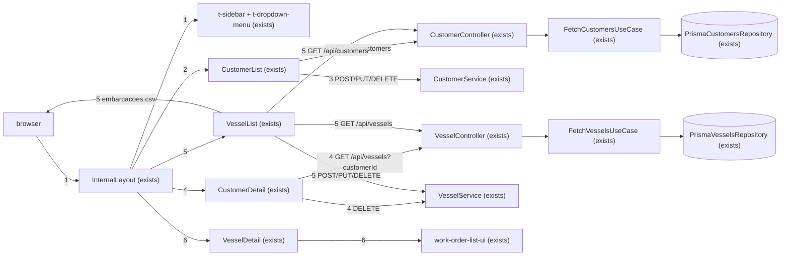

**Changes underneath**

| Front | What changes |
| --- | --- |
| domain | nothing - Customer and Vessel keep their meaning and fields (AD-021) |
| stored data | nothing to migrate - `vesselCount` is computed on read |
| contract | `GET /customers` and `GET /vessels` without `page` answered page 1 (10 records); now they answer every record (AD-023). Callers today: the web pages above, which all drop `page`, and `api-smoke.sh` line 98, which still holds |
| readers | `web/src/styles.css` tokens change for every page: dashboard, WorkOrder detail, inspection templates, Organizations, sign-in and invitation accept change colour (criteria 3 and 4) |
| readers | `InternalLayout` loses its header; `organization-switcher-ui` and the user menu move into the sidebar - the identity specs that drive them follow (criteria 6 to 9) |
| readers | `web/src/package/shared/testing/write-access.ts` expects `?page=1` URLs and follows the new URLs |

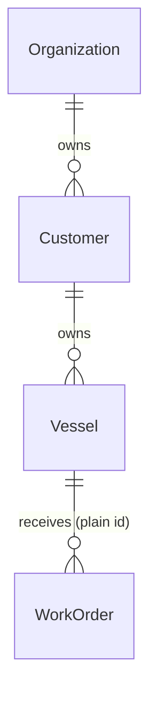

New: nothing - read only. `vesselCount` is a count of `Customer -> Vessel`, never stored.

## Surface

| Route | In | Out | Status | Who |
| --- | --- | --- | --- | --- |
| `GET /customers` | `page` optional; absent = every Customer of the session's Organization | `customers[]` (each with `vesselCount`), `total` | `200`, `401` without a token | every Role of the Organization; another Organization's Customers never appear |
| `GET /vessels` | `page` and `customerId` optional; `page` absent = every Vessel (of `customerId` when given) | `vessels[]`, `total` | `200`, `401` without a token | every Role of the Organization; another Organization's Vessels never appear |

## Landing

| One-way door | Literal shape | Alternative rejected |
| --- | --- | --- |
| 1. List contract without `page` | `GET /customers` -> `{ customers: [{ id, name, email, phone, address: { address, city, state }, vesselCount }], total }` with every Customer; `GET /vessels[?customerId=]` -> `{ vessels, total }` with every Vessel; with `page=n` both keep today's behaviour | a `search` parameter with paging: the user chose search in the browser over the whole list (AD-023); an `all=true` flag: no caller depends on "no `page` = page 1" except the smoke test, which still holds, so a second switch is noise |
| 2. Shell pattern | `InternalLayout` = `t-sidebar-provider` > `t-sidebar` (brand, Organization switcher, menu groups, profile) + `t-sidebar-inset` (topbar with breadcrumb `Operação > <section>` and theme toggle, then `router-outlet`); a new screen adds one menu item and one section label | keeping the top header: the user chose the mareos shell (AD-020) |
| 3. Theme tokens | light (`:root`): `--background #f7f8fa`, `--foreground #17283b`, `--card #fff`, `--popover #fff`, `--primary #087f8c`, `--primary-foreground #fff`, `--secondary #edf4f5`, `--secondary-foreground #1c5961`, `--muted #f2f5f7`, `--muted-foreground #7b8794`, `--accent #edf4f5`, `--accent-foreground #1c5961`, `--destructive #bd5550`, `--border #e9edf0`, `--input #e9edf0`, `--ring #087f8c`, `--radius .65rem`, `--sidebar #fff`, `--sidebar-accent #eaf4f4`, `--sidebar-accent-foreground #087f8c`, `--sidebar-border #e9edf0`; dark (`.dark`): `--background #0c131b`, `--foreground #e5edf4`, `--card #141e29`, `--popover #141e29`, `--primary #2da9ad`, `--primary-foreground #071216`, `--secondary #1b2c37`, `--secondary-foreground #b7e5e0`, `--muted #1a2632`, `--muted-foreground #9aaab8`, `--accent #1b2c37`, `--accent-foreground #b7e5e0`, `--destructive #e17670`, `--border #293847`, `--input #293847`, `--ring #2da9ad`, `--sidebar #141e29`, `--sidebar-accent #1b343a`, `--sidebar-accent-foreground #65d0c7`, `--sidebar-border #293847` (AD-030); body `font-family: Arial, Helvetica, sans-serif`, `font-size: 13px` | the neutral shadcn tokens: the user chose the mareos palette for the whole app (AD-020) |

- Nothing else in this change is hard to reverse

## Criteria

### S1: Every authenticated page sits in the mareos shell and palette (P1)

The shell and the palette replace the header and the neutral theme on every page behind sign-in.

**Acceptance Criteria**

1. WHEN a signed-in user opens any route under the authenticated layout THEN the system SHALL show the sidebar and topbar of `.specs/features/customer-ui-redesign/captures/customer-list.png` around the page, with no top header of links
2. The sidebar SHALL show an anchor and "UMBRIELSHIP" as the brand, a group "MENU PRINCIPAL" with "Visão geral" (`/dashboard`), "Embarcações" (`/vessels`), "Clientes" (`/customers`) and "Modelos de inspeção" (`/inspection-templates`), and a group "GESTÃO" with "Organizações" (`/organizations`) only for an internal Administrator; no other menu item, no counter, no "Precisa de ajuda?" card (AD-024, AD-025)
   - operator of a client Organization -> four items, no "GESTÃO"; administrator of the internal Organization -> five items
3. WHILE the light theme is on the system SHALL paint with the light tokens of Landing door 3 - `--primary` `#087f8c` on "Novo cliente", page background `#f7f8fa`, body font Arial 13px
4. WHEN the user uses the theme button ("Ativar tema escuro" / "Ativar tema claro", `aria-pressed`) in the topbar THEN the system SHALL switch to the dark tokens of Landing door 3, keep the choice in `@umbriel:theme` across a reload, and paint the sidebar with `#141e29` and Customer names in the list with a contrast of at least 4.5:1 against their row - unlike the light sidebar and faint names of `.specs/features/customer-ui-redesign/captures/customer-list-dark.jpg` (AD-030)
5. WHEN the user is on `/customers`, `/customers/:id`, `/vessels`, `/vessels/:id`, `/work-orders/:id`, `/dashboard`, `/inspection-templates[/:id]` or `/organizations[/:id]` THEN the topbar SHALL read "Operação" > "Clientes", "Clientes", "Embarcações", "Embarcações", "Embarcações", "Visão geral", "Modelos de inspeção" or "Organizações", and the matching menu item SHALL be marked active (`aria-current="page"` on its own route)
6. WHEN the user uses "Selecionar organização" in the sidebar THEN the system SHALL open the menu of `.specs/features/customer-ui-redesign/captures/shell-organization-menu.png` labelled "Trocar organização", one item per Membership with the Organization's initials, name and the Role label ("Administrador", "Operador", "Inspetor"), the active one checked
7. WHEN the user picks another Organization in that menu THEN the system SHALL call `POST /api/organizations/switch` with its id and reload into it, as the header switcher does today; picking the active one SHALL only close the menu
8. The sidebar footer SHALL show the user's initials, name and active Role label; WHEN the user opens its "..." button and uses "Sair" THEN the system SHALL sign out and show `/auth`
9. WHILE the window is narrower than 768px the sidebar SHALL be hidden and the topbar SHALL show "Abrir menu", which slides the sidebar in; WHEN the user picks a menu item there THEN the sidebar SHALL close and the page SHALL navigate
10. The shell SHALL not show "Oficina em operação", a help button or the footer "MARÉOS · Operação com rumo certo." (AD-025); the notifications bell came back with AD-116
11. WHILE the window is 640, 768, 1024, 1280 or 1536px wide the Customer and Vessel pages SHALL have no horizontal page scroll - only a table scrolls inside its panel - unlike `.specs/features/customer-ui-redesign/captures/customer-list-375.jpg`

### S2: Customers on one page, searched as the user types (P1)

The Customer list shows every Customer with counts, search and row actions.

**Acceptance Criteria**

12. WHEN a user opens `/customers` THEN the system SHALL request `GET /api/customers` once, with no `page`, and show the page in `.specs/features/customer-ui-redesign/captures/customer-list.png`, with "Consulte, cadastre e atualize os clientes da sua organização." under "Lista de clientes" and no "Cadastro vinculado à frota" (AD-027)
13. WHEN `GET /customers` is called without `page` THEN the API SHALL answer `200` with every Customer of the session's Organization and `total` equal to their number, each with `vesselCount`
    - 23 Customers -> 23 in `customers`, `total` 23; with `page=1` -> 10, as today; a Customer of another Organization with the same email -> absent
14. The API SHALL make `vesselCount` equal the number of Vessels of that Customer in PostgreSQL, proven by `api/test/smoke/api-smoke.sh`
    - Customer with 0 Vessels -> 0; with 2 Vessels -> 2; after one is deleted -> 1
15. The list SHALL be sorted by name with `localeCompare(…, 'pt-BR')`
    - "Barco Azul", "anchor co", "Ágata Pesca" -> "Ágata Pesca", "anchor co", "Barco Azul" (accent and case do not move a name out of its letter)
16. The four metrics SHALL read, over every Customer and never over the search result: "Clientes cadastrados" = number of Customers; "Embarcações vinculadas" = sum of `vesselCount`; "Com e-mail cadastrado" = Customers with an email; "Com telefone cadastrado" = Customers whose `phone` is not null nor empty - each padded to two digits
    - 8 Customers, 3 with phone, 11 Vessels -> "08", "11", "08", "03"; 120 Customers -> "120"
17. WHEN the user types in "Buscar por nome, contato ou cidade..." THEN the table SHALL keep only Customers whose name, email, phone, city or state contains the text, case-insensitive (`toLocaleLowerCase('pt-BR')`), with no request; the footer SHALL read "Exibindo <shown> de <all> clientes"
    - "santos" -> Customers in Santos; "SP" -> Customers in SP and any name containing "sp"; "" -> all
18. The Customer list SHALL show in each row the initials (first letter of the first two words, uppercase), the name as a link to `/customers/:id`, the street or "Endereço não informado", the email or "E-mail não informado", the phone or "Telefone não informado", "<city>, <state>" or "Localização não informada", and "<n> embarcação" for 1 or "<n> embarcações" otherwise
19. IF the Organization has no Customer THEN the table SHALL say "Ainda não há clientes cadastrados."; IF the search matches none THEN it SHALL say "Nenhum cliente encontrado para essa busca."
20. WHILE `GET /api/customers` is loading the table SHALL show skeleton rows; IF it fails THEN the system SHALL show an error toast with the API message, as today
21. WHEN a writer (administrator or operator) uses "Novo cliente" THEN the system SHALL open the drawer in `.specs/features/customer-ui-redesign/captures/customer-drawer.jpg` without the "Logo (URL da imagem)" field (AD-021) and with "Estado (UF) *" as a select of the UFs starting at "Selecione o estado" (AD-028); WHEN they fill it and use "Cadastrar cliente" THEN the system SHALL `POST /api/customers`, close the drawer, show the toast "Cliente criado com sucesso" and the new Customer in the list
22. WHEN a writer uses "Editar <name>" on a row THEN the system SHALL open the same drawer titled "Editar cliente" with the Customer's values and the button "Salvar alterações"; WHEN they save THEN the system SHALL `PUT /api/customers/:id`, close the drawer, show the toast "Cliente atualizado com sucesso" and the new values in the row
23. IF the API answers `409` to a create or edit THEN the drawer SHALL stay open with the values typed and the system SHALL show an error toast with the API message
24. WHEN a writer uses "Excluir <name>" on a row THEN the system SHALL ask "Tem certeza que deseja excluir este cliente? Esta ação não pode ser desfeita." (title "Excluir cliente"); WHEN they confirm THEN the system SHALL `DELETE /api/customers/:id`, show "Cliente excluído com sucesso" and drop the row; IF the API answers `409` (the Customer still has a Vessel) THEN the row SHALL stay and the system SHALL show an error toast with the API message
25. WHEN a user uses "Ver detalhes de <name>" THEN the system SHALL open `/customers/:id`
26. WHILE the user's Role is `inspector` the page SHALL show no "Novo cliente", no "Editar <name>" and no "Excluir <name>"

### S3: Customer detail as in mareos (P1)

The Customer detail shows the profile, contact, linked Vessels and location.

**Acceptance Criteria**

27. WHEN a user opens `/customers/:id` THEN the system SHALL request `GET /api/customers/:id` and `GET /api/vessels?customerId=<id>` with no `page`, and show the page in `.specs/features/customer-ui-redesign/captures/customer-detail.png`, with the kicker "CADASTRO DE CLIENTE" (AD-027), "Proprietário de <n> embarcação" for 1 or "Proprietário de <n> embarcações na frota." otherwise, and no "Editar", "Nova embarcação" or map (AD-022)
    - 1 Vessel -> "Proprietário de 1 embarcação na frota."; 0 -> "Proprietário de 0 embarcações na frota."
28. The breadcrumb SHALL be a link "Clientes" to `/customers`, "/", then the Customer's name
29. The Customer detail SHALL show in "Contato e endereço" "E-mail", "Telefone" (or "Não informado") and "Endereço" as "<street>, <city>, <state>"; "Localização" SHALL show "<city>, <state>", the street and "<city> — <state>"
30. "Embarcações vinculadas" SHALL list every Vessel of the Customer with its count beside the title; each row SHALL link to `/vessels/:id` and show the name and the type label ("Carga", "Tanque", …) with no port and no status (AD-021); IF there is none THEN it SHALL say "Nenhuma embarcação vinculada a este cliente."
31. WHEN a writer uses "Excluir <vessel name>" on a linked Vessel THEN the system SHALL ask "Tem certeza que deseja excluir esta embarcação? Esta ação não pode ser desfeita."; WHEN they confirm THEN the system SHALL `DELETE /api/vessels/:id`, show "Embarcação excluída com sucesso", drop the row and lower the count and the "Proprietário de …" sentence by one
32. IF the Customer does not exist or belongs to another Organization THEN the system SHALL show "Cliente não encontrado", "Este cadastro não está disponível na lista de clientes." and a link "Voltar para clientes" to `/customers`, inside the shell
33. WHILE the user's Role is `inspector` the page SHALL show no "Excluir <vessel name>"

### S4: Vessels on one page, searched, selected and exported (P1)

The Vessel list shows every Vessel with its Customer, search, selection, CSV export and row actions.

**Acceptance Criteria**

34. WHEN a user opens `/vessels` THEN the system SHALL request `GET /api/vessels` and `GET /api/customers`, each once with no `page`, and show the page in `.specs/features/customer-ui-redesign/captures/vessel-list.png` without the status tabs, the status column and the metrics "Em operação", "Em manutenção" and "Fora de operação" (AD-021); the one metric "Total na frota" SHALL be the number of Vessels, padded to two digits; the subtitle SHALL read "Gerencie os dados cadastrais da sua frota." and the list footer SHALL not show "Frota atualizada" (AD-027)
35. WHEN `GET /vessels` is called without `page` THEN the API SHALL answer `200` with every Vessel of the session's Organization and `total` equal to their number
    - 14 Vessels -> 14; with `customerId=c1` -> only c1's; with `page=1` -> 10, as today; a Vessel of another Organization -> absent
36. The list SHALL be sorted by Vessel name with `localeCompare(…, 'pt-BR')`, and each row SHALL show a checkbox "Selecionar embarcação <name>", the name as a link to `/vessels/:id` with no code beneath it, the IMO number or "—", the type label, the length as "<n> m" with at most one decimal in pt-BR ("32,5 m"), and the Customer's name under the header "CLIENTE"
37. WHEN the user types in "Buscar por nome, cliente ou IMO..." THEN the table SHALL keep only Vessels whose name, Customer name, IMO number or type label contains the text, case-insensitive, with no request, and "Limpar busca" SHALL empty it; the footer SHALL read "Exibindo <shown> de <all> embarcações"; IF nothing matches THEN the table SHALL say "Nenhuma embarcação corresponde à sua busca."
    - "aurora" -> Vessel "Aurora"; "atlântico" -> Vessels of Customer "Pescados Atlântico"; "9182" -> IMO 9182451; "carga" -> Vessels of type `CARGO`
38. WHEN the user ticks "Selecionar todas as embarcações visíveis" THEN every row shown SHALL be selected; WHILE only some shown rows are selected that checkbox SHALL be indeterminate; selection SHALL survive a search change
39. WHILE no Vessel is selected "Exportar" SHALL be disabled with the label "Selecione embarcações para exportar"; WHEN n are selected THEN it SHALL read "Exportar (n)" with the label "Exportar 1 embarcação selecionada em CSV" or "Exportar <n> embarcações selecionadas em CSV"
40. WHEN the user uses "Exportar" THEN the browser SHALL download `embarcacoes.csv`, UTF-8 with BOM, CRLF lines, every cell in double quotes, header `Embarcação,Número IMO,Tipo,Comprimento (m),Cliente`, one line per selected Vessel - including selected ones the search hides
    - Aurora, 9182451, CARGO, 32.5, Pescados Atlântico -> `"Aurora","9182451","Carga","32,5","Pescados Atlântico"`; a name `=SUM(A1)` -> `"'=SUM(A1)"`; a name with `"` -> doubled `""`
41. WHEN a writer uses "Nova embarcação" THEN the system SHALL open the drawer in `.specs/features/customer-ui-redesign/captures/vessel-drawer.jpg` without the "Operação" card (AD-021), with "Cliente responsável *" as a select of every Customer by name and "Número IMO *" required (AD-028); WHEN they save with "Salvar embarcação" THEN the system SHALL `POST /api/vessels`, close the drawer, show "Embarcação criada com sucesso" and the new Vessel in the list
    - an Organization with 11 Customers -> all 11 in "Cliente responsável"
42. WHEN a writer uses "Editar embarcação <name>" on a row THEN the system SHALL open the drawer titled "Editar embarcação" with the Vessel's values, no "Cliente responsável" and no "Número IMO" (AD-028), and "Salvar alterações"; WHEN they save THEN the system SHALL `PUT /api/customers/:customerId/vessels/:id`, show "Embarcação atualizada com sucesso" and the new values in the row
43. WHEN a writer uses "Excluir embarcação <name>" on a row THEN the system SHALL ask the confirmation of criterion 31; WHEN they confirm THEN the system SHALL `DELETE /api/vessels/:id`, show "Embarcação excluída com sucesso", drop the row and its selection
44. IF the API answers `409` (IMO already used) to a create THEN the drawer SHALL stay open with the values typed and the system SHALL show an error toast with the API message
45. WHILE the user's Role is `inspector` the page SHALL show no "Nova embarcação", no "Editar embarcação <name>" and no "Excluir embarcação <name>"; selection and "Exportar" SHALL stay

### S5: Vessel detail as in mareos (P2)

The Vessel detail shows the profile, its WorkOrders and its Customer.

**Acceptance Criteria**

46. WHEN a user opens `/vessels/:id` THEN the system SHALL show the page in `.specs/features/customer-ui-redesign/captures/vessel-detail.png` with the kicker "FROTA", no status badge and no "Porto base" (AD-021), and the breadcrumb link "Voltar à frota" SHALL open `/vessels`
47. The Vessel detail SHALL show under "Número IMO" the IMO number or "Não informado" and under "Comprimento" "<n> m" in pt-BR
48. WHEN a writer uses "Editar" THEN the system SHALL open the "Editar embarcação" drawer of criterion 42 and, after saving, show the new values on the page
49. "Ordens de serviço" SHALL list the Vessel's WorkOrders with the columns "Ordem", "Docagem", "Desdocagem" and "Status", the code as `#` plus the first 8 characters of the id in uppercase, and the dates as "10 de novembro de 2026"; IF there is none THEN it SHALL show "Nenhuma ordem vinculada" and "As ordens de serviço desta embarcação aparecerão aqui."
50. WHEN a writer uses "Nova ordem" THEN the system SHALL open the current WorkOrder form (AD-021) and, after saving, show the new WorkOrder in the table
51. WHEN a writer deletes a WorkOrder from that table and confirms "Tem certeza que deseja excluir esta ordem de serviço? Esta ação não pode ser desfeita." THEN the system SHALL `DELETE /api/work-orders/:id`, show "Ordem de serviço excluída com sucesso" and drop the row (AD-029)
52. WHILE the Vessel has more than 10 WorkOrders the table SHALL show 10 per page with the pagination it has today (AD-029)
    - 11 WorkOrders -> 10 on page 1, 1 on page 2; 10 -> one page
53. The panel "CLIENTE RESPONSÁVEL" SHALL show the Customer's initials, name and the tag "Cliente", the Customer's email and phone (or "Não informado"), and a button "Ver cliente" to `/customers/:customerId`, with no "Ver ordens de serviço" (AD-029)
54. IF the Vessel does not exist or belongs to another Organization THEN the system SHALL show "Embarcação não encontrada", "Esse registro não está disponível na sua organização." (AD-027) and a link "Voltar à frota" to `/vessels`
55. WHILE the user's Role is `inspector` the page SHALL show no "Editar", no "Nova ordem" and no WorkOrder delete

## Out of scope

| Excluded | Why |
| --- | --- |
| Customer logo, Vessel status, base port, `EMB-0001` code, mareos vessel types, Serviço/Categoria/Equipe/Prioridade on a WorkOrder | not in the stored model; the user chose to omit them (AD-021) |
| Restructuring the dashboard, WorkOrder detail, inspection templates and Organization screens | only the palette and the shell reach them (AD-020); their content stays |
| Sign-in and invitation accept pages in the shell | they are outside the authenticated layout; only the palette reaches them |
| Help, workshop status, help card, page footer | no equivalent in the umbrielship (AD-025) |
| Notifications | the bell of the top bar, its notices derived from the WorkOrders and inspections (AD-116) |
| In-page success notice and in-drawer error | the user kept toasts (AD-026) |
| Server-side search | the user chose search in the browser over the whole list (AD-023) |
| `take = page * 10` in `CustomerController.get` and `VesselController.get` (page 2 answers up to 20) | existing defect; no web caller sends `page` after this change - a separate fix |
| The fields of the WorkOrder form | they belong to the `work-order` module and stay as they are (AD-021) |

## Assumptions

| Assumption | Chosen default | Rationale | Confirmed? |
| --- | --- | --- | --- |
| Widths the screens must work at | 640, 768, 1024, 1280 and 1536px (the Tailwind breakpoints) | the user answered with the Tailwind breakpoint table | y |
| Widths below 640px | not covered by any criterion | the user's table starts at 640px | n |
| Order of the Vessel list | by name, `pt-BR` | the capture's order is sample data; the Customer list sorts by name in the source | n |
| Brand colours | "UMBRIEL" in `--foreground`, "SHIP" in `--primary`, as "MARÉ" + "OS" | follows the source's split | n |
| Organization switcher with one Membership | same trigger; the menu lists that one Organization | the source has no single-Organization state | n |
| WorkOrder detail in the shell | marks "Embarcações" and reads "Operação > Embarcações" | it is reached from a Vessel and has no menu item | n |
| Profile "..." button | opens a menu with "Sair"; the topbar avatar shows the initials and does nothing | the source draws both without an action; sign-out must live somewhere | n |
| Customer edit toast | "Cliente atualizado com sucesso" instead of today's "Embarcação criada com sucesso" | today's text is a defect | n |
| Dark sidebar tokens | `--sidebar #141e29`, `--sidebar-accent #1b343a`, `--sidebar-accent-foreground #65d0c7`, `--sidebar-border #293847` | taken from the mareos dark rules for the active item; the source never sets `--sidebar` in dark; user accepted (AD-030) | y |
| Customer metrics over the search | always over every Customer | the source computes them over every client | y |

**Open questions:** none - all resolved or logged above. The four asked on 2026-11-17 were answered "Aceito as quatro" and are AD-027 to AD-030.

## Differences from the source

| Source shows | Product shows | Confirmed |
| --- | --- | --- |
| "Logo (URL da imagem)" field and logo images | initials only, no logo field | y - AD-021 |
| Vessel status tabs, status column, status badges, status-coloured avatars, "Em operação" / "Em manutenção" / "Fora de operação" metrics | nothing - one teal avatar, one metric "Total na frota" | y - AD-021 |
| "Porto base" in the Vessel drawer, list, detail and Customer detail rows; "CLIENTE / PORTO BASE" header | nothing; header "CLIENTE" | y - AD-021 |
| `EMB-0001` under the Vessel name and in "FROTA / EMB-0001"; "ID" column in the CSV | nothing; kicker "FROTA"; no ID column | y - AD-021 |
| Vessel types "Barco pesqueiro", "Traineira", "Barco de apoio", "Lancha", "Rebocador", "Outro" | the seven current types ("Carga", "Tanque", "Passageiro", "Pesca", "Graneleiro", "Contêiner", "Outro") | y - AD-021 |
| "Nova ordem de serviço" drawer with Serviço, Categoria, Equipe responsável, Prioridade | the current WorkOrder form | y - AD-021 |
| Rows with no delete | "Excluir" with confirmation on Customer rows, Vessel rows and the Vessels of a Customer | y - AD-022 |
| "MARÉOS" brand, "Oficina em operação", help, "Precisa de ajuda?", menu counter "12", page footer | "UMBRIELSHIP" brand; the rest omitted | y - AD-025 |
| Three fixed notices ("Ordem de serviço atualizada", "Inspeção agendada", "Peças aguardando aprovação") and "Novas" | the notices of the Role, derived from the open WorkOrders and the inspection assignments, a dot until opened and "<n> novas" | y - AD-116 |
| Menu items Ordens de serviço, Inspeções, Agenda, Equipe técnica, Estoque e peças, Relatórios | omitted; "Modelos de inspeção" added to "MENU PRINCIPAL" | y - AD-024 |
| In-page notice after saving; error inside the drawer | toasts | y - AD-026 |
| "Os proprietários são identificados a partir das embarcações cadastradas." | "Consulte, cadastre e atualize os clientes da sua organização." | y - AD-027 |
| "Gerencie os dados cadastrais e acompanhe a situação da sua frota." | "Gerencie os dados cadastrais da sua frota." | y - AD-027 |
| List footers "Cadastro vinculado à frota" and "Frota atualizada" | nothing | y - AD-027 |
| Kicker "PROPRIETÁRIO DA FROTA" on the Customer detail | "CADASTRO DE CLIENTE" | y - AD-027 |
| "Esse registro não está disponível na sessão atual." | "Esse registro não está disponível na sua organização." | y - AD-027 |
| "Estado (UF)" as a 2-letter text field | a select of the UFs | y - AD-028 |
| "Cliente responsável" as free text, editable | a select of every Customer, hidden when editing | y - AD-028 |
| "Número IMO" optional, 7 digits, editable | required, any text, set only on create | y - AD-028 |
| "Já existe um cliente cadastrado com esse nome." | no name check; a repeated email answers 409 shown as a toast | y - AD-028 |
| "Ver ordens de serviço" and "Telefone e e-mail não estão cadastrados para este cliente." in "CLIENTE RESPONSÁVEL" | the Customer's email and phone and "Ver cliente" | y - AD-029 |
| WorkOrder table with no actions and no pagination | delete with confirmation and 10 per page | y - AD-029 |
| Light sidebar and faint Customer names in dark mode (`captures/customer-list-dark.jpg`) | dark sidebar `#141e29` and names at 4.5:1 or more | y - AD-030 |
| The Customer detail 647px wide | 1044px wide at most, as the list pages | y - AD-098 |
| Vessel status metrics and the "Operação" card | the four cards "Total na frota", "Em operação", "Em manutenção", "Fora de operação" and the "Status" field alone in "Operação"; no status tabs, badges or "Porto base" | y - AD-099 |
| A name link in each Customer and Vessel row, "Ver detalhes de <nome>" in the Customer row, and "Editar"/"Excluir" always shown | the row opens the Customer or the Vessel, except on its checkbox and its actions; ghost icon buttons shown on the row's hover or focus, "Excluir" in the destructive colour | y - AD-103 |
| The Vessel detail 988px wide | 1044px wide at most, as the Customer detail | y - AD-104 |

## Sources

- mareos prototype, `/home/luciano/workspace/development/apps/mareos` (Next.js, run with `npm run dev -- -p 3100`), captured 2026-11-17 - binding - the shell, the palette and the Customer and Vessel screens; the "1 Insight" pill in the captures is the Next.js dev overlay, not part of the app
- `captures/source/` - binding - the mareos source of the captured screens (`client-management.tsx`, `client-detail.tsx`, `vessel-list-page.tsx`, `vessel-detail-view.tsx`, `vessel-drawer.tsx`, `app-sidebar.tsx`, `globals.css`): labels, aria-labels, the search and CSV rules
- 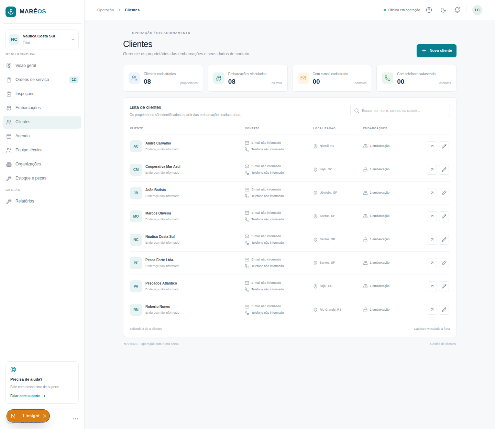 - binding - Customer list, 1440px, light
- 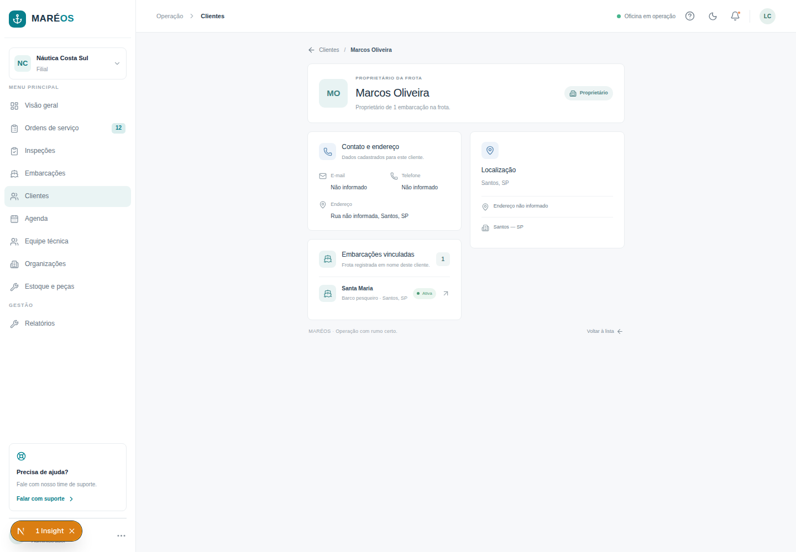 - binding - Customer detail
- 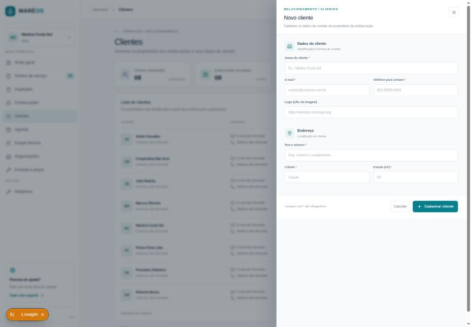 - binding - "Novo cliente" drawer
- 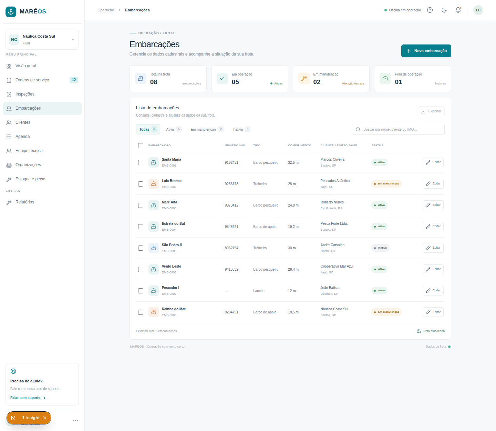 - binding - Vessel list
- 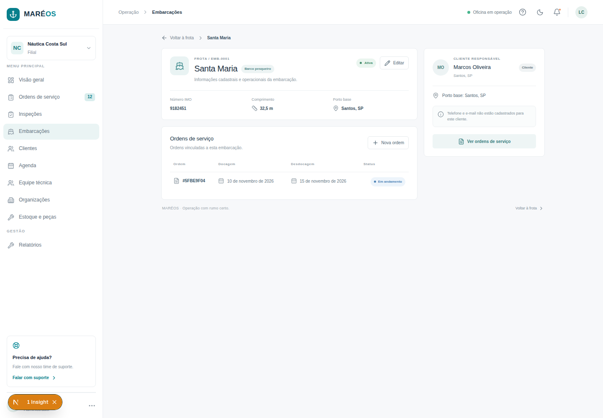 - binding - Vessel detail
- 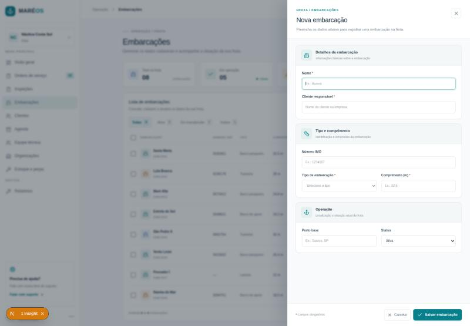 - binding - "Nova embarcação" drawer
- 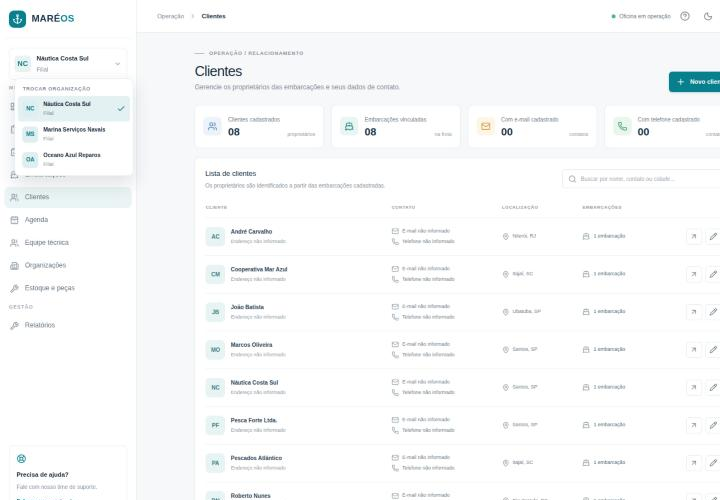 - binding - sidebar with the Organization menu open
- 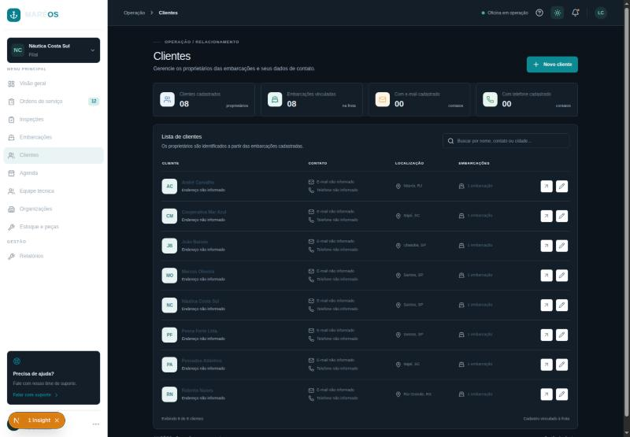 - binding - dark theme (with the defects AD-030 departs from)
- 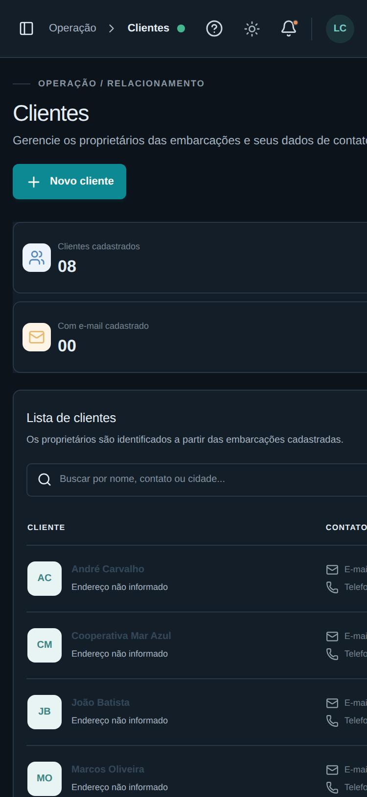 - binding - 375px, showing the horizontal overflow criterion 11 rules out
- `.specs/STATE.md` AD-020 to AD-030 - the answers of 2026-11-17
