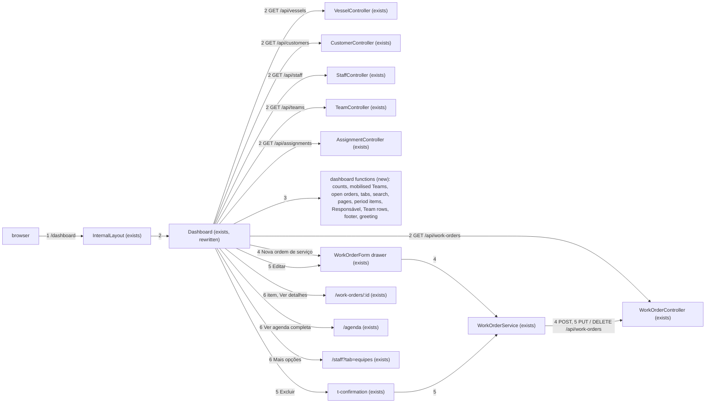
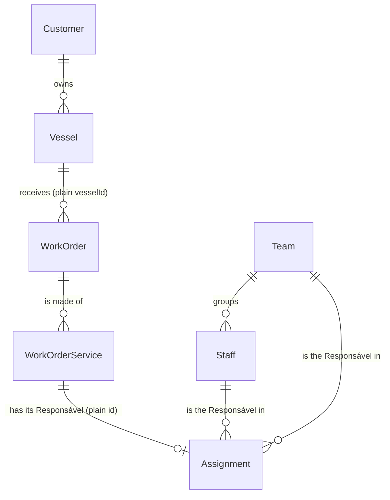
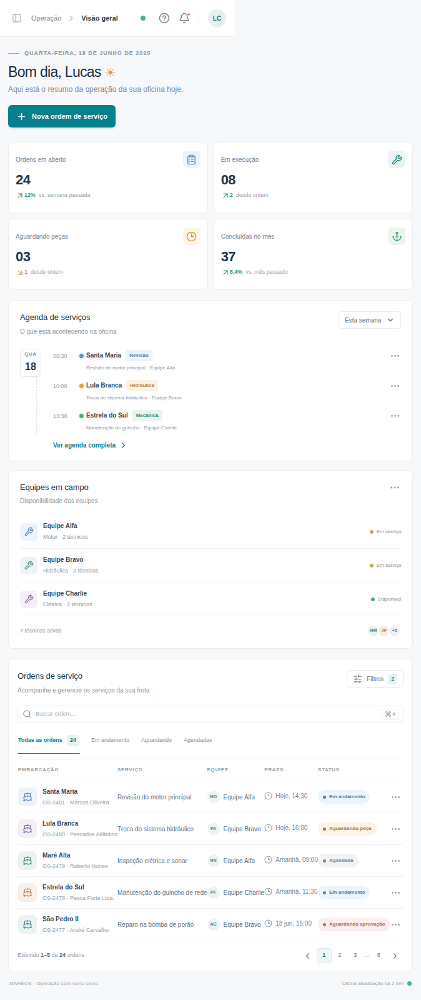

# Dashboard after mareos

**Approved**: 2026-11-18 - user: "Aprovo o plano"

> Build this with **tlc-implement**. Every criterion becomes a check with a proof; nothing under
> the open questions is settled while building.

## Problem

"Visão geral" (`/dashboard`) is the first page after sign-in (`/` redirects to it), and it shows two
cards, "Total de Clientes" and "Embarcações Ativas", both reading "—", and the sentence "Nenhum evento
ainda": no number and nothing of the operation. The shell and every other page of the sidebar took the
mareos look (AD-020, `customer-ui-redesign`, `work-order-ui-redesign`, `workforce`); this page did not,
so it is the one screen in the old look, and it is the one everybody lands on. An operator who wants to
know what is in progress, what is pending, what is scheduled today and which Teams are busy opens
"Ordens de serviço", "Agenda" and "Equipe técnica" one after the other. The team's prototype of the
page it wants is the mareos "Visão geral" (`/home/luciano/workspace/development/apps/mareos`,
`app/page.tsx`); the request gives no other evidence.

When this ships, `/dashboard` greets the User by name with today's date, shows four counts of the
Organization's WorkOrders, the Agenda items of today or of this week with the Responsável of each
service, every Team with its status, and the open WorkOrders with their Responsável, tabs, search and
pages, in the mareos look; a writer creates, edits and deletes a WorkOrder from it.

## Shape

This reuses the reads other pages already make (`GET /api/work-orders` with its services, AD-040 and
AD-041; `GET /api/vessels` and `GET /api/customers`, AD-023; `GET /api/staff`, `GET /api/teams` and
`GET /api/assignments`, `workforce`), the pure functions of `work-order-filters.ts` (search, pages,
range, "PRAZO" label), `agenda-week.ts` (Agenda items, week days), `work-order-csv.ts`,
`staff-status.ts` (`servicesInProgress`, `teamStatus`, AD-084), `assignee.ts` (`responsavelLabel`) and
`initials.ts`, the "Nova ordem de serviço" drawer (`WorkOrderForm` in its `t-sheet`, AD-042, AD-053,
with "Responsável" for an `administrator`, AD-077, AD-079), the row menu of the WorkOrder list,
`t-confirmation`, `t-skeleton`, the toasts and `AuthenticationService.name` / `canWrite`; the API does
not change. The counts, the mobilised Teams, which WorkOrders the panel lists and in what order, the
tabs, the search, the pages, the Agenda items of the period with their Responsável, the Team rows and
the footer, and the greeting by hour run in plain functions under `web/src/package/analytics/dashboard/`
and in the page's `computed` signals, reached by specs in `web/src/package/analytics/dashboard/__test__/`
(`npm test` in `web/`).

1. browser `/dashboard` -> `InternalLayout` (exists) - "Visão geral" active in the sidebar, topbar "Operação > Visão geral", as today
2. `Dashboard` page (exists, rewritten) -> `GET /api/work-orders`, `GET /api/vessels`, `GET /api/customers`, `GET /api/staff`, `GET /api/teams`, `GET /api/assignments`, once each with no `page`, `take` or `skip`, for every Role -> `WorkOrderController`, `VesselController`, `CustomerController`, `StaffController`, `TeamController`, `AssignmentController` (exist) - every record of the active Organization
3. `Dashboard` (exists) - greeting from `AuthenticationService.name` (exists, set by the layout from `GET /me`), the four counts and the mobilised Teams, the Agenda panel of the period with each service's Responsável, the Team rows and the footer, the open-orders panel (tabs, search, 5 per page, Responsável), the CSV
4. "Nova ordem de serviço" -> `WorkOrderForm` drawer (exists) -> `WorkOrderService` (exists) -> `POST /api/work-orders` with `services` (and each service's Responsável for an `administrator`) -> the work-order and assignment reads reload
5. row menu "Editar" -> the same drawer -> `PUT /api/work-orders/:id`; "Excluir" -> `t-confirmation` (exists) -> `DELETE /api/work-orders/:id` -> the work-order and assignment reads reload
6. out: the page renders; an Agenda item and "Ver detalhes" open `/work-orders/:id`, "Ver agenda completa" opens `/agenda`, the "Mais opções" of "Equipes em campo" opens `/staff?tab=equipes`; nothing is stored beyond what the existing WorkOrder routes write

**Changes underneath**

| Front | What changes |
| --- | --- |
| domain | nothing - no term changes meaning; "Em serviço" keeps AD-084 |
| stored data | nothing to migrate |
| readers | the cards "Total de Clientes" and "Embarcações Ativas" disappear; no spec, page or job reads them. `not-found` and `forbidden` keep "Voltar para o Dashboard" to `/dashboard` |

New: nothing - read only (the drawer and the row menu write WorkOrders, WorkOrderServices and
Assignments through the routes that exist).

## Surface

None - nothing consumed outside: the page calls `GET /api/work-orders`, `GET /api/vessels`,
`GET /api/customers`, `GET /api/staff`, `GET /api/teams`, `GET /api/assignments`,
`POST /api/work-orders`, `PUT /api/work-orders/:id` and `DELETE /api/work-orders/:id` with the
signatures they have today.

## Landing

None - no schema, no route, no consumed contract and no dependency changes; the page and its functions
are reversible in a refactor.

- Nothing else in this change is hard to reverse

## Criteria

### S1: The overview shows today's operation of the Organization (P1)

A user who opens `/dashboard` sees the counts, the Agenda of the period, the Teams and the open
WorkOrders of the active Organization, in the mareos look.

**Acceptance Criteria**

1. WHEN a signed-in user of any Role opens `/dashboard` (or `/`, which redirects there) THEN the system SHALL request `GET /api/work-orders`, `GET /api/vessels`, `GET /api/customers`, `GET /api/staff`, `GET /api/teams` and `GET /api/assignments` once each, with no `page`, `take` or `skip`, and show the page in `.specs/features/dashboard-redesign/captures/dashboard.png` (`.specs/features/dashboard-redesign/captures/dashboard.aria.yml`) inside the shell, minus what `## Differences from the source` lists
2. The page SHALL open with the kicker of today's date in the browser's time zone as `Intl` `pt-BR` writes it, upper-case ("TERÇA-FEIRA, 17 DE NOVEMBRO DE 2026"), the heading "<saudação>, <primeiro nome>" and the subtitle "Aqui está o resumo da operação da sua oficina hoje."; the first name is the first word of the User's `name` from `GET /me`, and the greeting goes by the browser's hour (AD-092)
   - 05:00 → "Bom dia" with the sun; 11:59 → "Bom dia"; 12:00 → "Boa tarde" with the sun; 17:59 → "Boa tarde"; 18:00 → "Boa noite" with a moon; 04:59 → "Boa noite"; name "Ana Maria Souza" → "Ana"
3. The section "Indicadores da operação" SHALL show four cards, every value padded to two digits and counted over every WorkOrder of the Organization, never over a tab or a search: "Ordens em aberto" = `PENDING` + `IN_PROGRESS`; "Em execução" = `IN_PROGRESS`; "Pendentes" = `PENDING`; "Concluídas no mês" = `COMPLETED` whose Desdocagem (`endDate`) falls in the current calendar month of the browser (AD-088)
   - on 2026-11-17 with 3 `PENDING`, 2 `IN_PROGRESS`, 1 `CANCELLED`, a `COMPLETED` ending 2026-11-03 10:00 and a `COMPLETED` ending 2026-10-31 23:59 → "05", "02", "03", "01"; the `CANCELLED` one counts nowhere; with no WorkOrder → "00" four times
4. The card "Em execução" SHALL carry the note "<n> equipes mobilizadas", n being the Teams whose status is "Em serviço" (AD-084, AD-088); no card SHALL carry a trend or any other note: no "vs. semana passada", "vs. mês passado", "desde ontem", "com prioridade alta", "entregas previstas hoje" or "no prazo" (AD-091)
   - Team Alfa Responsável of a service `IN_PROGRESS` of a WorkOrder `IN_PROGRESS`, Team Bravo of a service `PENDING`, Team Charlie of a service `IN_PROGRESS` of a `CANCELLED` WorkOrder → "1 equipe mobilizada"; a Staff of Bravo Responsável of a service `IN_PROGRESS` does not make Bravo count; no Team "Em serviço" → "0 equipes mobilizadas"
5. The panel "Agenda de serviços" ("O que está acontecendo na oficina") SHALL list the Agenda items of the period - each WorkOrderService at its `startDate`, each WorkOrder at its Docagem and at its Desdocagem, none of a `CANCELLED` WorkOrder (AD-036, AD-047, AD-089) - grouped by day, days in order and items by time within a day, with only the days that have items; each day draws its weekday ("QUA") and day number ("18"), and each item its time ("08:30"), the Vessel name, the tag "Serviço", "Docagem" or "Desdocagem" (AD-091), and beneath them, for a service, "<nome do serviço> · <responsável>" - the Staff's name or "Equipe <nome>" - or "<nome do serviço> · <#code>" when it has no Responsável, and for a Docagem or Desdocagem "Docagem · <#code>" or "Desdocagem · <#code>" (AD-087)
   - a WorkOrder `#AB12CD34` docking Monday 08:00 and undocking Friday 17:00 with a service "Pintura do casco" starting Wednesday 10:30 whose Responsável is Team "Alfa" → three items, under SEG, QUA and SEX, reading "Docagem · #AB12CD34", "Pintura do casco · Equipe Alfa" and "Desdocagem · #AB12CD34"; the same service with no Responsável → "Pintura do casco · #AB12CD34"; the same WorkOrder `CANCELLED` → no item
6. WHEN the user opens the page THEN the period button SHALL read "Esta semana" and the panel SHALL hold the items of Monday to Sunday of the current week; WHEN the user uses the period button THEN it SHALL switch to "Hoje" and hold only today's items, and the next use switches back to "Esta semana", as `dashboard-period-today.png` shows the button (`.specs/features/dashboard-redesign/captures/dashboard-period-today.png`) (AD-089)
   - on Wednesday 2026-11-18, an item on Sunday 2026-11-22 23:00 is in "Esta semana" and an item on Monday 2026-11-23 00:00 is not; an item on 2026-11-18 at 00:00 is in "Hoje"
7. WHILE the period holds more than three items the panel SHALL show only the first three by time, and the list SHALL not scroll (AD-119); IF the period holds no item THEN the panel SHALL read "Nenhum item na agenda hoje." or "Nenhum item na agenda nesta semana." (AD-089, AD-092)
8. WHEN the user uses an Agenda item THEN the system SHALL open `/work-orders/:workOrderId` of that item (AD-047, AD-089); the items carry no "Mais opções" button (AD-091)
9. WHEN the user uses "Ver agenda completa" THEN the system SHALL open `/agenda`
10. The panel "Equipes em campo" ("Disponibilidade das equipes") SHALL list the first three Teams of the Organization by name (`pt-BR`) (AD-120), each as "Equipe <nome>" (AD-093), with "<especialidade> · <n> técnicos" (n being the Staff whose Team it is) and its status "Em serviço" (amber dot) or "Disponível" (green dot) as AD-084 derives it; the list SHALL not scroll (AD-085, AD-120)
    - Team "Alfa", specialty "Motor", 2 Staff, Responsável of a service `IN_PROGRESS` of an open WorkOrder → "Equipe Alfa", "Motor · 2 técnicos", "Em serviço"; Team "Charlie" with 1 Staff and no Assignment → "Equipe Charlie", "Elétrica · 1 técnico", "Disponível"; a Team with no Staff → "<especialidade> · 0 técnicos"
11. The footer of "Equipes em campo" SHALL read "<n> técnicos ativos", n being every Staff of the Organization with or without a Team, beside the initials of the first two Staff by name (`pt-BR`) and "+<n − 2>" when there are more than two (AD-092)
    - 7 Staff, the first two by name "Joana Prado" and "Rafael Mendes" → "7 técnicos ativos", "JP", "RM", "+5"; 2 Staff → two initials and no "+"; 1 Staff → "1 técnico ativo" and one initial; no Staff → "0 técnicos ativos" and no initial
12. IF the Organization has no Team THEN "Equipes em campo" SHALL read "Ainda não há equipes cadastradas." above its footer (AD-092)
13. WHEN the user uses "Mais opções" of "Equipes em campo" THEN the system SHALL open `/staff?tab=equipes`, the "Equipes" tab of "Equipe técnica" (AD-085)
14. The panel "Ordens de serviço" ("Acompanhe e gerencie os serviços da sua frota") SHALL list only WorkOrders `PENDING` or `IN_PROGRESS`, the nearest Desdocagem first and then the `#` code, with the tabs "Todas as ordens" (carrying the count of every open WorkOrder, as the capture), "Em andamento" (`IN_PROGRESS`) and "Pendentes" (`PENDING`), 5 rows per page, and the footer "Exibindo <a>–<b> de <n> ordens" counting the rows of the tab and the search (AD-090, AD-095)
    - 7 open WorkOrders on "Todas as ordens" → the count "7", pages "1" and "2", "Exibindo 1–5 de 7 ordens", and on page 2 "Exibindo 6–7 de 7 ordens"; 3 of them `PENDING` on "Pendentes" → "Exibindo 1–3 de 3 ordens"; a `COMPLETED` or `CANCELLED` WorkOrder appears on no tab and in no count of the tab
15. WHEN the user types in "Buscar ordem..." THEN the table SHALL keep the rows of the tab whose `#` code (with or without "#"), Vessel name, Customer name or a service name contains the text, case-insensitive, and go back to page 1; IF nothing matches THEN the table SHALL read "Nenhuma ordem encontrada." as `.specs/features/dashboard-redesign/captures/dashboard-search-empty.png`; WHEN the user picks a tab THEN the table SHALL go back to page 1, as `.specs/features/dashboard-redesign/captures/dashboard-tab-em-andamento.png` (AD-090)
    - "#ab12" finds the WorkOrder `#AB12CD34`; "pintura" finds a WorkOrder whose second service is "Pintura do casco"
16. The orders table SHALL show, in each row, in "EMBARCAÇÃO" the teal Vessel avatar, the Vessel name and "<#code> · <Customer name>"; in "SERVIÇO" the first service's name and beneath it "+1 serviço" / "+<n> serviços" or "Nenhum serviço" (AD-041); in "RESPONSÁVEL" the Responsável of that first service - the initials of its name in a small avatar beside the Staff's name or "Equipe <nome>" - or "Sem responsável" when it has none or the WorkOrder has no service (AD-086); in "PRAZO" the Desdocagem as "Hoje, 14:30", "Amanhã, 09:00" or "20 nov, 10:00" by the browser's day; in "STATUS" the badge "Pendente" or "Em andamento"
    - first service's Responsável Staff "Rafael Mendes" → "RM" and "Rafael Mendes"; Team "Alfa" → "A" and "Equipe Alfa"; only the second service has a Responsável → "Sem responsável"
17. WHEN a user uses "Ações para <#code>" on a row THEN the system SHALL show "Ver detalhes", which opens `/work-orders/:id`, and, for an `administrator` or `operator`, "Editar" and "Excluir" (AD-090, AD-094)
18. WHEN a writer uses "Editar" THEN the system SHALL open the WorkOrder list's edit drawer filled with the WorkOrder - with each service's "Responsável" for an `administrator` (AD-077, AD-079) - and WHEN they save with "Salvar alterações" THEN the system SHALL `PUT /api/work-orders/:id`, close the drawer, show the toast "Ordem atualizada com sucesso" and the new values in the cards, the Agenda panel, "Equipes em campo" and the table without a page reload
    - an `administrator` sets Team "Alfa" as the Responsável of the first service, `IN_PROGRESS`, of an `IN_PROGRESS` WorkOrder → the row reads "Equipe Alfa", Alfa reads "Em serviço" and the note reads "1 equipe mobilizada"
19. WHEN a writer uses "Excluir" THEN the system SHALL ask in `t-confirmation`, and on confirming `DELETE /api/work-orders/:id`, show "Ordem de serviço excluída com sucesso" and drop the WorkOrder from the cards, the Agenda panel and the table, and its Assignments from "Equipes em campo" and the note "equipes mobilizadas" (AD-064), without a page reload
20. WHEN the user uses "Exportar" THEN the system SHALL download `ordens-de-servico.csv` with the header `OS,Embarcação,Cliente,Serviço,Docagem,Desdocagem,Status` (AD-044) and one line per row of the current tab and search, every page included; IF the tab and search hold no row THEN "Exportar" SHALL be disabled (AD-090)
    - "Pendentes" with 3 rows over 1 page, searched "aurora" matching 1 → a file of 2 lines; 7 rows over 2 pages on "Todas as ordens" → a file of 8 lines
21. WHEN a writer (`administrator` or `operator`) uses "Nova ordem de serviço" THEN the system SHALL open the drawer of `.specs/features/drawer-standard/captures/work-order-drawer.dark.png` with no Vessel chosen, with "Responsável" on each service for an `administrator` only (AD-079); WHEN they save with "Criar ordem" THEN the system SHALL `POST /api/work-orders` with its services, close the drawer, show "Ordem de serviço criada com sucesso" and count the new WorkOrder in the cards, the Agenda panel, the table and, with a Responsável, "Equipes em campo", without a page reload
22. WHILE the active Role is `inspector` the page SHALL show no "Nova ordem de serviço", no "Editar" and no "Excluir" (AD-017), and SHALL show the Responsável, the Teams and their status as for any other Role
23. WHILE any of the six requests is loading the parts that read it SHALL show skeletons - the cards, the Agenda panel, "Equipes em campo" and the table - and a Responsável SHALL never read "Sem responsável" before `GET /api/staff`, `GET /api/teams` and `GET /api/assignments` have answered; IF one of them fails THEN the system SHALL show one toast "Erro ao carregar a visão geral" with the API message, or "Não foi possível carregar a visão geral." when there is none (AD-092), and the parts that read it SHALL keep their skeletons instead of drawing "00", "0 equipes mobilizadas", "Sem responsável" or an empty sentence
24. IF the Organization has no open WorkOrder THEN the table SHALL read "Nenhuma ordem de serviço em aberto." and "Exibindo 0–0 de 0 ordens" with no page button (AD-092)
25. WHEN the user turns on the dark theme THEN the page SHALL take the dark tokens (AD-020), and the card values, the Vessel names, the Agenda item titles and the Team names SHALL keep a contrast of at least 4.5:1 against their surface - unlike the faint values of `.specs/features/dashboard-redesign/captures/dashboard-dark.png` (AD-092)
26. WHILE the window is 640, 768, 1024, 1280 or 1536px wide the page SHALL have no horizontal page scroll - only the table scrolls inside its panel - unlike `.specs/features/dashboard-redesign/captures/dashboard-375.png`; from 1024px "Agenda de serviços" and "Equipes em campo" sit side by side as in `dashboard.png`, and below 1024px the cards go two per row and the panels stack: "Agenda de serviços", "Equipes em campo", "Ordens de serviço"

## Out of scope

| Excluded | Why |
| --- | --- |
| Parts, priority, service category, history for trends ("vs. semana passada") | not in the stored model (AD-021, AD-034); no migration here; omitted by AD-091 |
| Creating, editing or deleting Staff or Teams from the dashboard | "Equipe técnica" does it (AD-066, AD-074); the panel's "Mais opções" opens it (AD-085) |
| A filter panel behind "Filtros" | mareos draws a button that does nothing; omitted by AD-091 |
| A keyboard shortcut (⌘K) to focus the search | mareos draws the key but binds nothing; omitted by AD-091 |
| Help, "Oficina em operação", the page footer "MARÉOS · Operação com rumo certo." and "Última atualização há 2 min" | the shell omits them (AD-025) |
| Any API change, a dashboard endpoint or server-side counts | the reads that exist carry every record (AD-023, AD-040); counting runs in the browser like the WorkOrder list and "Equipe técnica" |
| Selecting rows with checkboxes on the dashboard | the mareos dashboard table has none; selection stays on `/work-orders` |

## Assumptions

| Assumption | Chosen default | Rationale | Confirmed? |
| --- | --- | --- | --- |
| Widths the page must work at | 640, 768, 1024, 1280 and 1536px | the widths the user gave for the customer redesign, kept by the work-order redesign | n |
| Week of "Esta semana" | Monday to Sunday | the Agenda's week (`weekDays`, the source's `weekDaysFor`); AD-089 | y |
| What the period button is | one button that alternates "Esta semana" and "Hoje" | the source's `setPeriod` toggles on each click; AD-089 | y |
| Avatar colour | one teal avatar on every row | AD-044, as the WorkOrder list | n |
| Pagination | one button per page, previous and next | AD-044, as the WorkOrder list | n |
| The drawer opened from the dashboard | the WorkOrder list's drawer with no Vessel chosen, "Responsável" for an `administrator` | AD-042 shares it, AD-079 gates "Responsável"; only the Vessel detail locks a Vessel | n |
| Who sees the page | every Role, writes only for `administrator` and `operator` | AD-017; reads are open to every Role, the workforce reads included (AD-061) | n |
| Initials of a Responsável and of the footer | the first letter of the first two words of the Staff's or the Team's name, upper-case ("Rafael Mendes" → "RM", Team "Alfa" → "A") | the `initials` the app already draws for Customers | n |
| Colour of each Team's symbol | the source's three tones (blue, teal, violet) by the row's position, starting again on the fourth Team | the source draws one tone per row; a Team has no colour of its own | n |
| Singular copy | "1 técnico", "1 técnico ativo", "1 equipe mobilizada" | the app writes "+1 serviço" for one; the source draws only plurals | n |
| A failed read | its parts keep their skeletons and one toast says so | a failed read drawn as "00" or "Sem responsável" is a wrong number, as the workforce finding on the edit drawer showed | n |

**Open questions:** none - all resolved or logged above.

## Differences from the source

| Source shows | Product shows | Confirmed |
| --- | --- | --- |
| Code "OS-2481" | "#AB12CD34" (first 8 characters of the id) | y - AD-034 |
| Statuses "Aguardando peça", "Agendada", "Aguardando aprovação" | "Pendente", "Em andamento" | y - AD-034 |
| Avatars coloured per row | one teal avatar | y - AD-044 |
| Pages "1 2 3 … 8" | one button per page | y - AD-044 |
| "Oficina em operação", help, the page footer and "Última atualização há 2 min" | nothing | y - AD-025 |
| Card "Aguardando peças" | "Pendentes" | y - AD-088 |
| Note "4 equipes mobilizadas" with no rule behind it | "<n> equipes mobilizadas", the Teams "Em serviço" | y - AD-088 |
| Trends "vs. semana passada", "desde ontem", "vs. mês passado" and the notes "6 com prioridade alta", "2 entregas previstas hoje", "92% no prazo" | nothing | y - AD-091 |
| Three items under one day, whatever the period | the first three items of the period by time, grouped by day | y - AD-089, AD-119 |
| Category tags "Revisão", "Hidráulica", "Mecânica" | "Serviço", "Docagem", "Desdocagem" | y - AD-091 |
| "· Equipe Alfa" on every Agenda item | the service's Responsável, or the `#` code when it has none and on Docagem and Desdocagem | y - AD-087 |
| "Mais opções" on each Agenda item | nothing; the item opens its WorkOrder | y - AD-091 |
| Three fixed Teams, "Mais opções" with no action | the first three Teams of the Organization by name with their derived status; "Mais opções" opens `/staff?tab=equipes` | y - AD-085, AD-120 |
| Tabs "Aguardando" and "Agendadas" | "Pendentes" | y - AD-090 |
| Column "EQUIPE" | "RESPONSÁVEL", the Responsável of the first service or "Sem responsável" | y - AD-086 |
| "Filtros 2" and "⌘K" | nothing | y - AD-091 |
| Row menu named "Mais opções para <Vessel>" | "Ações para <#code>" | y - AD-094 |
| "Exibindo 1–2 de 24 ordens": the total of every order | the total of the tab and the search ("Exibindo 1–2 de 2 ordens") | y - AD-095 |
| "Bom dia" at any hour | "Bom dia", "Boa tarde" or "Boa noite" by the hour | y - AD-092 |
| Faint card values in dark mode | values at 4.5:1 or more | y - AD-092 |
| Underlined tabs with "Buscar ordem..." to their right | the pill tabs of "Lista de ordens", then "Buscar ordem..." across the panel, no rule under the tabs | y - AD-097 |

## Sources

- mareos prototype, `/home/luciano/workspace/development/apps/mareos` (Next.js, `.claude/launch.json` "mareos", port 3100), captured 2026-11-17 with headless Chrome at 1440px, the Next.js dev overlay removed - binding - the "Visão geral" page
- `captures/source/` - binding - the mareos source of the captured page (`dashboard-page.tsx`, `globals.css`): labels, aria-labels, the period toggle, the tab and search rules, the Team rows and footer
-  - binding - the page, 1440px, light; structure in `captures/dashboard.aria.yml`
-  - binding - the period button after one use ("Hoje")
-  - binding - the tab "Em andamento" selected
-  - binding - a search with no match ("Nenhuma ordem encontrada.")
-  - binding - dark theme, with the faint values AD-092 departs from
-  - binding - 375px, with the horizontal overflow criterion 26 rules out
- `.specs/features/workforce/plan.md` - built - Staff, Team, Assignment and the derived status this page reads
- `.specs/STATE.md` AD-020 to AD-095 - the shell, palette, drawer standard, WorkOrder list, workforce and dashboard rules this conforms to
