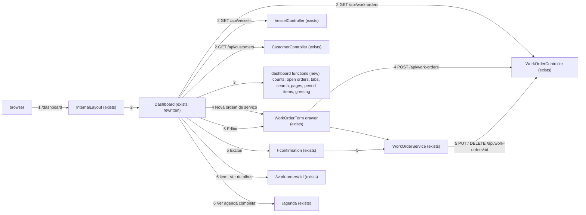
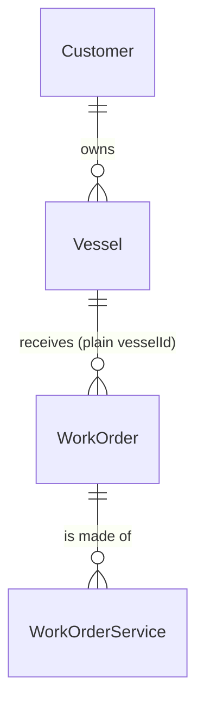
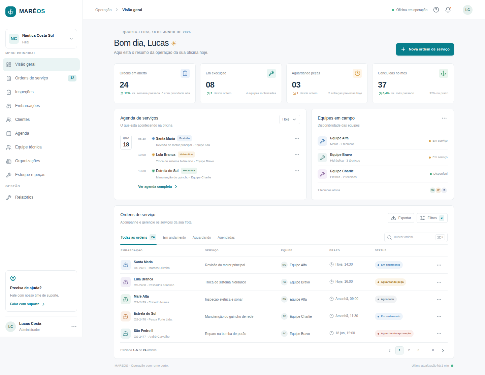
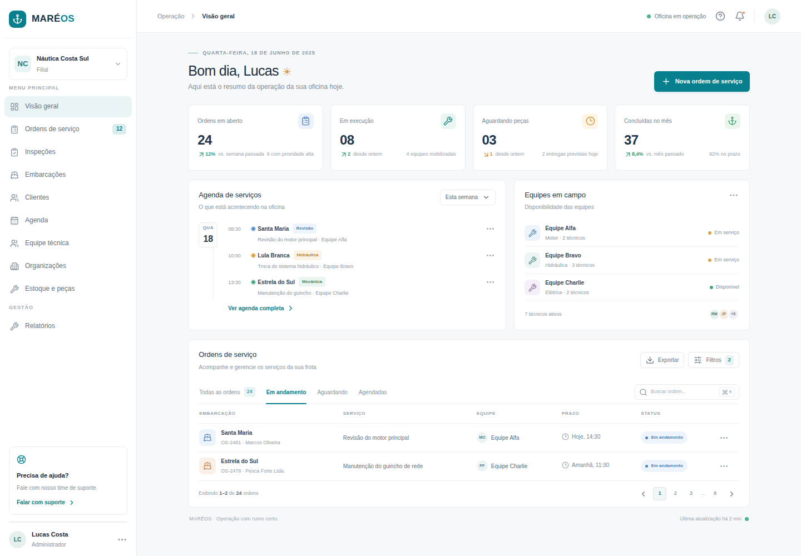
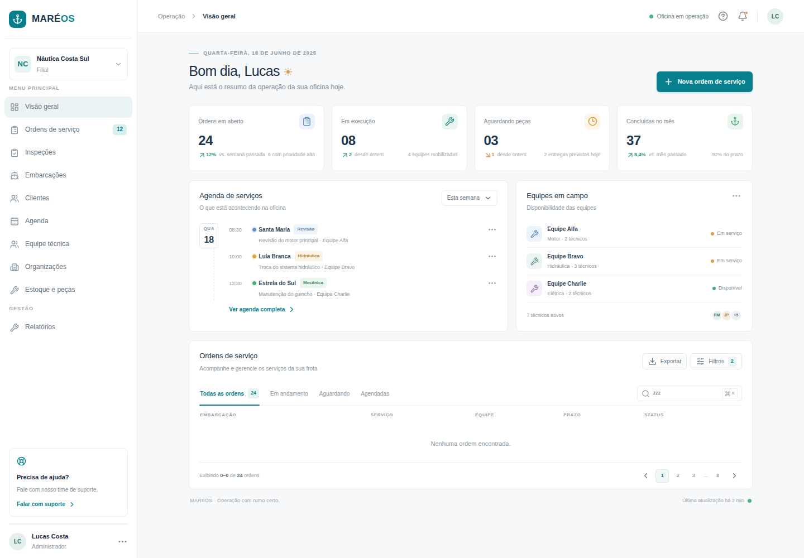
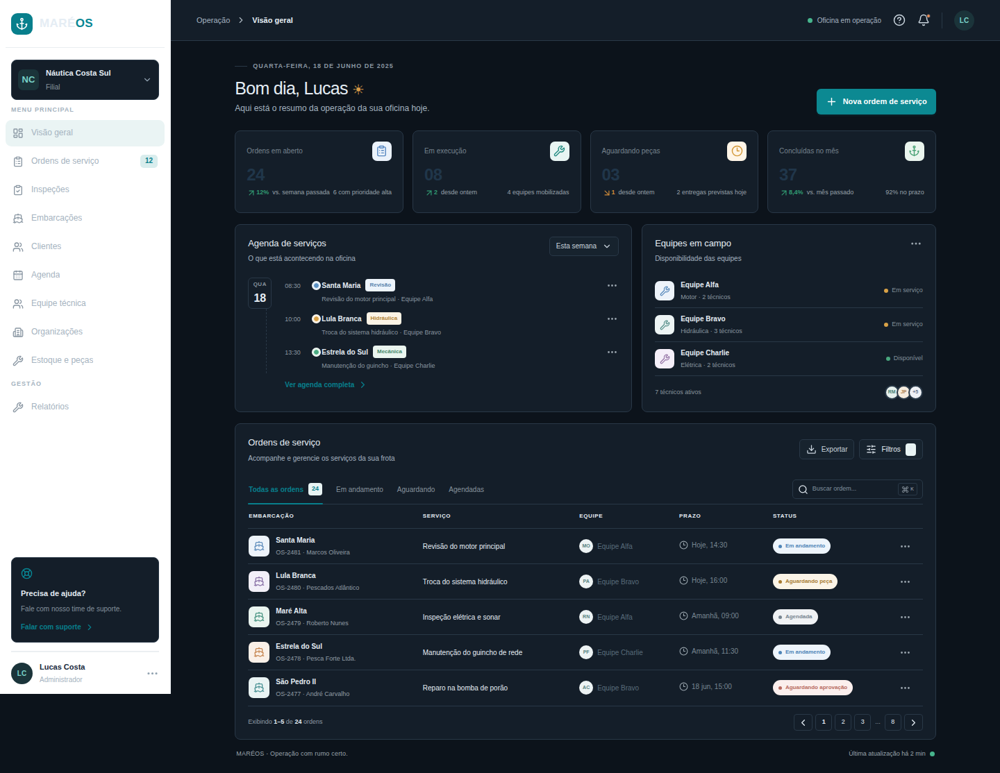

# Dashboard after mareos

> Build this with **tlc-implement**. Every criterion becomes a check with a proof; nothing under
> the open questions is settled while building.
>
> Waits on `.specs/features/workforce/plan.md` (AD-059): once Staff, Team and Assignment exist, open
> question 1 is asked again, since "Equipes em campo", the "EQUIPE" column and the team on Agenda
> items then have data behind them.

## Problem

"Visão geral" (`/dashboard`) is the first page after sign-in (`/` redirects to it), and it shows two
cards, "Total de Clientes" and "Embarcações Ativas", both reading "—", and the sentence "Nenhum evento
ainda": no number and nothing of the operation. The shell and every other page of the sidebar took the
mareos look (AD-020, `customer-ui-redesign`, `work-order-ui-redesign`); this page did not, so it is the
one screen in the old look, and it is the one everybody lands on. An operator who wants to know what is
in progress, what is pending and what is scheduled today opens "Ordens de serviço" and "Agenda" one
after the other. The team's prototype of the page it wants is the mareos "Visão geral"
(`/home/luciano/workspace/development/apps/mareos`, `app/page.tsx`); the request gives no other
evidence.

When this ships, `/dashboard` greets the User by name with today's date, shows four counts of the
Organization's WorkOrders, the Agenda items of today or of this week, and the open WorkOrders with tabs,
search and pages, in the mareos look; a writer creates a WorkOrder from it.

## Shape

This reuses the three reads the WorkOrder list already makes (`GET /api/work-orders` with its services,
AD-040 and AD-041; `GET /api/vessels` and `GET /api/customers`, AD-023), the pure functions of
`work-order-filters.ts` (search, pages, range, "PRAZO" label), `agenda-week.ts` (Agenda items, week
days) and `work-order-csv.ts`, the "Nova ordem de serviço" drawer (`WorkOrderForm` in its `t-sheet`,
AD-042, AD-053), the row menu of `work-order-table-ui`, `t-confirmation`, `t-skeleton`, the toasts and
`AuthenticationService.name` / `canWrite`; the API does not change. The counts, which WorkOrders the
panel lists and in what order, the tabs, the search, the pages, the Agenda items of the period and the
greeting by hour run in plain functions under `web/src/package/analytics/dashboard/` and in the page's
`computed` signals, reached by specs in `web/src/package/analytics/dashboard/__test__/` (`npm test` in
`web/`).

1. browser `/dashboard` -> `InternalLayout` (exists) - "Visão geral" active in the sidebar, topbar "Operação > Visão geral", as today
2. `Dashboard` page (exists, rewritten) -> `GET /api/work-orders`, `GET /api/vessels`, `GET /api/customers`, once each with no `page`, `take` or `skip` -> `WorkOrderController`, `VesselController`, `CustomerController` (exist) - every record of the active Organization
3. `Dashboard` (exists) - greeting from `AuthenticationService.name` (exists, set by the layout from `GET /me`), the four counts, the Agenda panel of the period, the open-orders panel (tabs, search, 5 per page), the CSV
4. "Nova ordem de serviço" -> `WorkOrderForm` drawer (exists) -> `WorkOrderService` (exists) -> `POST /api/work-orders` with `services` -> the three reads reload
5. row menu "Editar" -> the same drawer -> `PUT /api/work-orders/:id`; "Excluir" -> `t-confirmation` (exists) -> `DELETE /api/work-orders/:id` -> the reads reload
6. out: the page renders; an Agenda item and "Ver detalhes" open `/work-orders/:id`, "Ver agenda completa" opens `/agenda`; nothing is stored beyond what the existing WorkOrder routes write

**Changes underneath**

| Front | What changes |
| --- | --- |
| domain | nothing - no term changes meaning |
| stored data | nothing to migrate |
| readers | the cards "Total de Clientes" and "Embarcações Ativas" disappear; no spec, page or job reads them. `not-found` and `forbidden` keep "Voltar para o Dashboard" to `/dashboard` |

New: nothing - read only (the drawer and the row menu write WorkOrders and WorkOrderServices through
the routes that exist).

## Surface

None - nothing consumed outside: the page calls `GET /api/work-orders`, `GET /api/vessels`,
`GET /api/customers`, `POST /api/work-orders`, `PUT /api/work-orders/:id` and
`DELETE /api/work-orders/:id` with the signatures they have today.

## Landing

None - no schema, no route, no consumed contract and no dependency changes; the page and its functions
are reversible in a refactor.

- Nothing else in this change is hard to reverse

## Criteria

### S1: The overview shows today's operation of the Organization (P1)

A user who opens `/dashboard` sees the counts, the Agenda of the period and the open WorkOrders of the
active Organization, in the mareos look.

**Acceptance Criteria**

1. WHEN a signed-in user opens `/dashboard` (or `/`, which redirects there) THEN the system SHALL request `GET /api/work-orders`, `GET /api/vessels` and `GET /api/customers` once each, with no `page`, `take` or `skip`, and show the page in `.specs/features/dashboard-redesign/captures/dashboard.png` (`.specs/features/dashboard-redesign/captures/dashboard.aria.yml`) inside the shell, minus what `## Differences from the source` lists
2. The page SHALL open with the kicker of today's date in the browser's time zone as `Intl` `pt-BR` writes it, upper-case ("TERÇA-FEIRA, 17 DE NOVEMBRO DE 2026"), the heading "<saudação>, <primeiro nome>" and the subtitle "Aqui está o resumo da operação da sua oficina hoje."; the first name is the first word of the User's `name` from `GET /me`, and the greeting goes by the browser's hour (open question 5)
   - 05:00 → "Bom dia" with the sun; 11:59 → "Bom dia"; 12:00 → "Boa tarde" with the sun; 18:00 → "Boa noite" with a moon; 04:59 → "Boa noite"; name "Ana Maria Souza" → "Ana"
3. The section "Indicadores da operação" SHALL show four cards, every value padded to two digits and counted over every WorkOrder of the Organization, never over a tab or a search: "Ordens em aberto" = `PENDING` + `IN_PROGRESS`; "Em execução" = `IN_PROGRESS`; "Pendentes" = `PENDING`; "Concluídas no mês" = `COMPLETED` whose Desdocagem (`endDate`) falls in the current calendar month of the browser (open question 2)
   - on 2026-11-17 with 3 `PENDING`, 2 `IN_PROGRESS`, 1 `CANCELLED`, a `COMPLETED` ending 2026-11-03 10:00 and a `COMPLETED` ending 2026-10-31 23:59 → "05", "02", "03", "01"; the `CANCELLED` one counts nowhere; with no WorkOrder → "00" four times
4. The cards SHALL carry no trend or note beneath the value: no "vs. semana passada", "desde ontem", "com prioridade alta", "equipes mobilizadas", "entregas previstas" or "no prazo" (open question 1)
5. The panel "Agenda de serviços" ("O que está acontecendo na oficina") SHALL list the Agenda items of the period - each WorkOrderService at its `startDate`, each WorkOrder at its Docagem and at its Desdocagem, none of a `CANCELLED` WorkOrder (AD-036, AD-047) - grouped by day, days in order and items by time within a day, with only the days that have items; each day draws its weekday ("QUA") and day number ("18"), and each item its time ("08:30"), the Vessel name, the tag "Serviço", "Docagem" or "Desdocagem", and beneath them the service name or "Docagem" / "Desdocagem" and the `#` code (open question 3)
   - a WorkOrder docking Monday 08:00 and undocking Friday 17:00 with a service starting Wednesday 10:30 → three items, under SEG, QUA and SEX; the same WorkOrder `CANCELLED` → no item
6. WHEN the user opens the page THEN the period button SHALL read "Esta semana" and the panel SHALL hold the items of Monday to Sunday of the current week; WHEN the user uses the period button THEN it SHALL switch to "Hoje" and hold only today's items, and the next use switches back to "Esta semana", as `dashboard-period-today.png` shows the button (`.specs/features/dashboard-redesign/captures/dashboard-period-today.png`)
7. WHILE the period holds more items than the panel's height in `dashboard.png` the list SHALL scroll inside the panel and the page SHALL not grow; IF the period holds no item THEN the panel SHALL read "Nenhum item na agenda hoje." or "Nenhum item na agenda nesta semana." (open question 3)
8. WHEN the user uses an Agenda item THEN the system SHALL open `/work-orders/:workOrderId` of that item (AD-047); the items carry no "Mais opções" button (open question 1)
9. WHEN the user uses "Ver agenda completa" THEN the system SHALL open `/agenda`
10. The panel "Ordens de serviço" ("Acompanhe e gerencie os serviços da sua frota") SHALL list only WorkOrders `PENDING` or `IN_PROGRESS`, the nearest Desdocagem first and then the `#` code, with the tabs "Todas as ordens" (carrying the count of open WorkOrders, as the capture), "Em andamento" (`IN_PROGRESS`) and "Pendentes" (`PENDING`), and 5 rows per page (open question 4)
    - 7 open WorkOrders on "Todas as ordens" → pages "1" and "2", "Exibindo 1–5 de 7 ordens", and on page 2 "Exibindo 6–7 de 7 ordens"; 3 of them `PENDING` on "Pendentes" → "Exibindo 1–3 de 3 ordens"; a `COMPLETED` or `CANCELLED` WorkOrder appears on no tab
11. WHEN the user types in "Buscar ordem..." THEN the table SHALL keep the rows of the tab whose `#` code (with or without "#"), Vessel name, Customer name or a service name contains the text, case-insensitive, and go back to page 1; IF nothing matches THEN the table SHALL read "Nenhuma ordem encontrada." as `.specs/features/dashboard-redesign/captures/dashboard-search-empty.png`; WHEN the user picks a tab THEN the table SHALL go back to page 1, as `.specs/features/dashboard-redesign/captures/dashboard-tab-em-andamento.png`
    - "#ab12" finds the WorkOrder `#AB12CD34`; "pintura" finds a WorkOrder whose second service is "Pintura do casco"
12. The orders table SHALL show, in each row, in "EMBARCAÇÃO" the teal Vessel avatar, the Vessel name and "<#code> · <Customer name>"; in "SERVIÇO" the first service's name and beneath it "+1 serviço" / "+<n> serviços" or "Nenhum serviço" (AD-041); in "PRAZO" the Desdocagem as "Hoje, 14:30", "Amanhã, 09:00" or "20 nov, 10:00" by the browser's day; in "STATUS" the badge "Pendente" or "Em andamento"; there is no "EQUIPE" column (open question 1)
13. WHEN a user uses "Ações para <#code>" on a row THEN the system SHALL show "Ver detalhes", which opens `/work-orders/:id`, and, for an `administrator` or `operator`, "Editar" and "Excluir" (open question 4)
14. WHEN a writer uses "Editar" and saves with "Salvar alterações" THEN the system SHALL `PUT /api/work-orders/:id`, close the drawer, show the toast "Ordem atualizada com sucesso" and the new values in the cards, the Agenda panel and the table; WHEN they use "Excluir" THEN the system SHALL ask in `t-confirmation`, and on confirming `DELETE /api/work-orders/:id`, show "Ordem de serviço excluída com sucesso" and drop the WorkOrder from the cards, the panel and the table
15. WHEN the user uses "Exportar" THEN the system SHALL download `ordens-de-servico.csv` with the header `OS,Embarcação,Cliente,Serviço,Docagem,Desdocagem,Status` (AD-044) and one line per row of the current tab and search, every page included; IF the tab and search hold no row THEN "Exportar" SHALL be disabled (open question 4)
    - "Pendentes" with 3 rows over 1 page, searched "aurora" matching 1 → a file of 2 lines
16. WHEN a writer (`administrator` or `operator`) uses "Nova ordem de serviço" THEN the system SHALL open the drawer of `.specs/features/drawer-standard/captures/work-order-drawer.dark.png` with no Vessel chosen; WHEN they save with "Criar ordem" THEN the system SHALL `POST /api/work-orders` with its services, close the drawer, show "Ordem de serviço criada com sucesso" and count the new WorkOrder in the cards, the Agenda panel and the table without a page reload
17. WHILE the active Role is `inspector` the page SHALL show no "Nova ordem de serviço", no "Editar" and no "Excluir" (AD-017)
18. WHILE any of the three requests is loading the cards, the Agenda panel and the table SHALL show skeletons; IF one of them fails THEN the system SHALL show the toast "Erro ao carregar a visão geral" with the API message, or "Não foi possível carregar a visão geral." when there is none (open question 5)
19. IF the Organization has no open WorkOrder THEN the table SHALL read "Nenhuma ordem de serviço em aberto." and "Exibindo 0–0 de 0 ordens" with no page button (open question 5)
20. WHEN the user turns on the dark theme THEN the page SHALL take the dark tokens (AD-020), and the card values, the Vessel names and the Agenda item titles SHALL keep a contrast of at least 4.5:1 against their surface - unlike the faint values of `.specs/features/dashboard-redesign/captures/dashboard-dark.png` (open question 5)
21. WHILE the window is 640, 768, 1024, 1280 or 1536px wide the page SHALL have no horizontal page scroll - only the table scrolls inside its panel - unlike `.specs/features/dashboard-redesign/captures/dashboard-375.png`; below 1024px the cards go two per row and the Agenda panel above the orders panel

## Out of scope

| Excluded | Why |
| --- | --- |
| Teams, technicians, parts, priority, service category, history for trends ("vs. semana passada") | not in the stored model (AD-021, AD-034); no migration here |
| A filter panel behind "Filtros" | mareos draws a button that does nothing; no filter is specified |
| A keyboard shortcut (⌘K) to focus the search | mareos draws the key but binds nothing |
| Notifications, help, "Oficina em operação", the page footer "MARÉOS · Operação com rumo certo." and "Última atualização há 2 min" | the shell omits them (AD-025) |
| Any API change, a dashboard endpoint or server-side counts | the three reads that exist carry every record (AD-023, AD-040); counting runs in the browser like the WorkOrder list |
| Selecting rows with checkboxes on the dashboard | the mareos dashboard table has none; selection stays on `/work-orders` |

## Assumptions

| Assumption | Chosen default | Rationale | Confirmed? |
| --- | --- | --- | --- |
| Widths the page must work at | 640, 768, 1024, 1280 and 1536px | the widths the user gave for the customer redesign, kept by the work-order redesign | n |
| Week of "Esta semana" | Monday to Sunday | the Agenda's week (`weekDays`, the source's `weekDaysFor`) | n |
| What the period button is | one button that alternates "Esta semana" and "Hoje" | the source's `setPeriod` toggles on each click | n |
| Avatar colour | one teal avatar on every row | AD-044, as the WorkOrder list | n |
| Pagination | one button per page, previous and next | AD-044, as the WorkOrder list | n |
| The drawer opened from the dashboard | the WorkOrder list's drawer with no Vessel chosen | AD-042 shares it; only the Vessel detail locks a Vessel | n |
| Who sees the page | every Role, writes only for `administrator` and `operator` | AD-017; reads are open to every Role | n |

**Open questions:**

1. `blocks` - The source draws what the stored model does not hold. Proposed: omit all of them - the
   panel "Equipes em campo" (the "Agenda de serviços" panel then takes the whole row), the card
   "Aguardando peças" (see question 2), the trends and notes beneath every card, the "EQUIPE" column,
   the category tags ("Revisão", "Hidráulica", "Mecânica", replaced by "Serviço" / "Docagem" /
   "Desdocagem"), "· Equipe Alfa" in the Agenda items, the "Mais opções" button of each Agenda item (the
   item itself opens its WorkOrder), "Filtros 2" and "⌘K". Alternative: omit them but put a panel built
   on data that exists where "Equipes em campo" is (for example the Organization's inspection
   assignments). Recommendation: omit all, as AD-021 and AD-034 did.
2. `blocks` - The four cards. Proposed (criterion 3): "Ordens em aberto" = Pendente + Em andamento;
   "Em execução" = Em andamento; "Pendentes" in place of "Aguardando peças"; "Concluídas no mês" =
   Concluídas whose Desdocagem falls in the current month, because no completion date is stored.
   Alternatives: the four cards of `/work-orders` ("Total de ordens", "Em andamento", "Pendentes",
   "Concluídas" of all time, as AD-044), or three cards without the one that has no equivalent.
   Recommendation: the proposal.
3. `blocks` - The panel "Agenda de serviços". Proposed (criteria 5 to 7): the items of the Agenda
   (services, Docagem and Desdocagem, AD-036), every item of the period with the list scrolling inside
   the panel, and the empty sentences "Nenhum item na agenda hoje." / "Nenhum item na agenda nesta
   semana.". Alternatives: only the next 5 items from now on, the rest behind "Ver agenda completa"; or
   only services, without Docagem and Desdocagem. Recommendation: the proposal.
4. `blocks` - The panel "Ordens de serviço". Proposed (criteria 10 to 15): only open WorkOrders, nearest
   Desdocagem first; tabs "Todas as ordens", "Em andamento", "Pendentes" in place of "Aguardando" and
   "Agendadas"; 5 per page; the row menu of the WorkOrder list ("Ver detalhes", "Editar", "Excluir");
   "Exportar" downloads the rows of the tab and search. Alternatives: the same rows, tabs and order as
   `/work-orders` with 5 per page; or a menu with only "Ver detalhes". Recommendation: the proposal.
5. `blocks` - What the source does not draw or draws wrong. Proposed: the greeting goes by the hour
   ("Bom dia" 05:00-11:59, "Boa tarde" 12:00-17:59, "Boa noite" 18:00-04:59 with a moon) where mareos
   always writes "Bom dia"; the error toast "Erro ao carregar a visão geral" / "Não foi possível carregar
   a visão geral."; the empty table "Nenhuma ordem de serviço em aberto."; and dark mode keeps the card
   values, Vessel names and item titles at 4.5:1, unlike the faint values of `dashboard-dark.png` (as
   AD-030 did for the sidebar and the Customer names). Recommendation: accept the four.

## Differences from the source

| Source shows | Product shows | Confirmed |
| --- | --- | --- |
| Code "OS-2481" | "#AB12CD34" (first 8 characters of the id) | y - AD-034 |
| Statuses "Aguardando peça", "Agendada", "Aguardando aprovação" | "Pendente", "Em andamento" | y - AD-034 |
| Avatars coloured per row | one teal avatar | y - AD-044 |
| Pages "1 2 3 … 8" | one button per page | y - AD-044 |
| "Oficina em operação", help, notifications, the page footer and "Última atualização há 2 min" | nothing | y - AD-025 |
| Panel "Equipes em campo" | nothing; "Agenda de serviços" takes the row | n - open question 1 |
| Trends and notes beneath the cards | nothing | n - open question 1 |
| Column "EQUIPE", "· Equipe Alfa", category tags, "Mais opções" on Agenda items, "Filtros 2", "⌘K" | nothing; tags "Serviço" / "Docagem" / "Desdocagem"; the item opens its WorkOrder | n - open question 1 |
| Card "Aguardando peças" | "Pendentes" | n - open question 2 |
| Tabs "Aguardando" and "Agendadas" | "Pendentes" | n - open question 4 |
| "Bom dia" at any hour | "Bom dia", "Boa tarde" or "Boa noite" by the hour | n - open question 5 |
| Faint card values in dark mode | values at 4.5:1 or more | n - open question 5 |

## Sources

- mareos prototype, `/home/luciano/workspace/development/apps/mareos` (Next.js, `.claude/launch.json` "mareos", port 3100), captured 2026-11-17 with headless Chrome at 1440px, the Next.js dev overlay removed - binding - the "Visão geral" page
- `captures/source/` - binding - the mareos source of the captured page (`dashboard-page.tsx`, `globals.css`): labels, aria-labels, the period toggle, the tab and search rules
-  - binding - the page, 1440px, light; structure in `captures/dashboard.aria.yml`
-  - binding - the period button after one use ("Hoje")
-  - binding - the tab "Em andamento" selected
-  - binding - a search with no match ("Nenhuma ordem encontrada.")
-  - binding - dark theme, with the faint values open question 5 departs from
-  - binding - 375px, with the horizontal overflow criterion 21 rules out
- `.specs/STATE.md` AD-020 to AD-058 - the shell, palette, drawer standard and WorkOrder list rules this conforms to
