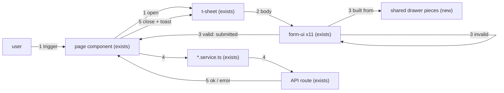
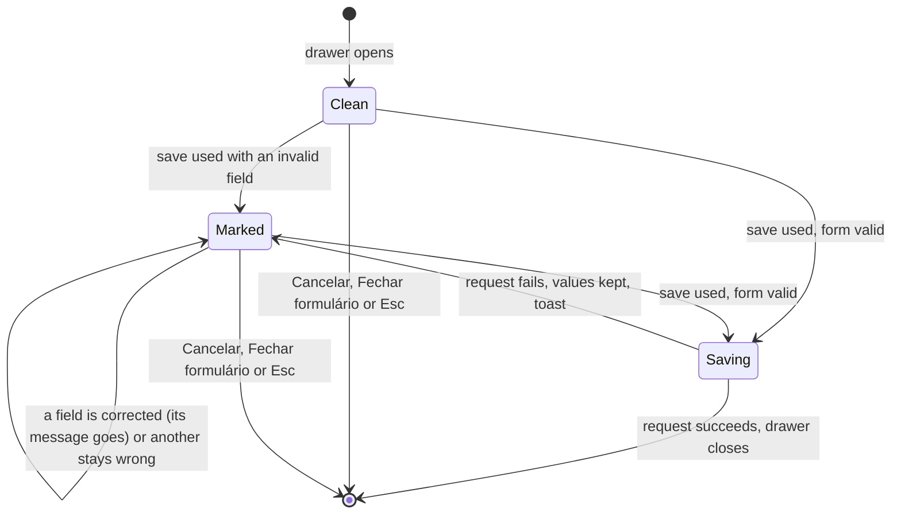
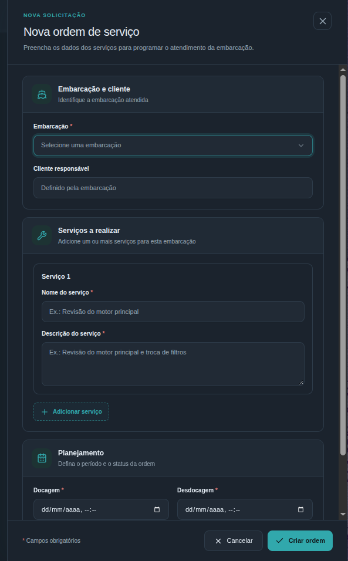
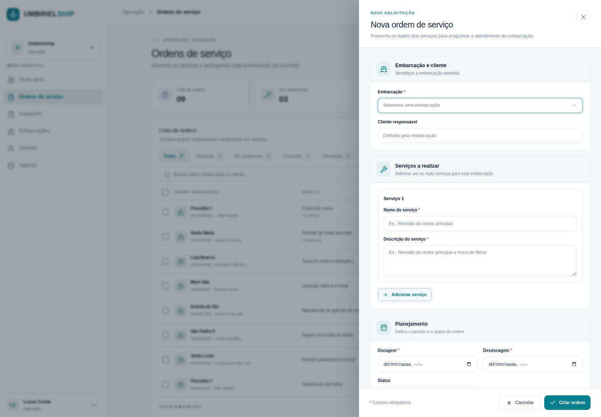

# Drawer standard after "Nova ordem de serviço"

**Approved**: 2026-11-17 - user: "Aprovo o plano"

> Build this with **tlc-implement**. Every criterion becomes a check with a proof; nothing under
> the open questions is settled while building.

## Problem

The web has 15 drawers (`t-sheet`), opened in 18 ways and filled by 11 form components, and they are
built in five different ways. Widths run from 448px to 590px. The WorkOrder, Vessel and "Novo serviço"
drawers have the grey body of cards and a pinned footer; the Customer drawer has a smaller header, flat
sections and its own footer sentence ("Campos com * são obrigatórios"); the template and assignment
drawers of the Inspections hub are white forms whose buttons follow the last field; the Agenda drawer is
a column of loose fields; and "Nova organização", "Novo usuário", "Novo convite" and "Atribuir modelo de
inspeção" still carry the look from before the mareos palette, with no kicker and default-size buttons.
The save button reads "Salvar", "Enviar", "Atribuir", "Cadastrar cliente" or "Salvar embarcação", with a
plus icon in five drawers, a check in four and nothing in three; "Cancelar" has the X icon in four forms
of eleven. Validation differs too: the identity drawers disable "Salvar" while the form is invalid with
no reason shown, "Novo serviço" and the Agenda list every error at the end of the form, and the WorkOrder
drawer shows each message under its field. Someone who creates a WorkOrder and then a Customer meets two
different forms for the same kind of task. The evidence is the user's request and the capture of the
WorkOrder drawer they sent; there is no other.

When this ships, every drawer opens 580px wide with the same header, a grey body of cards with icons, red
asterisks on required fields and the same pinned footer: "* Campos obrigatórios", "Cancelar" with an X
and a save button with a check whose label says what it does; using it with an invalid field sends
nothing and shows the message under each wrong field, as the WorkOrder drawer does today.

## Shape

This reuses the "Nova ordem de serviço" drawer as it is (`work-order-form-ui` in its `t-sheet`): its
card, card header, icon tile, field label, field, textarea and footer, which today are class strings
private to `work-order-form.ts` and copied by hand into `vessel-form.ts` and
`work-order-service-form.ts`, become shared pieces under `web/src/package/shared/components/ui` (prefix
`t-` / `t`, AD-012) that all 11 forms use, and `t-sheet` takes the 580px width so no page passes its
own. The rules that change what a user sees - when the save button is enabled, when a field turns red
and shows its message, which label and icon the button carries - run in the form components and the
shared pieces, reached by the specs under `web/src/package/**/__test__/` (`npm test`).

1. a user uses a drawer's trigger on its page -> page component (exists, 10 pages) - opens `t-sheet` (exists) with the kicker, title and description of its row in the S1 table
2. `t-sheet` (exists) - header, close button "Fechar formulário", 580px from `sm`, focuses the form's first field that accepts input once it opens (the forms' own focus helpers go), hands its body to the form
3. `<form>-form-ui` (exists, 11) built from the shared drawer pieces (new) - cards, labels, red `*`, the pinned footer; on save it checks the form: invalid -> marks every invalid field with its message and sends nothing; valid -> emits the request
4. page component (exists) -> its `*.service.ts` (exists) -> the API route it calls today (unchanged) - the save button shows "Salvando..." while the request runs
5. out: on success the drawer closes and the page shows its toast and refreshed list as today; on failure the drawer stays with its values and the page shows its error toast (AD-026)

The save button moves through these states in every drawer:

`Saving` is the only state with the save button disabled. A request that fails returns to an enabled
button with every value kept; the API's answer is shown by the page's toast, not under a field.

Data: none - the change is the web's presentation and form behaviour; no route, payload or stored
record changes.

**Changes underneath**

| Front | What changes |
| --- | --- |
| domain | nothing - no term changes meaning |
| stored data | nothing to migrate |
| readers | the 10 pages that open drawers: `work-order-list`, `work-order-detail`, `vessel-list`, `vessel-detail`, `customer-list`, `agenda`, `inspections-hub`, `inspection-template-detail`, `organization-list`, `organization-detail`; `organization-list` and `organization-detail` gain a saving state to pass to their forms (criterion 8), and `organization-list` resets its form when the drawer opens (criterion 28) |
| shared UI | `t-sheet` takes 580px from `sm` as its width, and its `compact` header loses its only caller (the Customer drawer) and goes; `t-form-group` shows a touched field's errors today, which inside a drawer would show red and a message on leaving an empty field, against criterion 24; forms outside drawers keep today's behaviour |
| validation | the identity forms stop disabling "Salvar" while invalid (`organization-form`, `user-form`); `work-order-service-form` and `appointment-form` stop listing errors at the end of the form; `customer-form`, `vessel-form`, `inspection-template-form`, both assignment forms and the identity forms gain per-field messages after the first save attempt (criteria 22 to 26) |
| specs | specs that pin the old copy or behaviour are updated in the same change, among them `customer-list.spec.ts` ("Cadastrar cliente", "Campos com * são obrigatórios"), `vessel-list.spec.ts` ("Salvar embarcação"), `organization-form.spec.ts` and `user-form.spec.ts` (the save button disabled while invalid), `inspection-template-form.spec.ts` (the "Adicionar" button above the questions), `organization-list.spec.ts` and `organization-detail.spec.ts` ("Salvar", "Enviar"), `work-order-detail.spec.ts` ("Salvar", "Atribuir") and `agenda.spec.ts` (the error list) |
| earlier plans | the drawer layouts, labels and icons fixed by `customer-ui-redesign` and `work-order-ui-redesign` for these drawers are superseded by AD-053, AD-054, AD-056, AD-057 and AD-058; their other criteria stand |

## Surface

None - nothing consumed outside the web changes; every drawer calls the route and sends the payload it
sends today.

## Landing

None - every change is a template, a style or a component input inside the web, undone by a revert; no
schema, no consumed contract, no backfill, and no dependency (`@ng-icons/lucide` already provides
`lucideX`, `lucideCheck`, `lucideLoader2` and the card icons).

## Criteria

### S1: Every drawer in the frame of "Nova ordem de serviço" (P1)

All 18 ways of opening a drawer show the same frame, size, cards, footer and buttons, in both themes.

The drawers - the kicker, title and save label each one shows:

| # | Page | Opened by | Kicker | Title | Save button |
| --- | --- | --- | --- | --- | --- |
| D1 | `/work-orders` | "Nova ordem de serviço" | NOVA SOLICITAÇÃO | Nova ordem de serviço | Criar ordem |
| D2 | `/work-orders` | row menu "Editar" | ORDEM DE SERVIÇO | Editar ordem de serviço | Salvar alterações |
| D3 | `/vessels/:id` | "Nova ordem" | NOVA SOLICITAÇÃO | Nova ordem de serviço | Criar ordem |
| D4 | `/work-orders/:id` | "Editar" | ORDEM DE SERVIÇO | Editar ordem de serviço | Salvar alterações |
| D5 | `/work-orders/:id` | "Novo serviço" | ORDEM DE SERVIÇO | Novo serviço | Criar serviço |
| D6 | `/work-orders/:id` | "Atribuir modelo" | ATRIBUIR INSPEÇÃO | Atribuir modelo de inspeção | Atribuir inspeção |
| D7 | `/vessels` | "Nova embarcação" | FROTA / EMBARCAÇÕES | Nova embarcação | Criar embarcação |
| D8 | `/vessels` | row "Editar" | FROTA / EMBARCAÇÕES | Editar embarcação | Salvar alterações |
| D9 | `/vessels/:id` | "Editar" | FROTA / EMBARCAÇÕES | Editar embarcação | Salvar alterações |
| D10 | `/customers` | "Novo cliente" | RELACIONAMENTO / CLIENTES | Novo cliente | Criar cliente |
| D11 | `/customers` | row "Editar" | RELACIONAMENTO / CLIENTES | Editar cliente | Salvar alterações |
| D12 | `/agenda` | "Novo compromisso", "Adicionar horário", "Adicionar à agenda" | NOVO COMPROMISSO | Adicionar à agenda | Agendar serviço |
| D13 | `/inspections` | "Novo modelo" | BIBLIOTECA DE INSPEÇÕES | Novo modelo | Criar modelo |
| D14 | `/inspection-templates/:id` | "Editar" | BIBLIOTECA DE INSPEÇÕES | Editar modelo | Salvar alterações |
| D15 | `/inspections` | a template card's "Atribuir à OS" | ATRIBUIR INSPEÇÃO | Escolha a OS e o alvo | Atribuir inspeção |
| D16 | `/organizations` | "Nova Organização" | GESTÃO / ORGANIZAÇÕES | Nova organização | Criar organização |
| D17 | `/organizations/:id` | "Novo usuário" | ORGANIZAÇÃO / USUÁRIOS | Novo usuário | Criar usuário |
| D18 | `/organizations/:id` | "Novo convite" | ORGANIZAÇÃO / CONVITES | Novo convite | Enviar convite |

Descriptions stay as each drawer writes them today.

**Acceptance Criteria**

1. WHEN a user opens any drawer D1 to D18 THEN the system SHALL show it in the frame of
   `.specs/features/drawer-standard/captures/work-order-drawer.light.png` in the light theme and
   `.specs/features/drawer-standard/captures/work-order-drawer.dark.png` in the dark theme: the header
   with the kicker, title and description of its row at the reference's size (no smaller header), the
   close button labelled "Fechar formulário", the grey body of cards and the pinned footer
2. WHILE the window is at least 640px wide, every drawer SHALL be 580px wide; below 640px it SHALL fill
   the window's width with no horizontal scroll
   - 1280px window → 580px; 640px → 580px; 639px → 639px; 375px → 375px, footer buttons fully visible
3. The system SHALL place every field of a drawer in a card of the reference: a header with a 34px icon tile, the
   card's title and subtitle (S2), and a body holding the fields; the cards stack in the grey body,
   which scrolls while the drawer's header and footer stay in view
   - D13 with 20 questions in a 1280x800 window → the body scrolls, "Criar modelo" stays visible
4. The system SHALL draw every field label in the reference's style (10px, semibold), with a red `*`
   after the label of a field the form requires that opens empty, and none on a select that always
   holds a value
   - "Nome do cliente *", "Nome do modelo *", "Enunciado *", "Usuário *", "Modelo *", "Ordem de serviço *" → star; "Status", "Papel", "Alvo", "Tipo de resposta" → no star
5. The footer of every drawer that shows fields SHALL show "* Campos obrigatórios" on the left and, on
   the right, "Cancelar" followed by the save button of its row
   - D10 today "Campos com * são obrigatórios" → "* Campos obrigatórios"; D12 today no sentence → "* Campos obrigatórios"
6. The system SHALL draw "Cancelar" in every drawer as the reference's outline button, 35px high, with
   the `lucideX` icon before the word; WHEN a user uses it THEN the drawer SHALL close and send no
   request
7. The save button SHALL be the reference's primary button, 35px high, with the `lucideCheck` icon
   before the label of its row; no drawer SHALL show `lucidePlus` or no icon on its save button
   - D10 "Cadastrar cliente" with a plus → "Criar cliente" with a check; D18 "Enviar" with no icon → "Enviar convite" with a check
8. WHILE a drawer's request runs, its save button SHALL be disabled and show the spinning
   `lucideLoader2` and "Salvando..." in every drawer, D16, D17 and D18 included
9. WHEN a drawer opens THEN focus SHALL be on its first field that accepts input
   - D1 → "Embarcação"; D3 (Vessel locked) → "Nome do serviço"; D4 (Vessel locked) → "Docagem"; D10 → "Nome do cliente"; D12 → "Ordem de serviço"; D16 → "Nome"
10. WHILE the dark theme is on, every drawer SHALL show the reference's dark colours - grey body, card
    header, icon tile and footer - as `work-order-drawer.dark.png` draws them; WHILE the light theme is
    on, as `work-order-drawer.light.png` draws them

### S2: Each drawer's cards and copy (P1)

The drawers that are not the reference take the cards, kickers and labels the user approved (AD-054,
AD-056, AD-058). D1 to D4 keep their cards as they are.

**Acceptance Criteria**

11. WHEN a user opens D10 or D11 THEN the system SHALL show the card "Dados do cliente" (building-2
    icon, "Identificação e formas de contato") with "Nome do cliente *", "E-mail *" and "Telefone para
    contato *", and the card "Endereço" (map-pin icon, "Localização do cliente") with "Rua e número *",
    "Cidade *" and "Estado (UF) *"
12. WHEN a user opens D7, D8 or D9 THEN the system SHALL show the cards "Detalhes da embarcação" and
    "Tipo e comprimento" with today's fields and rules (AD-028)
13. WHEN a user opens D5 THEN the system SHALL show the card "Serviço" (wrench icon, "Identifique o
    serviço a realizar") with "Nome *" and "Descrição *", a multi-line field with no length limit, and
    the card "Planejamento" (calendar-days icon, "Defina o período e o status do serviço") with "Início
    *", "Fim *" and "Status"
14. WHEN a user opens D12 THEN the system SHALL show the card "Serviço" (wrench icon, "Escolha a ordem e
    descreva o serviço") with "Ordem de serviço *", "Serviço *" and "Descrição *", a multi-line field
    with no length limit, and the card "Planejamento" (calendar-days icon, "Defina o início e o fim do
    serviço") with "Início *" and "Fim *"; a drawer opened from a cell keeps that cell's day and hour
    in "Início" (AD-037)
15. WHEN a user opens D13 or D14 THEN the system SHALL show the card "Modelo" (clipboard-list icon,
    "Identifique o modelo de inspeção") with "Nome do modelo *", and the card "Perguntas" (list-checks
    icon, "Todas as perguntas precisam ser respondidas; “Não se aplica” vale como resposta.") holding
    one bordered block per question, titled "Pergunta 01", "Pergunta 02"…, each with "Enunciado *" and
    "Tipo de resposta", and a dashed "Adicionar pergunta" button under the last block; the "Adicionar"
    button above the questions is gone
16. WHEN a user uses "Adicionar pergunta" THEN the system SHALL add a block at the end, numbered after
    the last, with an empty "Enunciado" and "Texto livre"; WHILE the template holds 100 questions,
    "Adicionar pergunta" SHALL be disabled
    - 1 question → "Pergunta 02" added; 99 → 100th added, button disabled; 100 → nothing added
17. WHILE a template holds two or more questions, each block SHALL show "Subir", "Descer" and "Remover
    pergunta <n>" with the trash icon (AD-051); WHILE it holds one, none of them
18. WHEN a user opens D15 THEN the system SHALL show the card "Atribuição" (clipboard-check icon,
    "Escolha a ordem de serviço e o alvo") with "Ordem de serviço *", "Alvo" and, inside the same card,
    the template's question count ("1 pergunta", "3 perguntas")
19. WHEN a user opens D6 THEN the system SHALL show the kicker "ATRIBUIR INSPEÇÃO" and the card
    "Atribuição" (clipboard-check icon, "Escolha o modelo e o alvo") with "Modelo *" and "Alvo"
20. IF D6 opens and the templates failed to load, or the Organization has none, THEN the body SHALL
    show the message ("Nenhum modelo de inspeção cadastrado" or the load error) inside a card and the
    footer SHALL show only "Cancelar", with no "* Campos obrigatórios" and no save button
21. WHEN a user opens D16 THEN the system SHALL show the card "Detalhes da organização" (building-2
    icon, "Informações básicas sobre a organização") with "Nome *" and "E-mail *"
22. WHEN a user opens D17 THEN the system SHALL show the card "Detalhes do usuário" (user icon,
    "Informações básicas sobre o usuário") with "Nome *" and "E-mail *", and the card "Acesso" (shield
    icon, "Senha e papel do usuário na organização") with "Senha *" and "Papel"
23. WHEN a user opens D18 THEN the system SHALL show the card "Convite" (send icon, "Quem será
    convidado e com qual papel") with "Usuário *" and "Papel"

### S3: Every drawer validates as the WorkOrder drawer (P1)

The save button is never blocked by an invalid form; using it shows what is wrong, under each field
(AD-057).

**Acceptance Criteria**

24. WHILE no request runs, the save button of every drawer SHALL be enabled, whatever its fields hold
    - D16 opened empty → "Criar organização" enabled (today disabled); D17 with a 5-character password → "Criar usuário" enabled
25. WHILE the save button has not been used since the drawer opened, no field SHALL be red and no
    message SHALL show
    - focus "Nome" in D16 and leave it empty → nothing red, no message
26. IF a user uses the save button while a field is invalid THEN the drawer SHALL send no request and
    each invalid field SHALL turn red and show exactly one message beneath it, the form's own message;
    no list of errors SHALL show elsewhere in the drawer
    - D16 empty → "Nome é obrigatório" and "E-mail é obrigatório" under their fields
    - D17 password "12345" and the rest valid → only "Senha deve ter no mínimo 8 caracteres", under "Senha"
    - D10 e-mail "ana@" and the rest valid → only "E-mail inválido", under "E-mail"
    - D12 empty → five messages, each under its field, none at the end of the form
    - D13 with a 101-character name → "Nome deve ter no máximo 100 caracteres" under "Nome do modelo"
27. WHEN, after a save attempt, a user corrects an invalid field THEN that field's red and message SHALL
    go at once while the other invalid fields keep theirs
28. WHEN a drawer is closed and opened again THEN it SHALL show no red field and no message
29. WHEN a user uses the save button with every field valid THEN the drawer SHALL send the request it
    sends today, with the same payload, once

## Out of scope

| Excluded | Why |
| --- | --- |
| The confirmation dialog (`t-confirmation`) and its buttons | it is a dialog, not a drawer; the request names drawers |
| Forms outside drawers (sign-in, invitation acceptance, the inspection page) | not drawers; they keep today's validation and buttons |
| Blocking "Salvar alterações" while nothing changed | a capability nobody asked for |
| Restyling the organization pages around their drawers (titles, "Nova Organização" button) | only the drawers are in the request |
| A length limit on "Descrição" in D5 and D12 | the field becomes multi-line only; the API sets no limit and adding one is a new rule |
| Showing the API's error (409 and others) under a field | AD-026 keeps toasts for API errors |

## Assumptions

| Assumption | Chosen default | Rationale | Confirmed? |
| --- | --- | --- | --- |
| The kickers already on D1-D5, D7-D15 | kept as they are | the user named only the missing ones (AD-056) | n |
| The close button's label on D12 ("Fechar"), D10 ("Fechar cadastro") and D15 ("Fechar atribuição") | "Fechar formulário" in every drawer, as the reference | it is the reference's label and part of the frame; it is read by screen readers only | n |
| Focus on open (criterion 9) | every drawer focuses its first field that accepts input, as the reference does on open | the reference drawer does it; three drawers already do | n |
| Descriptions of the drawers | kept word for word, including the identity ones without a final period | the user changed no description | n |

**Open questions:** none - all resolved or logged above.

## Differences from the source

| Source shows | Product shows | Confirmed |
| --- | --- | --- |
| The customer drawer of `customer-ui-redesign/captures/customer-drawer.jpg`: smaller header, flat sections, "Campos com * são obrigatórios", plus icon on "Cadastrar cliente" | the reference frame with cards, "* Campos obrigatórios", check icon on "Criar cliente" | y - AD-053, AD-054 |
| The template and assignment drawers of `work-order-ui-redesign/captures/inspection-template-drawer.png` and `inspection-assignment-drawer.png`: white form, buttons after the fields, plus icon, "Adicionar" above the questions | the reference frame with cards and pinned footer, check icon, dashed "Adicionar pergunta" under the questions | y - AD-053, AD-056 |
| "Salvar embarcação" (customer-ui-redesign) | "Criar embarcação" | y - AD-054 |
| Widths of 448, 460, 500, 520, 560 and 590px | 580px for every drawer | y - AD-053 |

The two captures of this feature are matched as drawn.

## Sources

- User request (2026-11-17): "planejar a padronização de todos os drawers de acordo com o drawer de criar nova ordem de serviço. padroniza também os botões de ações de drawer como cancelar e salvar. no botão cancelar adicione o icon lucideX e no botão de salvar adicione o icone lucideCheck." - binding - the scope and the two icons
-  - binding - the capture the user sent: "Nova ordem de serviço" in the dark theme, 593x956
-  - binding - the same running drawer in the light theme, taken for `work-order-ui-redesign` at the 1440x1000 window
- `web/src/package/work-order/work-order/components/work-order-form.ts` and its `t-sheet` in `work-order-list.html` at 16aa2a2 - binding - the reference's classes, sizes and behaviour, which the captures show
- `.specs/STATE.md` AD-053 to AD-058 - the user's answers to the questions of this plan
