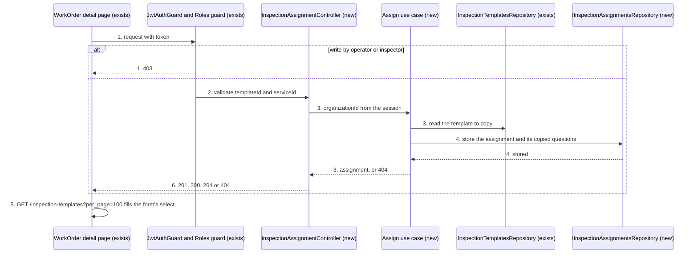
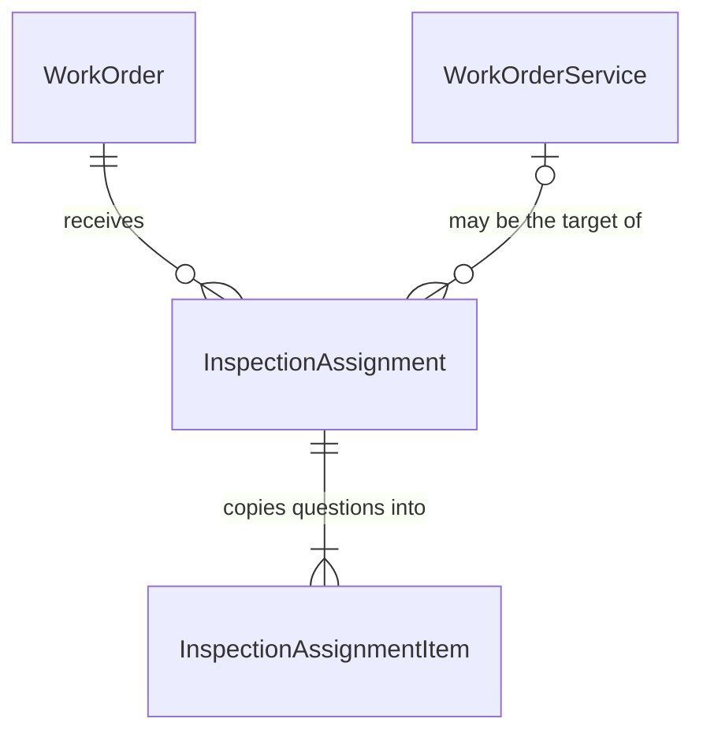

# InspectionAssignment

**Approved**: 2026-11-14 - user: "Aprovo o plano"

> Build this with **tlc-implement**. Every criterion becomes a check with a proof; nothing under
> the open questions is settled while building.

## Problem

An Organization can now write checklists ("Modelos de inspeção"), but a checklist is not tied to
any work: nothing records that a WorkOrder, or one of its WorkOrderServices, is to be inspected
against a given checklist, and an edit to the checklist would change what such a record means. The
inspection design (`.design/inspection.md`) needs that link before an inspector can answer anything.
The source gives no usage evidence; the product is not in use yet.

When this ships, an Administrator opens a WorkOrder, picks a "Modelo de inspeção" and, optionally,
one of its services, and the WorkOrder shows that assignment with a frozen copy of the questions.
Everybody in the Organization sees the assignments of a WorkOrder; only an Administrator assigns or
removes them.

## Shape

This reuses the `work-order` context (D1), the InspectionTemplate aggregate and its repository to
read the template being copied, the WorkOrder and WorkOrderService repositories to check the
target, the Roles guard with `@Roles('administrator')` (AD-017), and the WorkOrder detail page with
its sheet and confirmation components. The rules that change what a user sees - who may write, the
copy of the questions, the target check, the order of the list - run in the API use cases, reached
by the Vitest specs in `api/`; the web decides only which controls it renders, reached by `ng test`.

1. A request with a token -> `JwtAuthGuard` and the Roles guard (exists) - a write by a Role other than `administrator` answers 403 before validation or any read
2. `InspectionAssignmentController` (new) in `work-order` - validates `templateId` and the optional `serviceId` with Zod and calls one use case per handler
3. Assign use case (new) - reads the WorkOrder (`IWorkOrdersRepository`, exists), the WorkOrderService when given (`IWorkOrderServicesRepository`, exists; it must belong to that WorkOrder) and the template (`IInspectionTemplatesRepository`, exists), all filtered by the session's `organizationId`, and copies the template's name and questions
4. `IInspectionAssignmentsRepository` (new) - persists the assignments and their copied questions (door 1), and lists a WorkOrder's assignments newest first with the target service's current name
5. `GET /inspection-templates` (exists) gains `per_page` (door 2) so the assignment form can list up to 100 templates
6. out: the assignment with its copied questions, the WorkOrder's assignments, or 204; the WorkOrder detail page (exists) gains an "Inspeções" section that reads them

**Changes underneath**

| Front | What changes |
| --- | --- |
| domain | `InspectionAssignment` is a new term; nothing branches on it today. `CONTEXT.md` gains its entry |
| stored data | nothing to migrate - two new tables, empty. Deleting a WorkOrder or a WorkOrderService now also deletes its assignments (D5: an assignment alone protects nothing) |
| readers | the WorkOrder detail page gains the "Inspeções" section; `GET /inspection-templates` gains `per_page` (default 10), so the "Modelos de inspeção" list keeps 10 per page; `api/test/layout.spec.ts` learns the three routes and the new aggregate |

New: `InspectionAssignment` and `InspectionAssignmentItem`. No relation to `InspectionTemplate`: the
assignment holds a copy (D3). One-way constraints: an assignment is deleted with its WorkOrder or
its WorkOrderService, and its items with it (door 1).

## Surface

| Route | In | Out | Status | Who |
| --- | --- | --- | --- | --- |
| `POST /work-orders/:workOrderId/inspection-assignments` | `{ templateId, serviceId? }` | `inspectionAssignment: { id, templateName, service: { id, name } or null, createdAt, items: [{ id, label, position }] }` | `201`, `400`, `401`, `403`, `404` | `administrator`; `operator` and `inspector` 403; a WorkOrder, template or service of another Organization 404 |
| `GET /work-orders/:workOrderId/inspection-assignments` | - | `inspectionAssignments`: the same shape, newest first | `200`, `401`, `404` | every Role; a WorkOrder of another Organization 404 |
| `DELETE /work-orders/:workOrderId/inspection-assignments/:id` | - | - | `204`, `401`, `403`, `404` | `administrator`; the rest 403; an assignment of another WorkOrder or Organization 404 |
| `GET /inspection-templates` | `per_page` added, 1 to 100, default 10 | as today | `200`, `400`, `401` | every Role, as today |

## Landing

| One-way door | Literal shape | Alternative rejected |
| --- | --- | --- |
| 1. Two persisted tables | `inspection_assignments` (`id` uuid, `organizationId`, `workOrderId` FK to `work_orders` `onDelete: Cascade`, `workOrderServiceId` nullable FK to `work_order_services` `onDelete: Cascade`, `templateName` text, `assignedBy` text (a plain User id, no FK: User belongs to `identity`), `createdAt` default now, indexes on `organizationId` and `workOrderId`) and `inspection_assignment_items` (`id` uuid, `organizationId`, `assignmentId` FK `onDelete: Cascade`, `label`, `position` int from 0, `@@unique([assignmentId, position])`, index on `organizationId`), through `npx prisma migrate dev --name add-inspection-assignments` | A `templateId` reference read at display time - an edit or delete of the template would change or erase what the WorkOrder was to be inspected against (D3) |
| 2. A query parameter a consumer binds to | `GET /inspection-templates?per_page=N`, integer 1 to 100, default 10; `page` keeps its meaning with the new page size | A separate unpaged route - a second read of the same list with its own rules |

- Nothing else in this change is hard to reverse

## Criteria

### S1: An Administrator assigns templates to a WorkOrder through the API (P1)

An Administrator assigns a template to a WorkOrder or one of its services; every Role reads the assignments; the rest are refused.

**Acceptance Criteria**

1. WHEN an `administrator` calls `POST /work-orders/:workOrderId/inspection-assignments` with a `templateId` of the Organization THEN the system SHALL answer 201 with the assignment, whose `templateName` and `items` (`label`, `position` 0, 1, 2...) are a copy of the template's at that moment, `service: null`, and `createdAt`, and SHALL store the session User's id as who assigned it
2. WHEN the body also has a `serviceId` of a WorkOrderService of that WorkOrder THEN the assignment SHALL have `service: { id, name }` of that service
3. The system SHALL accept the assignment whatever the status of the WorkOrder and of the WorkOrderService
   - `PENDING`, `IN_PROGRESS`, `COMPLETED` and `CANCELLED` WorkOrders → 201
4. WHEN the same template is assigned twice to the same target THEN the system SHALL store two assignments
5. WHEN the template is edited or deleted after the assignment THEN `GET` SHALL return the assignment with the name and questions it copied
   - template edited from `[A,B]` to `[C]` → the assignment still has A at 0 and B at 1; template deleted → the assignment is unchanged
6. IF the WorkOrder, the template or the WorkOrderService is unknown or belongs to another Organization, or the WorkOrderService belongs to another WorkOrder, THEN `POST` SHALL answer 404 and store nothing
7. IF `templateId` is missing or not a uuid, or `serviceId` is present and not a uuid, THEN `POST` SHALL answer 400 and store nothing
8. WHEN any Role calls `GET /work-orders/:workOrderId/inspection-assignments` THEN the system SHALL answer the WorkOrder's assignments ordered by `createdAt` descending, ties by `id`, each with its items ordered by `position`, and `service.name` as the service is named now
   - a WorkOrder with none → `inspectionAssignments: []`; assignments of another WorkOrder are not listed
9. IF the WorkOrder of `GET` is unknown or belongs to another Organization THEN the system SHALL answer 404
10. WHEN an `administrator` calls `DELETE /work-orders/:workOrderId/inspection-assignments/:id` THEN the system SHALL answer 204, and the assignment and its items SHALL no longer be returned
11. IF the assignment of `DELETE` is unknown, belongs to another WorkOrder or to another Organization THEN the system SHALL answer 404 and delete nothing
12. IF an `operator` or an `inspector` calls `POST` or `DELETE` on the assignment routes THEN the system SHALL answer 403 with `statusCode: 403` and `message: "Forbidden"`, before validation, and write nothing
13. WHEN a WorkOrder or a WorkOrderService that has assignments is deleted THEN its assignments and their items SHALL be deleted with it, and the delete SHALL answer as today
14. WHEN any Role calls `GET /inspection-templates?per_page=N` THEN the system SHALL answer up to N templates per page, newest first, with `total`; without `per_page` it SHALL answer 10 per page as today
    - `per_page=100` with 101 templates → 100, then 1 on `page=2`; `per_page=0` → 400; `per_page=101` → 400
15. The test suite SHALL fail when a write handler under `work-order` declares no Roles, and SHALL list the three new routes among the routes of today
16. The `CONTEXT.md` SHALL have an `InspectionAssignment` entry: a copy of a template's name and questions placed on one WorkOrder, with or without a target WorkOrderService, written only by an `administrator`, unchanged by later edits of the template, and deleted with its WorkOrder or WorkOrderService

### S2: The WorkOrder page shows and manages its assignments (P2)

Everybody sees the assignments of a WorkOrder; an Administrator assigns and removes them.

**Acceptance Criteria**

17. WHEN a User of any Role opens `/work-orders/:id` THEN the page SHALL show a section "Inspeções" listing the WorkOrder's assignments newest first, each with the template name, the target ("Ordem de serviço inteira" or the service's name) and its number of questions
18. WHILE the WorkOrder has no assignment, the section SHALL show "Nenhum modelo atribuído"
19. WHEN a User uses an assignment's summary THEN it SHALL expand to show the copied questions numbered from 1 in `position` order, and using it again SHALL collapse them
20. WHILE the session's Role is `administrator`, the section SHALL render "Atribuir modelo" and a "Remover" control on each assignment; WHILE it is `operator`, `inspector` or not loaded yet, it SHALL render neither
21. WHEN an Administrator uses "Atribuir modelo" THEN a sheet "Atribuir modelo de inspeção" SHALL open with a "Modelo" select listing the Organization's templates newest first (from `GET /inspection-templates?per_page=100`) and an "Alvo" select whose first option is "Ordem de serviço inteira", selected, followed by each service of the WorkOrder by name
22. WHILE the Organization has no template, the sheet SHALL show "Nenhum modelo de inspeção cadastrado" and send nothing
23. IF no template is chosen THEN the form SHALL show "Modelo é obrigatório" and send nothing
24. WHEN an Administrator submits the form THEN the web SHALL send `POST` with `templateId`, and `serviceId` only when a service was chosen, close the sheet, show "Modelo atribuído com sucesso" and request the assignments again, so the new one shows first
25. WHEN an Administrator uses "Remover" on an assignment THEN a confirmation "Remover atribuição" SHALL ask "Tem certeza que deseja remover esta atribuição? As perguntas copiadas serão excluídas."; confirming SHALL send `DELETE`, show "Atribuição removida com sucesso" and request the assignments again; cancelling SHALL send nothing
26. IF `POST` or `DELETE` fails THEN the page SHALL show the error message the shared API error helper gives, and the assignments SHALL stay as they were
27. WHILE the window is 375 px wide, the WorkOrder page with an expanded assignment, the assignment sheet and the confirmation SHALL show every control and question without horizontal page scroll

## Out of scope

| Excluded | Why |
| --- | --- |
| Completing, reading or discarding Inspections, and the 409 when removing an inspected assignment | The Inspection slice of `.design/inspection.md` |
| Refusing the delete of an inspected WorkOrder or WorkOrderService | The WorkOrder deletion slice |
| Showing who assigned and when | Design default 1: stored for audit, not shown |
| Editing an assignment, or refreshing its copy from the template | D3: the copy is frozen; remove and assign again |
| Searching templates by name in the form | user chose "Select com até 100 (Recomendado)" |
| Grouping assignments by target | user chose "Mais recentes primeiro (Recomendado)" |

## Assumptions

| Assumption | Chosen default | Rationale | Confirmed? |
| --- | --- | --- | --- |
| How the template is chosen | A select with up to 100 templates, newest first, from `per_page=100` | user: "Select com até 100 (Recomendado)" | y |
| What an assignment shows | Template name, target and question count; a tap expands the numbered questions | user: "Resumo + expandir (Recomendado)" | y |
| Order of the assignments | `createdAt` descending, ties by `id` | user: "Mais recentes primeiro (Recomendado)" | y |
| Removing an assignment | "Remover" opens a confirmation | user: "Com confirmação (Recomendado)" | y |
| Who assigned and when | Stored as a plain User id (`assignedBy`) and `createdAt`; `assignedBy` is not returned | Design default 1 | y |
| A WorkOrderService deleted while its assignment has no Inspection | The assignment is deleted with it | Design default 2, D5 | y |
| Copy of the section, sheet, toasts and confirmation | The strings in criteria 17 to 25 | Follow the app's "… com sucesso" pattern and the design's vocabulary | n |
| Where the section sits | Below "Serviços" on the WorkOrder detail page | The assignment can target a service, so it reads after them | n |
| Target name shown | The service's current name, read on every `GET` | The service is in the same context and can be renamed; the copy rule (D3) covers the template only | n |
| The form's select when there are more than 100 templates | The 100 newest are listed | Consequence of the chosen option | n |

**Open questions:** none - all resolved or logged above.

## Differences from the source

None - the product matches the source

## Sources

- `.design/inspection.md`, slice `InspectionAssignment` and decisions D1, D2, D3, D5 - binding - the entity, its routes, who writes, the frozen copy and the cascade with its WorkOrder or service
- `.specs/STATE.md` AD-002 (organization-scoped data, no cross-context FK), AD-004 (web conventions), AD-017 (Roles gate tenant writes), AD-018 (many Inspections per assignment, owned by the Inspection slice) - binding - the decisions this conforms to
- `.specs/features/inspection-template/plan.md` - binding - the template routes and limits this reads and extends with `per_page`
