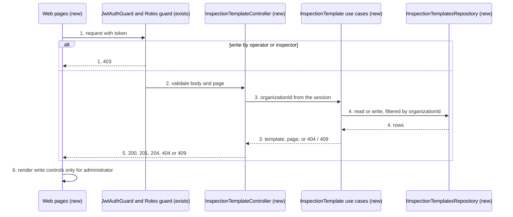
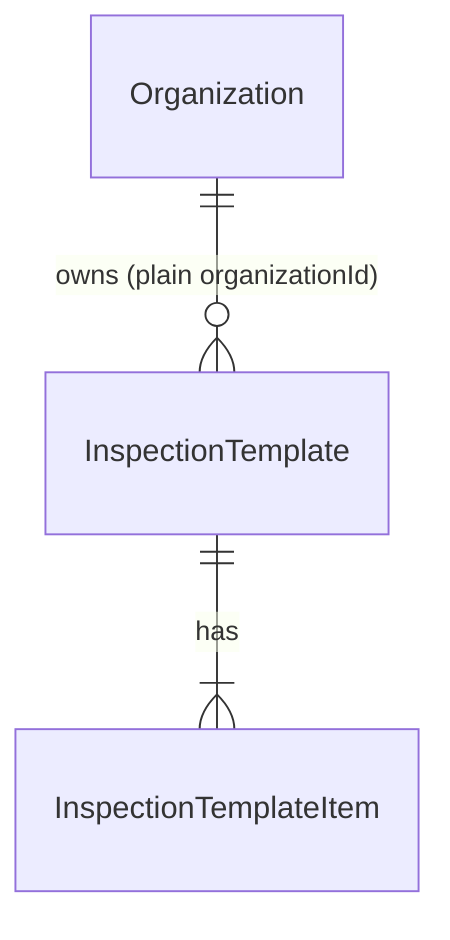

# InspectionTemplate

**Approved**: 2026-11-14 - user: "Aprovo o plano"

> Build this with **tlc-implement**. Every criterion becomes a check with a proof; nothing under
> the open questions is settled while building.

## Problem

An Organization that checks the work done on a Vessel keeps its checklists outside the app, on
paper or in a spreadsheet, so nothing in the record of a WorkOrder says which questions a check is
meant to answer. The inspection design (`.design/inspection.md`) needs those checklists inside the
app before one can be assigned to a WorkOrder or answered by an inspector, and today there is
nowhere to write one. The source gives no usage evidence; the product is not in use yet.

When this ships, an Administrator of an Organization opens "Modelos de inspeção", writes a named
checklist of ordered questions, edits it or deletes it, and everybody in the Organization can open
the list and read each checklist's questions. Operators and inspectors find no control that
changes them, and the API refuses their writes with 403.

## Shape

This reuses the `work-order` context (design D1), the Roles guard and `@Roles` the inspector slice
added (AD-017), the page and pagination conventions of Customers, and the sheet and confirmation
components of the web. The rules that change what a user sees - who may write, the name
uniqueness, the question limits, the order of the list and the order of the questions - run in
the API use cases and their Zod schemas, reached by the Vitest specs in `api/`; the web decides
only which controls it renders, reached by `ng test`.

1. A request with a token -> `JwtAuthGuard` (exists) and the Roles guard (exists) - a write by a Role other than `administrator` answers 403 before validation or any read
2. `InspectionTemplateController` (new) in `work-order` - validates the body and the page with Zod and calls one use case per handler
3. InspectionTemplate use cases (new) - take `organizationId` from the session, refuse a duplicate name with 409 and an id of another Organization with 404, and replace the whole question list on edit
4. `IInspectionTemplatesRepository` (new) - persists the templates and their questions (door 1), filtered by `organizationId`
5. out: the template with its questions in `position` order, a page of templates ordered by `createdAt` descending, or 204
6. Web "Modelos de inspeção" list and detail pages (new) - read through `httpResource`; render create, edit and delete controls only when the session's Role is `administrator`

**Changes underneath**

| Front | What changes |
| --- | --- |
| domain | `InspectionTemplate` is a new term; nothing branches on it today. `CONTEXT.md` gains its entry |
| stored data | nothing to migrate - two new tables, empty |
| readers | the layout menu gains a link, and the layout header wraps so a page fits 375 px (C29); `api/test/layout.spec.ts` lists the routes of today (C32) and requires every write handler under `work-order` to declare Roles (inspector C15), and both learn the new handlers |

New: `InspectionTemplate` and `InspectionTemplateItem`, a template has 1 to 100 items. One-way
constraints: the name is unique per Organization without case, and the items are deleted with
their template (door 1).

## Surface

| Route | In | Out | Status | Who |
| --- | --- | --- | --- | --- |
| `GET /inspection-templates` | query `page` (default 1) | `inspectionTemplates: [{ id, name, itemCount, createdAt }]`, `total`; 10 per page, newest first | `200`, `400`, `401` | every Role; without a token 401 |
| `GET /inspection-templates/:id` | - | `inspectionTemplate: { id, name, createdAt, items: [{ id, label, position }] }`, items by `position` | `200`, `401`, `404` | every Role; without a token 401; an id of another Organization 404 |
| `POST /inspection-templates` | `{ name, items: [{ label }] }` | `inspectionTemplate` as above | `201`, `400`, `409`, `403` | `administrator`; `operator` and `inspector` 403 |
| `PUT /inspection-templates/:id` | same body; replaces name and every question | `inspectionTemplate` as above | `200`, `400`, `404`, `409`, `403` | `administrator`; the rest 403 |
| `DELETE /inspection-templates/:id` | - | - | `204`, `404`, `403` | `administrator`; the rest 403 |

## Landing

| One-way door | Literal shape | Alternative rejected |
| --- | --- | --- |
| 1. Two persisted tables | `inspection_templates` (`id` uuid, `organizationId`, `name` citext, `createdAt` default now, `@@unique([organizationId, name])`, `@@index([organizationId])`) and `inspection_template_items` (`id` uuid, `organizationId`, `templateId` FK to `inspection_templates` `onDelete: Cascade`, `label`, `position` int from 0, `@@unique([templateId, position])`, `@@index([organizationId])`), through `npx prisma migrate dev --name add-inspection-templates` | The questions as a JSON array on the template - the next slice copies each question into an assignment and answers point at a question, which a JSON column gives no row to hold |
| 2. Role declaration for an administrator-only write | `@Roles('administrator')` on the three write handlers; inspector C15 in `api/test/layout.spec.ts` becomes "every `POST`, `PUT` and `DELETE` handler under `customer` and `work-order` declares Roles", with the 14 existing handlers still on `@Roles(...WRITERS)` and these three on `@Roles('administrator')` | `@Roles(...WRITERS)` with an Administrator check inside the use case - two places would decide who writes, and the 403 would arrive after validation |

- Nothing else in this change is hard to reverse

## Criteria

### S1: An Administrator maintains templates through the API (P1)

An Administrator creates, edits and deletes a template; every Role reads it; the rest are refused.

**Acceptance Criteria**

1. WHEN an `administrator` calls `POST /inspection-templates` with a `name` and 1 to 100 `items` THEN the system SHALL answer 201 with the template, its `createdAt`, and its items with `position` 0, 1, 2... in the order sent
   - `items: [{label:"Casco limpo"},{label:"Pintura sem bolhas"}]` → positions 0 and 1 in that order
2. The system SHALL trim surrounding spaces from `name` and from each `label` before validating and storing them
   - `name: "  Pintura  "` → stored `"Pintura"`; `label: "   "` → 400
3. IF the body has no items, more than 100 items, a `label` empty or longer than 200 characters, or a `name` empty or longer than 100 characters, THEN the system SHALL answer 400 and store nothing
   - 0 items → 400; 100 items → 201; 101 items → 400; a 200-character label → 201; 201 characters → 400; a 100-character name → 201; 101 characters → 400
4. The system SHALL accept two items with the same `label` in one template
5. IF the Organization already has a template whose `name` is the same without case THEN `POST` and `PUT` SHALL answer 409 and store nothing
   - `"Pintura"` exists, create `"PINTURA"` → 409; another Organization has `"Pintura"`, create `"Pintura"` → 201; `PUT` of `"Pintura"` keeping its own name → 200
6. WHEN an `administrator` calls `PUT /inspection-templates/:id` THEN the system SHALL replace the name and the whole question list with the body, so `GET` returns exactly the items sent, with positions renumbered from 0
   - 3 items edited to 2 → `GET` returns 2; reordering `[A,B]` to `[B,A]` → B at 0, A at 1
7. WHEN an `administrator` calls `DELETE /inspection-templates/:id` THEN the system SHALL answer 204, and the template and its items SHALL no longer be returned
8. WHEN any Role calls `GET /inspection-templates?page=N` THEN the system SHALL answer the Organization's templates ordered by `createdAt` descending, 10 per page, each with `id`, `name`, `itemCount` and `createdAt`, and `total`
   - 11 templates → page 1 has the 10 newest, page 2 the oldest; `total: 11`; an Organization with none → `inspectionTemplates: []`, `total: 0`
9. WHEN any Role calls `GET /inspection-templates/:id` THEN the system SHALL answer the template with its items ordered by `position`
10. IF the id of `GET`, `PUT` or `DELETE /inspection-templates/:id` is unknown or belongs to another Organization THEN the system SHALL answer 404 and change nothing
11. IF an `operator` or an `inspector` calls `POST`, `PUT` or `DELETE` on `/inspection-templates` THEN the system SHALL answer 403 with `statusCode: 403` and `message: "Forbidden"`, before validation, and write nothing
    - an invalid body → 403, not 400; an id of another Organization → 403, not 404
12. The test suite SHALL fail when a `POST`, `PUT` or `DELETE` handler under `customer` or `work-order` declares no Roles, and SHALL list the five new routes among the routes of today
13. The `CONTEXT.md` SHALL have an `InspectionTemplate` entry: a named, ordered checklist of 1 to 100 questions that belongs to one Organization, written only by an `administrator`, with a name unique in the Organization without case

### S2: The web lists, shows and edits templates (P2)

Everybody opens "Modelos de inspeção" and reads the questions; an Administrator creates, edits, reorders and deletes.

**Acceptance Criteria**

14. WHEN a signed-in User of any Role opens the layout menu THEN it SHALL show the link "Modelos de inspeção" to `/inspection-templates`
15. WHEN a User opens `/inspection-templates` THEN the page SHALL show the title "Modelos de inspeção" and one row per template with its name and its number of questions, newest first, with the pagination Customers uses, and each row SHALL lead to `/inspection-templates/:id`
16. WHILE the Organization has no template, `/inspection-templates` SHALL show "Nenhum modelo de inspeção encontrado"
17. WHEN a User opens `/inspection-templates/:id` THEN the page SHALL show the template's name and its questions numbered from 1 in `position` order
18. IF `GET /inspection-templates/:id` answers 404 THEN the detail page SHALL show "Modelo de inspeção não encontrado"
19. WHILE the session's Role is `administrator`, the list page SHALL render "Novo modelo" and the detail page SHALL render "Editar" and "Excluir"; WHILE it is `operator`, `inspector` or not loaded yet, neither page SHALL render any of the three
20. WHEN an Administrator uses "Novo modelo" THEN a sheet titled "Novo modelo de inspeção" SHALL open with an empty "Nome" field and one empty question
21. WHEN an Administrator uses "Adicionar pergunta" in the form THEN a new empty question SHALL be appended at the end of the list
22. WHEN an Administrator uses "Subir" or "Descer" on a question THEN that question SHALL swap places with the one above or below; "Subir" SHALL be disabled on the first question and "Descer" on the last
23. WHEN an Administrator uses "Remover" on a question THEN it SHALL leave the list; "Remover" SHALL be disabled while only one question remains, and "Adicionar pergunta" while 100 exist
24. IF the name or a question is empty, or longer than 100 or 200 characters, THEN the form SHALL show the field's error and send nothing
25. WHEN an Administrator submits a valid new template THEN the web SHALL send `POST /inspection-templates` with the questions in the order shown, close the sheet, show "Modelo de inspeção criado com sucesso", and the list SHALL show it first
26. WHEN an Administrator uses "Editar" on the detail page THEN a sheet titled "Editar modelo de inspeção" SHALL open with the current name and questions in order, and submitting SHALL send `PUT` with the list as shown, close the sheet, show "Modelo de inspeção atualizado com sucesso", and the page SHALL show the new questions
27. IF the API answers 409 to a create or edit THEN the web SHALL show "Já existe um modelo de inspeção com este nome" and keep the sheet open with what was typed
28. WHEN an Administrator uses "Excluir" on the detail page THEN a confirmation "Excluir modelo de inspeção" SHALL ask "Tem certeza que deseja excluir este modelo? Esta ação não pode ser desfeita."; confirming SHALL send `DELETE`, show "Modelo de inspeção excluído com sucesso" and go to `/inspection-templates`; cancelling SHALL send nothing
29. WHILE the window is 375 px wide, the list page, the detail page and the form sheet SHALL show every column, question and control without horizontal page scroll

## Out of scope

| Excluded | Why |
| --- | --- |
| Assigning a template to a WorkOrder, and any read of templates from the WorkOrder page | The InspectionAssignment slice of `.design/inspection.md` |
| Searching or filtering templates | Not asked for; the list is ordered and paged |
| Duplicating a template | Not asked for |
| Drag-and-drop reordering | user chose "Botões subir/descer (Recomendado)" |
| A template history or versioning | Assignments keep their own copy (D3), so nothing reads an old version |
| `ROADMAP.md` | The design puts the Inspections item there; it is written once, by the last slice, when the whole path exists |

## Assumptions

| Assumption | Chosen default | Rationale | Confirmed? |
| --- | --- | --- | --- |
| Which screens | A list page and a detail page; create on the list, edit and delete on the detail, the form in a sheet | user: "Lista + detalhe (Recomendado)" | y |
| How questions are reordered | "Subir" and "Descer" buttons on each question | user: "Botões subir/descer (Recomendado)" | y |
| Limits | 1 to 100 questions, label 1 to 200 characters, name 1 to 100, trimmed, repeated labels accepted | user: "1–100 perguntas, 200/100 (Recomendado)" | y |
| Label of the page | "Modelos de inspeção", button "Novo modelo" | user: "Modelos de inspeção (Recomendado)" | y |
| Order of the list | `createdAt` descending, 10 per page; ties by `id` | user: "Mais recentes primeiro" | y |
| A template with no questions | Refused with 400 | Design default 1: it could not produce a result | n |
| Editing replaces the whole question list | Yes; item ids are not preserved | Design default 2: nothing references a template's question (D3) | n |
| Copy of toasts, empty state, not-found state and confirmation | The strings in criteria 16, 18, 25 to 28 | Follow the "… com sucesso" pattern and the Customer copy already in the app | n |
| Where the menu link sits | After "Embarcações", visible to every Role | Reads are open to every Role (AD-017) | n |
| What a phone layout must hold | Criterion 29 only; the pages are built for the desk and must not break at 375 px | The design's phone focus is on the pages an inspector walks, owned by the Inspection slice | n |
| What the detail page shows besides questions | Name, questions, and the creation date | No other field exists | n |

**Open questions:** none - all resolved or logged above.

## Differences from the source

None - the product matches the source

## Sources

- `.design/inspection.md`, slice `InspectionTemplate` and decisions D1, D2, D3 - binding - the entity, its routes, who writes, uniqueness without case, and that edits do not touch assignments
- `.specs/STATE.md` AD-002 (citext, uniqueness per Organization), AD-004 (web conventions), AD-017 (Roles gate tenant writes) - binding - the decisions this conforms to
- `api/test/layout.spec.ts` - binding - the route list and the Roles rule criterion 12 extends
