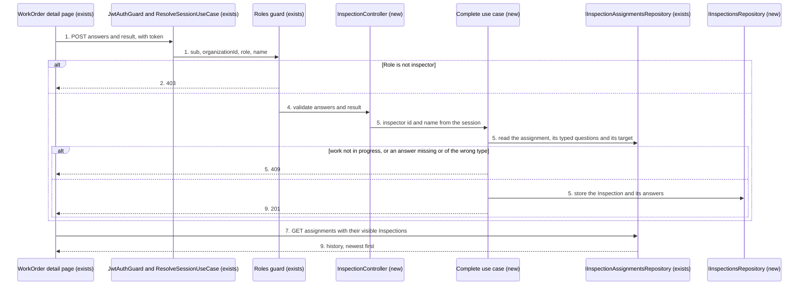
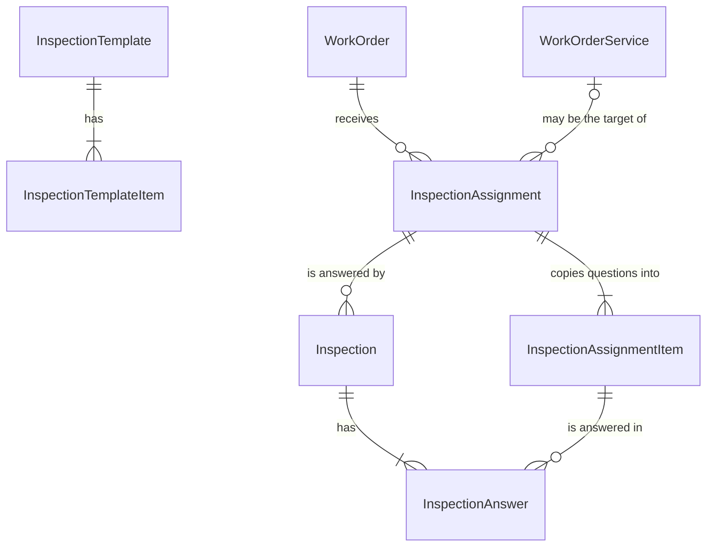
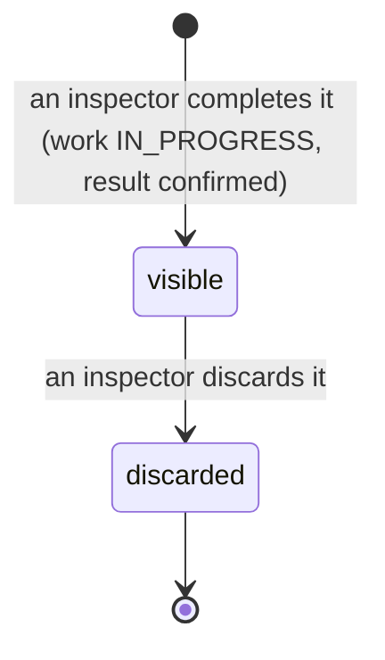

# Inspection

**Approved**: 2026-11-14 - user: "Aprovo o plano"

> Build this with **tlc-implement**. Every criterion becomes a check with a proof; nothing under
> the open questions is settled while building.

## Problem

A WorkOrder can now carry InspectionAssignments, a frozen copy of a checklist, but nobody can answer
one: an inspector who checks the work on a Vessel has no place in the app to record what was
checked, what each question got, who checked and when, or whether the work passed. Every question
today is implicitly conforming/non-conforming, while the owner's checklists mix free text, yes/no
answers and 0 to 10 scores. And a WorkOrder or a WorkOrderService is deleted with everything under
it, so a record of inspected work could disappear. The source gives no usage evidence; the product
is not in use yet.

When this ships, an Administrator writes questions of four types. On a WorkOrder in progress an
inspector opens an assignment, answers every question with its own kind of control, on a desk or a
phone, and confirms whether the inspection is approved or reproved. Each assignment keeps the full
history of its inspections; an inspector can discard one made by mistake, and inspected work can no
longer be deleted.

## Shape

This reuses the `work-order` context (D1), the InspectionTemplate and InspectionAssignment aggregates
(the type is a new field on their questions, copied the way labels are copied), the Roles guard with
`@Roles` (AD-017), the session the `JwtAuthGuard` resolves (it gains the User's name), the WorkOrder
detail page and its "Inspeções" section, and the sheet and confirmation components. The rules that
decide an outcome - who may write, the in-progress check, every question answered with a value of
its type, the order of the history, what a discard hides, and the refused deletes - run in the API
use cases and repositories, reached by the Vitest specs in `api/`; the web decides which controls it
renders and enables, reached by `ng test`.

1. A request with a token -> `JwtAuthGuard` (exists) - `ResolveSessionUseCase` (exists) now also hands on the User's `name`
2. Roles guard (exists) - `POST` of an Inspection and its discard admit `inspector` only; template and assignment writes stay `administrator`
3. The template routes (exist) - each question now carries a `type` (door 1), copied by the Assign use case (exists) into the assignment's questions
4. `InspectionController` (new) in `work-order` - validates the answers and the confirmed result with Zod and calls one use case per handler
5. Complete use case (new) - reads the assignment (`IInspectionAssignmentsRepository`, exists), the WorkOrder and the target service; refuses with 409 unless both are `IN_PROGRESS` and every question is answered once with a value of its type or "not applicable"; stores the Inspection and its answers (door 2) with the inspector's id and name
6. Discard use case (new) - marks a visible Inspection with who and when; a discarded one is not found again
7. `IInspectionAssignmentsRepository` (exists) - lists each assignment with its visible Inspections newest first and whether it can be removed; the remove use case refuses an assignment with any Inspection (409)
8. WorkOrder and WorkOrderService delete use cases (exist) - refuse with 409 when an Inspection sits under them; the database refuses too (door 3)
9. out: 201, 204, 409; the WorkOrder detail page (exists) shows each assignment's history, the checklist sheet and the closing confirmation, and the Vessel detail page (exists) explains a refused delete

**Changes underneath**

| Front | What changes |
| --- | --- |
| domain | A question gains a type (AD-019); the Inspection's result is confirmed by the inspector instead of computed (D7 as amended). `Inspection` is a new term. The session gains `name` - read today by nothing in `work-order` |
| stored data | `inspection_template_items` and `inspection_assignment_items` gain `type`, backfilled `CONFORMITY` for every existing row (AD-019); `inspections` and `inspection_answers` are new and empty |
| readers | the template form and detail page show and set the type; the assignment section shows the type, the history, the checklist and the discard; `GET .../inspection-assignments` gains `type`, `removable` and `inspections`; `POST /inspection-templates` and `PUT` require `type`; `DELETE /work-orders/:id`, `DELETE .../services/:id` and `DELETE .../inspection-assignments/:id` may answer 409; the Vessel detail page shows that 409; `CONTEXT.md` gains Inspection and the question types; the layout header stops being sticky below 640 px |

New: `Inspection` and `InspectionAnswer`, and a `type` on both item tables. One-way constraints: an
Inspection refuses the delete of its assignment, so of the assignment's WorkOrder and target
service (door 3); an answer refuses the delete of its question; types are a closed enum (door 1).

## Surface

| Route | In | Out | Status | Who |
| --- | --- | --- | --- | --- |
| `POST /inspection-templates`, `PUT /inspection-templates/:id` | each item gains a required `type`: `TEXT`, `YES_NO`, `CONFORMITY` or `SCORE` | each item carries `type` | as today: `201`/`200`, `400`, `401`, `403`, `404`, `409` | `administrator`; the rest 403, as today |
| `GET /inspection-templates/:id` | - | each item carries `type` | as today: `200`, `401`, `404` | every Role, as today |
| `GET /work-orders/:workOrderId/inspection-assignments` | - | each item carries `type`; each assignment gains `removable` and `inspections`: visible ones, newest first, each `{ id, result, inspectorName, completedAt, answers: [{ itemId, notApplicable, value, note }] }` | `200`, `401`, `404` | every Role, as today |
| `DELETE /work-orders/:workOrderId/inspection-assignments/:id` | - | - | `204`, `401`, `403`, `404`, and now `409` when it has any Inspection | `administrator`, as today |
| `POST /work-orders/:workOrderId/inspection-assignments/:assignmentId/inspections` | `{ result: "APPROVED" or "REPROVED", answers: [{ itemId, notApplicable?, value?, note? }] }` | `inspection` in the shape above | `201`, `400`, `401`, `403`, `404`, `409` | `inspector`; `administrator` and `operator` 403 |
| `POST /work-orders/:workOrderId/inspection-assignments/:assignmentId/inspections/:id/discard` | - | - | `204`, `401`, `403`, `404` | `inspector`; the rest 403 |
| `DELETE /work-orders/:id` | - | - | as today (`204`, `401`, `403`, `404`), and now `409` when an Inspection sits under it | `administrator`, `operator`; `inspector` 403, as today |
| `DELETE /work-orders/:workOrderId/services/:id` | - | - | as today (`204`, `401`, `403`, `404`), and now `409` when an Inspection targets it | `administrator`, `operator`; `inspector` 403, as today |

## Landing

| One-way door | Literal shape | Alternative rejected |
| --- | --- | --- |
| 1. A closed enum on two populated tables | Prisma enum `QuestionType` (`@@map("question_type")`) with `TEXT`, `YES_NO`, `CONFORMITY`, `SCORE`; column `type QuestionType @default(CONFORMITY)` on `inspection_template_items` and `inspection_assignment_items`, so existing rows backfill to `CONFORMITY` in the same migration | A free text column - a typo becomes a type nobody can answer, and the answer rules switch on it |
| 2. Two tables for what was answered | `inspections` (`id`, `organizationId`, `assignmentId` FK, `result` enum `inspection_result` `APPROVED`/`REPROVED`, `inspectorId` and `inspectorName` text with no FK - User belongs to `identity`, `completedAt` default now, `discardedAt` and `discardedBy` nullable, indexes on `organizationId` and `assignmentId`) and `inspection_answers` (`id`, `organizationId`, `inspectionId` FK `onDelete: Cascade`, `itemId` FK to `inspection_assignment_items` `onDelete: Restrict`, `notApplicable` boolean, `textValue` text, `booleanValue` boolean, `scoreValue` int, `note` text, all value columns nullable, `@@unique([inspectionId, itemId])`), through `npx prisma migrate dev --name add-inspections` | One JSON column of answers on the Inspection - nothing ties an answer to its question, and a later report could not query answers |
| 3. The database refuses deleting inspected work | `inspections.assignmentId` FK to `inspection_assignments` `onDelete: Restrict`, so the cascade from `work_orders` or `work_order_services` through the assignment fails; the repositories map that violation (P2003) to `ConflictDomainException` and the use cases check first, answering 409 with nothing deleted | A check in the use case only - a delete racing an inspection would erase it (D5, "Careful") |
| 4. The session carries the User's name | `UserPayload` gains `name`, filled by `ResolveSessionUseCase` on every request; `inspectorName` is a copy taken at completion | Reading the User from `work-order` - it may not import `identity` |

- Nothing else in this change is hard to reverse

## Criteria

### S1: Questions have a type (P1)

An Administrator gives each question one of four types; assignments copy it; existing questions are conforming/non-conforming.

**Acceptance Criteria**

1. WHEN an `administrator` creates or edits a template THEN each item SHALL require `type` `TEXT`, `YES_NO`, `CONFORMITY` or `SCORE`, and the template SHALL return each item's `type`
   - `type: "SCORE"` → stored and returned; missing `type` → 400; `type: "DATE"` → 400
2. WHEN a template is assigned THEN each copied question SHALL keep its `type`, and a later edit of the template's types SHALL not change the assignment
3. WHEN the migration runs THEN every existing question of a template or an assignment SHALL have `type: "CONFORMITY"`
4. WHEN an Administrator opens the template form THEN each question SHALL have a "Tipo" select with "Texto livre", "Sim/Não", "Conforme/Não conforme" and "Nota de 0 a 10", "Conforme/Não conforme" selected on a new question, and the form SHALL send the chosen `type` in the order shown
5. WHEN a User opens a template's detail page or expands an assignment THEN each question SHALL show its type's label next to it
6. The `CONTEXT.md` SHALL describe the four question types in the `InspectionTemplate` entry

### S2: Inspectors record inspections through the API (P1)

An inspector completes an assignment while the work is in progress, as many times as needed, and may discard a mistaken one.

**Acceptance Criteria**

7. WHEN an `inspector` calls `POST .../inspections` with one answer per question of the assignment and `result` THEN the system SHALL answer 201 and store the Inspection with that `result`, `completedAt`, the session User's id and name as `inspectorId` and `inspectorName`, and each answer
8. The system SHALL accept for each question either `notApplicable: true` with no `value`, or a `value` of its type: a trimmed text of 1 to 1000 characters for `TEXT`, a boolean for `YES_NO` and `CONFORMITY`, an integer from 0 to 10 for `SCORE`
   - `SCORE` 0 → 201; 10 → 201; 11 → 409; 7.5 → 409; `TEXT` of spaces → 409; `YES_NO` with `"sim"` → 409
9. The system SHALL accept an optional `note` of up to 500 characters, trimmed, on `YES_NO`, `CONFORMITY` and `SCORE` answers, and SHALL refuse a `note` on a `TEXT` answer with 409
10. IF a question has no answer, an answer names a question of another assignment, or a question is answered twice THEN the system SHALL answer 409 and store nothing
11. IF the WorkOrder is not `IN_PROGRESS`, or the assignment targets a WorkOrderService that is not `IN_PROGRESS`, THEN the system SHALL answer 409 and store nothing
    - WorkOrder `PENDING` → 409; WorkOrder `IN_PROGRESS` and service `COMPLETED` → 409; both `IN_PROGRESS` → 201; whole-WorkOrder assignment on an `IN_PROGRESS` WorkOrder → 201
12. IF `result` is missing or not `APPROVED` or `REPROVED`, or a `note` is longer than 500 characters, THEN the system SHALL answer 400 and store nothing
13. WHEN an assignment already has Inspections, or two inspectors complete it at once, THEN each completion SHALL add one Inspection and keep the others
14. WHEN any Role calls `GET .../inspection-assignments` THEN each assignment SHALL carry its visible Inspections ordered by `completedAt` descending, ties by `id`, each with `result`, `inspectorName`, `completedAt` and its answers, and `removable: true` only when it has no Inspection, discarded ones included
15. WHEN an `inspector` calls `POST .../inspections/:id/discard` on a visible Inspection THEN the system SHALL answer 204, store who discarded it and when, and no read SHALL return it again; the assignment's other Inspections SHALL stay
    - discard with the WorkOrder `COMPLETED` → 204
16. IF the Inspection of a discard is already discarded, unknown, of another assignment or of another Organization THEN the system SHALL answer 404 and change nothing
17. IF an `administrator` or an `operator` calls `POST .../inspections` or its discard THEN the system SHALL answer 403 with `statusCode: 403` and `message: "Forbidden"`, before validation, and write nothing
18. IF the assignment of `POST .../inspections` is unknown, of another WorkOrder or of another Organization THEN the system SHALL answer 404 and store nothing
19. IF an `administrator` removes an assignment that has any Inspection, discarded ones included, THEN the system SHALL answer 409 and delete nothing
20. The test suite SHALL list the two new routes and require `@Roles('inspector')` on both, and the `CONTEXT.md` SHALL have an `Inspection` entry: one answer sheet of an assignment, by an `inspector`, with a confirmed result, never edited, hidden when discarded

### S3: Inspectors answer and read inspections on the WorkOrder page, on a desk or a phone (P2)

The WorkOrder page shows each assignment's history; an inspector answers the checklist and confirms the result; anyone opens an inspection's answers.

**Acceptance Criteria**

21. WHEN a User of any Role opens `/work-orders/:id` THEN each assignment's summary SHALL show "N inspeções" and the latest result ("Aprovada" or "Reprovada"), or "Nenhuma inspeção"
22. WHEN a User expands an assignment THEN it SHALL list its Inspections newest first, each with "Aprovada" or "Reprovada", the inspector's name and the date and time `dd/MM/yyyy HH:mm`
23. WHEN a User uses an Inspection in the list THEN a sheet "Inspeção" SHALL show its result, inspector, date and every question numbered from 1 with its answer - the text, "Sim"/"Não", "Conforme"/"Não conforme", the score, or "Não se aplica" - and its note when there is one
24. WHILE the session's Role is `inspector`, an expanded assignment SHALL render "Inspecionar"; it SHALL be enabled when the WorkOrder, and the target service when there is one, are `IN_PROGRESS`, and otherwise disabled with "Disponível com a ordem em andamento" or "Disponível com o serviço em andamento"; other Roles SHALL not see it
25. WHEN an inspector uses "Inspecionar" THEN a sheet "Inspecionar" SHALL list every question numbered from 1 with the control of its type - a text box for "Texto livre", "Sim" and "Não" for "Sim/Não", "Conforme" and "Não conforme" for "Conforme/Não conforme", "0" to "10" for "Nota de 0 a 10" - a "Não se aplica" control, and, except on "Texto livre", an optional "Observação"
26. IF an inspector uses "Concluir" with a question unanswered, or a text longer than 1000 or a note longer than 500 characters, THEN the sheet SHALL show the error on that question ("Responda esta pergunta" for an unanswered one) and send nothing
27. WHEN an inspector uses "Concluir" with every question answered THEN a confirmation "Concluir inspeção" SHALL show how many answers are "Não conforme" and "Não", offer "Aprovada" and "Reprovada" with neither selected, and keep "Confirmar" disabled until one is chosen
28. WHEN the inspector confirms THEN the web SHALL send `POST .../inspections` with the chosen `result` and every answer, close the sheet, show "Inspeção registrada com sucesso" and request the assignments again, so the new Inspection shows first
29. WHILE the session's Role is `inspector`, the "Inspeção" sheet SHALL render "Descartar"; using it SHALL ask "Descartar inspeção" - "Tem certeza que deseja descartar esta inspeção? Ela deixará de aparecer no app." - and confirming SHALL send the discard, show "Inspeção descartada com sucesso" and request the assignments again; cancelling SHALL send nothing; other Roles SHALL not see it
30. WHILE an assignment is not `removable`, the section SHALL render no "Remover" on it
31. IF `POST .../inspections` or the discard fails THEN the page SHALL show the shared API error message, keep the checklist answers as typed when completing, and leave the history as it was
32. WHILE the window is narrower than 640 px, the layout header SHALL scroll with the page instead of staying fixed
33. WHILE the window is 375 px wide, the WorkOrder page with an expanded assignment, the "Inspecionar" sheet with one question of each type, the "Concluir inspeção" confirmation and the "Inspeção" sheet SHALL show every question, control and answer without horizontal page scroll, and every answer control SHALL be at least 40 px tall

### S4: Inspected work cannot be deleted (P1)

Deleting a WorkOrder or a WorkOrderService with an Inspection under it is refused; without one it works as today.

**Acceptance Criteria**

34. IF a WorkOrder has any Inspection, discarded ones included, on an assignment of its own or of one of its services, THEN `DELETE /work-orders/:id` SHALL answer 409 and delete nothing - services, images and assignments included
35. IF a WorkOrderService is the target of an assignment with any Inspection, discarded ones included, THEN `DELETE /work-orders/:workOrderId/services/:id` SHALL answer 409 and delete nothing
36. WHEN a WorkOrder or a WorkOrderService has assignments with no Inspection THEN its delete SHALL answer 204 and delete them with it, as today
37. WHEN the Vessel detail page receives 409 on a WorkOrder delete THEN it SHALL show "Esta ordem de serviço tem inspeções e não pode ser excluída." and keep the WorkOrder listed

## Out of scope

| Excluded | Why |
| --- | --- |
| A reproved Inspection blocking `COMPLETED` | The design keeps the result a record, not a gate |
| Reading discarded Inspections in the app | The owner decided they stay only in the database |
| Saving a half-filled checklist as a draft | Design alternative; checklists are answered in one sitting |
| A computed or suggested result | user: "no encerramento da inspeção deverá aparecer uma confirmação"; "Nada pré-selecionado (Recomendado)" |
| A reason for a discard | user chose "Confirmação simples (Recomendado)" |
| A web control that deletes a WorkOrderService | None exists today; the API refuses the inspected case for any caller |
| Other pages at phone width | Design default 5: the inspector's path only - sign in, WorkOrder detail and the sheets |
| `ROADMAP.md` | Written once the whole inspection path exists, after this plan ships |

## Assumptions

| Assumption | Chosen default | Rationale | Confirmed? |
| --- | --- | --- | --- |
| Plans for Inspection and WorkOrder deletion | One plan, released together | user: "Um plano, duas fatias (Recomendado)" | y |
| Question types | `TEXT`, `YES_NO`, `CONFORMITY`, `SCORE` (0 to 10), set on the template and copied | user: "a pergunta conterá um tipo de resposta (texto livre, sim/não, conforme/não conforme, uma nota de 0 à 10)." | y |
| How the result is decided | The inspector confirms "Aprovada" or "Reprovada" on closing, nothing pre-selected, with the "Não conforme" and "Não" counts shown | user: "no encerramento da inspeção deverá aparecer uma confirmação de aprovação ou reprovação da inspeção."; "Nada pré-selecionado (Recomendado)" | y |
| Required answers | Every question, with "Não se aplica" available on every type | user: "Todas obrigatórias, N/A em todas (Recomendado)" | y |
| Existing questions | Become `CONFORMITY` | user: "Conforme/não conforme (Recomendado)" | y |
| Where types land | First slice of this plan | user: "Neste plano, como 1ª fatia (Recomendado)" | y |
| "Inspecionar" outside the in-progress window | Disabled, with the reason | user: "Botão desativado + motivo (Recomendado)" | y |
| Layout header on a phone | Not sticky below 640 px | user: "Não fixo no celular (Recomendado)" | y |
| Text and note limits | Text 1000, note 500, note on every type but free text | user: "Texto 1000, observação 500 (Recomendado)" | y |
| Discard | A simple confirmation; who and when are stored | user: "Confirmação simples (Recomendado)" | y |
| History display | Inside the expanded assignment; an Inspection opens a sheet with every answer | user: "Lista dentro da atribuição (Recomendado)" | y |
| Inspector's name | The session gains the User's name, copied at completion | Design default 1 | y |
| Response to answers that do not match the questions | 409 | Design default 4: a use case answers only 404 or 409 | y |
| Who discards | Any inspector of the Organization, whatever the status of the work | Design behaviour table | y |
| Answer control labels and copy | The strings in criteria 21 to 33 and 37 | Follow the app's patterns; "Aprovada"/"Reprovada" agree with "inspeção" | n |
| Where "Descartar" sits | In the "Inspeção" sheet, for inspectors | Keeps the history list short on a phone | n |
| "Remover" on an inspected assignment | Hidden, from `removable` | A control that always answers 409 is noise | n |
| Template `type` in the request | Required, no default | Every caller is the app's own form, updated in the same change | n |
| The minimum touch target | 40 px tall answer controls | A phone has to work (design default 5) | n |

**Open questions:** none - all resolved or logged above.

## Differences from the source

None - the product matches the source

## Sources

- `.design/inspection.md`, slices `Inspection` and `WorkOrder deletion`, decisions D1, D2, D4, D5, D6 and D7 as amended - binding - the records, routes, who writes, the in-progress rule, the discard and the refused deletes
- `.specs/STATE.md` AD-002, AD-017, AD-018 (many Inspections per assignment, work in progress on both WorkOrder and service), AD-019 (question types and confirmed result) - binding - the decisions this conforms to
- `.specs/features/inspection-template/plan.md` and `.specs/features/inspection-assignment/plan.md` - binding - the routes and shapes this extends
