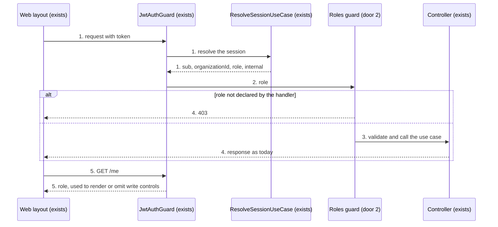
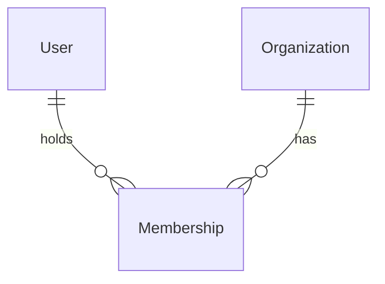

# Inspector Role

**Approved**: 2026-11-14 - user: "Aprovo o plano"

> Build this with **tlc-implement**. Every criterion becomes a check with a proof; nothing under
> the open questions is settled while building.

## Problem

A Role decides nothing inside an ordinary Organization today. `administrator` and `operator` may
call every route of `customer` and `work-order`; the only place a Role is read is
`InternalAdministratorGuard`, on the internal administration routes. The inspection design
(`.design/inspection.md`) needs a User who can read everything in an Organization and write only
Inspections, and the app has no way to express that: a third Role would be accepted nowhere and
refused nowhere. The source gives no usage evidence; the product is not in use yet.

When this ships, an internal Administrator can give a User the Role `inspector`. That User signs
in, sees the same Customers, Vessels and WorkOrders as everyone in the Organization, and finds no
control that creates, edits or deletes any of them; the API refuses those calls with 403.

## Shape

This reuses the session the global `JwtAuthGuard` already resolves on every request, which carries
the Role of the active Membership, instead of reading the Membership again. The rule that decides
who may write runs in the API, in a guard reached by the Vitest specs in `api/`; the web decides
only whether a control is shown, in one function reached by `ng test`.

1. A request with a token -> `JwtAuthGuard` (exists) - resolves the session through `ResolveSessionUseCase` (exists) and hands on `sub`, `organizationId`, `role`, `internal`
2. Roles guard (door 2) - reads the Roles the handler declares; a `role` outside them answers 403 before validation or any read
3. Controller (exists) of the aggregate - validates and calls its use case as today
4. out: the response as today, or 403
5. `GET /me` -> Web layout (exists) - holds the session; each page asks one function (new) whether the Role may write and renders its write controls or not

**Changes underneath**

| Front | What changes |
| --- | --- |
| domain | `Role` meant `administrator` or `operator`, now also `inspector` - branched on today by `InternalAdministratorGuard`, `CountOrganizationRolesUseCase`, the Zod enums of `POST /users` and `POST /invitations`, the session type `UserPayload`, and in the web by `roleLabels`, the Role type of the session and the internal administrator guard |
| stored data | nothing to migrate - the enum `role` gains a value and no row changes |
| readers | Organization detail (Users list badge), the Organization switcher, the Papel select of the User and Invitation forms; Organization detail reads the Role counts and does not show them |

New: nothing - no entity or relation is added. One-way constraints: the enum `role` gains
`inspector` (door 1).

## Surface

No route is added. These change signature:

| Route | In | Out | Status | Who |
| --- | --- | --- | --- | --- |
| `POST /users` | `role` accepts `inspector` | as today | `201`, `400`, `403` | internal Administrator; the rest get 403 as today |
| `POST /invitations` | `role` accepts `inspector` | as today | `201`, `400`, `403` | internal Administrator; the rest get 403 as today |
| `GET /me` | - | `role` and each Membership's `role` may be `inspector` | `200`, `401` | any signed-in User; without a token 401 |
| `GET /organizations/:id/roles` | - | `roles` has three entries: `administrator`, `operator`, `inspector` | `200`, `403` | internal Administrator; the rest get 403 as today |
| the 14 write routes of criterion 5 | as today | as today | the codes of today, plus `403` | `administrator` and `operator`; `inspector` gets 403 |

## Landing

| One-way door | Literal shape | Alternative rejected |
| --- | --- | --- |
| 1. A value in a persisted enum that the web binds to | `inspector`, lower case, added to the Prisma enum `Role` (`@@map("role")`) after `operator`, through `npx prisma migrate dev --name add-inspector-role` | A boolean `canInspect` on `memberships` - it lets a Membership be operator and inspector at once, which the design refuses (who inspects does not alter the work) |
| 2. Route-declared Roles, a pattern the codebase does not have | `@Roles('administrator', 'operator')` on the handler, exported from `shared/module/auth`, enforced by a guard registered globally after `JwtAuthGuard`; a handler with no `@Roles` is open to every Role; a layout spec fails when a `POST`, `PUT` or `DELETE` handler under `customer` or `work-order` has none | A guard that refuses `inspector` on every method other than `GET` - the next slices need `inspector` to `POST` an Inspection and `operator` refused on InspectionTemplates, which a method rule cannot say |

- Nothing else in this change is hard to reverse

## Criteria

### S1: A User can be an inspector, and the API refuses its writes (P1)

An internal Administrator creates an inspector; that inspector reads everything and every existing write route answers 403.

**Acceptance Criteria**

1. WHEN an internal Administrator calls `POST /users` with `role: "inspector"` THEN the system SHALL answer 201 and store the Membership with Role `inspector`
   - ordinary Organization → 201; the internal Organization → 201; `role: "auditor"` → 400 as today
2. WHEN an internal Administrator calls `POST /invitations` with `role: "inspector"` and the User accepts it THEN the system SHALL store the Membership with Role `inspector`
3. WHEN a User whose active Membership is `inspector` calls `GET /me` THEN the system SHALL answer 200 with `role: "inspector"`
4. WHEN an internal Administrator calls `GET /organizations/:id/roles` THEN the system SHALL answer `roles` with exactly three entries in the order `administrator`, `operator`, `inspector`
   - an Organization with no inspector → the `inspector` entry has `users: 0`
5. IF a User whose active Membership is `inspector` calls any of the 14 write routes below THEN the system SHALL answer 403 and write nothing
   - `POST /customers`, `PUT /customers/:id`, `DELETE /customers/:id`
   - `POST /vessels`, `PUT /customers/:customerId/vessels/:id`, `DELETE /vessels/:id`
   - `POST /work-orders`, `PUT /work-orders/:id`, `DELETE /work-orders/:id`
   - `POST /work-orders/:workOrderId/services`, `PUT /work-orders/:workOrderId/services/:id`, `DELETE /work-orders/:workOrderId/services/:id`
   - `POST /work-orders/:workOrderId/services/:serviceId/images`, `DELETE /work-orders/:workOrderId/services/:serviceId/images/:id`
   - a valid body → 403; an invalid body → 403, not 400; an id of another Organization → 403, not 404
   - the image upload → 403 and no file is written under `api/uploads/work-order-service-images/`
6. WHEN an `administrator` or an `operator` calls any route of criterion 5 THEN the system SHALL answer what it answers today
   - `POST /customers` by an operator → 201; by an administrator → 201
7. WHEN an `inspector` calls any `GET` route of `customer` or `work-order` THEN the system SHALL answer what it answers to an operator of the same Organization
8. WHEN an `inspector` who holds two Memberships calls `POST /organizations/switch` THEN the system SHALL switch the active Organization as today, and the Role of the next request SHALL be the Role of the new active Membership
   - inspector in A, operator in B: after switching to B, `POST /customers` → 201
9. IF an `inspector` of the internal Organization calls a route behind `InternalAdministratorGuard` THEN the system SHALL answer 403
10. The 403 of criterion 5 SHALL have the body `InternalAdministratorGuard` answers today: `statusCode: 403` and `message: "Forbidden"`
11. The test suite SHALL fail when a `POST`, `PUT` or `DELETE` handler in a controller under `customer` or `work-order` declares no Roles
12. `CONTEXT.md` SHALL list `inspector` in the Role entry with what it may do, and `AGENTS.md` SHALL name the three Roles where it names two today

### S2: The web shows the Role and hides what an inspector cannot do (P2)

An internal Administrator picks "Inspetor" in the forms; a signed-in inspector browses every page and finds no write control.

**Acceptance Criteria**

13. WHEN an internal Administrator opens the User form or the Invitation form on Organization detail THEN the Papel select SHALL offer "Administrador", "Operador" and "Inspetor", in that order
14. WHEN an internal Administrator submits either form with "Inspetor" THEN the web SHALL send `role: "inspector"`, and the Users list SHALL show the badge "Inspetor" for that User
15. WHEN an internal Administrator opens Organization detail THEN the page SHALL render no Role counts, as today - the counts `GET /organizations/:id/roles` returns are not shown (criterion 4 proves the API)
16. WHEN a User opens the Organization switcher THEN each Organization where its Membership is `inspector` SHALL show "Inspetor" under its name
17. WHILE the session's Role is `inspector`, the Customers page (`customers`) SHALL render no control that opens the "Novo cliente" sheet and no "Excluir" control on a row
18. WHILE the session's Role is `inspector`, the Customer detail page (`customers/:id`) SHALL render no control that edits the Customer, deletes the Customer, opens the "Nova embarcação" sheet or deletes a Vessel
19. WHILE the session's Role is `inspector`, the Vessels page (`vessels`) SHALL render no control that opens the "Nova embarcação" sheet and no "Excluir" control on a row
20. WHILE the session's Role is `inspector`, the Vessel detail page (`vessels/:id`) SHALL render no control that edits the Vessel, deletes the Vessel, opens the "Nova ordem" sheet or deletes a WorkOrder
21. WHILE the session's Role is `inspector`, the WorkOrder detail page (`work-orders/:id`) SHALL render no control that edits the WorkOrder, opens the "Novo serviço" sheet or sends an image ("Enviar foto de <name>")
22. WHILE the session's Role is `administrator` or `operator`, the pages of criteria 17 to 21 SHALL render every control they render today
    - an operator on `customers` → the control that opens "Novo cliente" is present
23. WHILE the session's Role is `inspector`, the pages of criteria 17 to 21 SHALL show the same lists, details and images an operator sees
24. WHEN a User switches from an Organization where it is `operator` to one where it is `inspector` THEN the page shown after the switch SHALL render no write control, without a new sign-in
25. WHILE the session's Role is not loaded yet, or is a value other than `administrator` and `operator`, the pages of criteria 17 to 21 SHALL render no write control - the web decides from the same allow-list the API does (added after verification)

## Out of scope

| Excluded | Why |
| --- | --- |
| InspectionTemplate, InspectionAssignment, Inspection and the WorkOrder delete rule | The four later slices of `.design/inspection.md`, each with its own plan |
| Any rule that separates `administrator` from `operator` on existing routes | The design keeps both as they are today (D2) |
| A route or screen that changes the Role of an existing Membership | None exists today and the design does not ask for one |
| The session carrying the User's name | Owned by the Inspection slice, which is the first to need it |
| How the existing pages behave at phone width | Owned by the Inspection slice, for the pages an inspector walks |
| Showing the Role counts on Organization detail | The page reads them and shows none today; showing them is a new screen. user: "Retirar do plano (Recomendado)" |

## Assumptions

| Assumption | Chosen default | Rationale | Confirmed? |
| --- | --- | --- | --- |
| What an inspector sees where a write control was | The control is absent, not disabled | user: "Não aparecem (Recomendado)" | y |
| May the internal Organization have inspectors | Yes, through `POST /users` | user: "Pode (Recomendado)" | y |
| Portuguese label of the Role | "Inspetor" | user: "Inspetor (Recomendado)" | y |
| The working tree has uncommitted web changes on the pages of criteria 17 to 21 | Build on the tree as it stands; do not revert or commit those changes as part of this work | They are the owner's work in flight | n |
| A write the web still attempts as an inspector and the API refuses | The page shows the message the shared API error helper already gives for 403 | No new copy was asked for | n |
| Position of `inspector` wherever Roles are listed | Last, after `operator` | Matches the order they were introduced | n |

**Open questions:** none - all resolved or logged above.

## Differences from the source

None - the product matches the source

## Sources

- `.design/inspection.md`, slice `inspector` and decision D2 (Roles gate tenant writes) - binding - the Role, who may write, and that existing write routes refuse it
- `.specs/STATE.md` AD-001 (Role belongs to a Membership) and AD-017 (Roles gate tenant writes) - binding - the decisions this conforms to
- `api/test/layout.spec.ts` - binding - the route list criterion 5 enumerates
