# Work order UI redesign after mareos

**Approved**: 2026-11-17 - user: "Aprovo o plano"

> Build this with **tlc-implement**. Every criterion becomes a check with a proof; nothing under
> the open questions is settled while building.

## Problem

The `work-order` screens of the web still have the layout they had before the mareos shell and
palette (AD-020): the shell and the colours changed, the content did not. A WorkOrder is reached only
from its Vessel's detail: there is no list of WorkOrders and no menu item for them (AD-024 omitted
"Ordens de serviço" because no screen existed), so an operator who looks for the WorkOrders in progress
opens every Vessel. An inspector who looks for what to inspect walks Vessel -> WorkOrder -> assignment,
one WorkOrder at a time, and answers the checklist in a side sheet. Nobody sees on a calendar which
services and dockings fall in a week. Creating a WorkOrder with three services takes four forms. The
WorkOrder detail's back button ("Voltar para detalhes da embarcação") has no destination and its
"Atividade recente" panel is always empty. The team's prototype of the look it wants is mareos
(`/home/luciano/workspace/development/apps/mareos`), which draws "Ordens de serviço", "Inspeções" and
"Agenda"; the request gives no other evidence.

When this ships, the sidebar has "Ordens de serviço", "Inspeções" and "Agenda": every WorkOrder of the
Organization is on one searchable list with counts, CSV export and a drawer that creates a WorkOrder
with its services in one step; the Inspections hub shows the templates as cards and every assignment
of the Organization, from which an inspector answers on a full page; the Agenda shows a week of
services, dockings and undockings; and the WorkOrder detail and template pages take the mareos look.

## Shape

This reuses the shell, palette, `t-sheet`/drawer, `t-confirmation`, `t-dropdown-menu`, toasts, the CSV
writer and the patterns of the customer redesign (`customer-list`, `vessel-list`, `vessel-detail`), the
existing services of `web/src/package/work-order/**`, and the existing use cases of the `work-order`
context; the API only stops paging two lists when no page is asked, adds the services to the WorkOrder
list, accepts services when a WorkOrder is created, and lists the Organization's InspectionAssignments.
Tabs, searching, counting, sorting, paging, the week grid, the CSV rows and "can be inspected now" run
in the web pages or plain functions they call, reached by the specs under
`web/src/package/work-order/**/__test__/` (`npm test`); the new API reads and the transactional create
run in use cases with Vitest specs and in the Prisma repositories, proven against real PostgreSQL in
`api/test/smoke/api-smoke.sh` (lesson L-029).

1. browser -> `InternalLayout` (exists) - sidebar gains "Ordens de serviço", "Inspeções", "Agenda" (AD-032); the breadcrumb maps `/work-orders`, `/inspections`, `/inspection-templates`, `/agenda`
2. `WorkOrderList` page (new) -> `GET /api/work-orders`, `GET /api/vessels`, `GET /api/customers` -> `WorkOrderController` (exists) -> `FetchWorkOrdersUseCase` (exists) -> `PrismaWorkOrdersRepository` (exists) - every WorkOrder with its services (door 1)
3. `WorkOrderList` (new) - tabs, search, counts, pages of 8, selection, `ordens-de-servico.csv`; deletes through `WorkOrderService` (exists)
4. "Nova ordem de serviço" drawer (new, used by `WorkOrderList` and `VesselDetail` (exists)) -> `POST /api/work-orders` with `services` -> `CreateWorkOrderUseCase` (exists) -> `PrismaWorkOrdersRepository` (exists) - WorkOrder and services in one transaction (door 2)
5. `WorkOrderDetail` (exists) -> `GET /api/work-orders/:id`, `/services`, `/inspection-assignments` - mareos look; "Inspecionar" and each Inspection navigate to the inspection page
6. `Inspections` hub (new) -> `GET /api/inspection-templates` (door 3), `GET /api/inspection-assignments` (door 4) -> `InspectionAssignmentController` (exists) -> new use case -> `PrismaInspectionAssignmentsRepository` (exists), `GET /api/work-orders`, `GET /api/vessels`; creates templates and assignments through `InspectionTemplateService` and `InspectionAssignmentService` (exist)
7. `InspectionTemplateDetail` (exists) - mareos look, edit in the template drawer
8. Inspection page (new) -> `GET /api/work-orders/:id`, `/services`, `/inspection-assignments` -> `POST .../inspections` or `POST .../inspections/:id/discard` through `InspectionService` (exists)
9. `Agenda` page (new) -> `GET /api/work-orders`, `GET /api/vessels` - week grid in the browser; creates a service through `WorkOrderServiceService` (exists) -> `POST /api/work-orders/:id/services`
10. out: the pages render; nothing new is stored beyond WorkOrders and WorkOrderServices created by the drawers

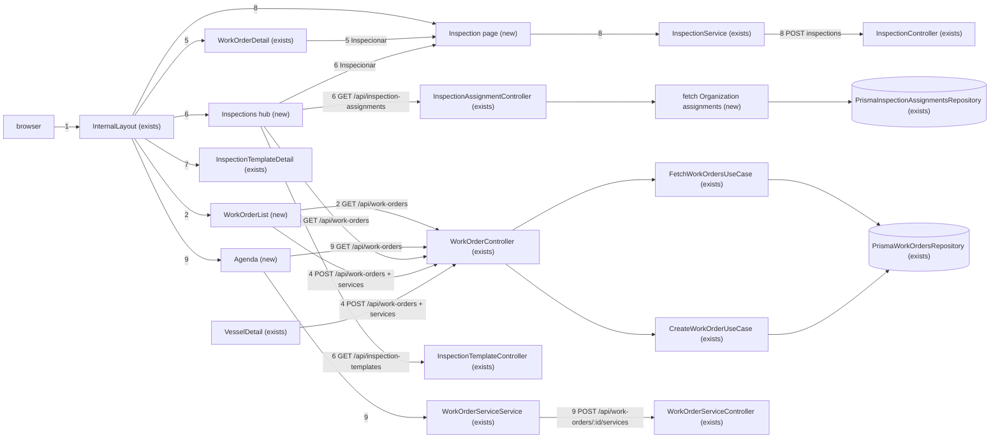

**Changes underneath**

| Front | What changes |
| --- | --- |
| domain | nothing - WorkOrder, WorkOrderService, InspectionTemplate, InspectionAssignment and Inspection keep their meaning and fields (AD-034) |
| stored data | nothing to migrate - no column is added; a create may now write a WorkOrder and its services together |
| contract | `GET /work-orders` without `take`/`skip` answered 10 WorkOrders; now every one, and every response carries `services` (door 1). Callers: `vessel-detail.ts` sends `take` and `skip` and keeps its 10 per page; `write-access.ts` expects that URL and holds |
| contract | `POST /work-orders` accepts an optional `services` array (door 2); `api-smoke.sh` line 104 sends none and holds |
| contract | `GET /inspection-templates` without `page`/`per_page` answered page 1 (10); now every template (door 3). Callers: the template list (removed by S4) and the assignment sheet (`per_page=100`, holds) |
| readers | sidebar: "Modelos de inspeção" leaves the menu and "Ordens de serviço", "Inspeções", "Agenda" enter, in the mareos order (AD-032); criterion 2 of `customer-ui-redesign/plan.md` ("four items") no longer holds and the shell specs follow (criterion 16) |
| readers | breadcrumb: `/work-orders/:id` read "Operação > Embarcações" (customer plan assumption); now "Operação > Ordens de serviço" (criterion 16) |
| readers | `/inspection-templates` (list) redirects to `/inspections`; `/inspection-templates/:id` stays (AD-039) |
| readers | `VesselDetail` "Nova ordem" opens the new drawer (AD-042, criterion 24); the inspection checklist and view sheets of `WorkOrderDetail` are replaced by the inspection page (criteria 29, 48, 56) |

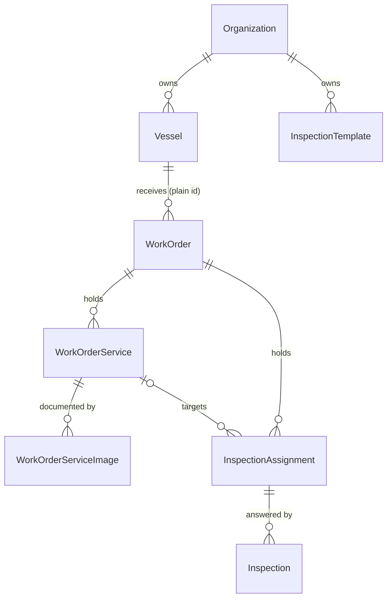

New: nothing - the create writes WorkOrder and WorkOrderService rows as today, in one transaction.

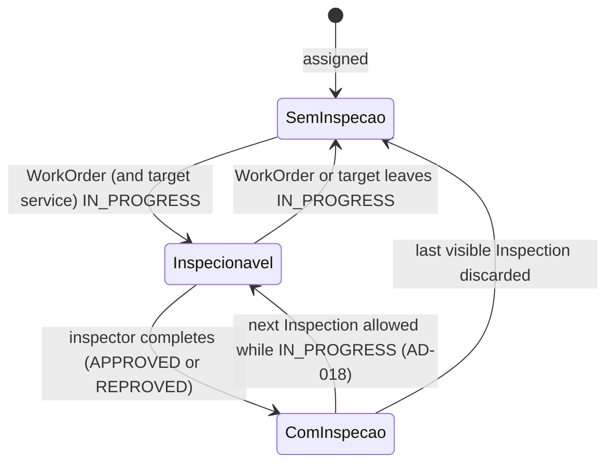

## Surface

| Route | In | Out | Status | Who |
| --- | --- | --- | --- | --- |
| `GET /work-orders` | `vesselId` optional; `take`/`skip` optional, both absent = every WorkOrder | `workOrders[]` (each with `services[]`), `total` | `200`, `400` on a bad `take`/`skip`/`vesselId`, `401` without a token | every Role of the Organization; another Organization's WorkOrders never appear |
| `POST /work-orders` | `vesselId`, `startDate`, `endDate`, `status`, `services?` (0 to 50 of `{ name, description }`) | `workOrder` | `201`, `400` invalid body, `404` Vessel not in the Organization, `401`, `403` for `inspector` | `administrator`, `operator` |
| `GET /inspection-templates` | `page`/`per_page` optional, both absent = every template | `inspectionTemplates[]`, `total` | `200`, `400`, `401` | every Role of the Organization |
| `GET /inspection-assignments` | nothing | `inspectionAssignments[]` | `200`, `401` without a token | every Role of the Organization; another Organization's assignments never appear |

## Landing

| One-way door | Literal shape | Alternative rejected |
| --- | --- | --- |
| 1. WorkOrder list contract | `GET /work-orders` -> `{ workOrders: [{ id, vesselId, startDate, endDate, status, services: [{ id, name, startDate, endDate, status }] }], total }`; `services` ordered by `startDate` then `name`; `take` and `skip` both absent = every WorkOrder of the Organization, either present = today's paging (`take` default 10, max 100) | a separate `GET /work-order-services` for the Agenda and a `serviceCount` on the list: two reads of the same rows, and the list needs the names (AD-041) |
| 2. Create with services | `POST /work-orders` body `services?: [{ name: string (min 1), description: string }]`, at most 50; each service is written with the WorkOrder's `startDate`, `endDate`, `status: PENDING` and the WorkOrder in one `prisma.$transaction`; response unchanged `{ workOrder }` | the web posting `/services` once per service after the WorkOrder: a failure halfway leaves a WorkOrder missing services (AD-035) |
| 3. Template list without paging | `GET /inspection-templates` with `page` and `per_page` both absent -> every template, `createdAt` desc; either present = today's paging | `per_page=100` from the hub: an Organization with 101 templates would lose one silently |
| 4. Organization assignment list | `GET /inspection-assignments` -> `{ inspectionAssignments: [{ id, templateName, createdAt, items, removable, inspections, service: { id, name, status } \| null, workOrder: { id, vesselId, status } }] }`, `createdAt` desc, `inspections` visible only, newest first (as `GET /work-orders/:id/inspection-assignments`) | one request per WorkOrder from the hub: N+1 requests for an Organization-wide list |
| 5. Web routes | `/work-orders`, `/work-orders/:id`, `/work-orders/:id/assignments/:assignmentId/inspect`, `/work-orders/:id/assignments/:assignmentId/inspections/:inspectionId`, `/inspections`, `/inspection-templates/:id`, `/agenda`; `/inspection-templates` redirects to `/inspections` | keeping `/inspection-templates` as the hub's URL: the hub is "Inspeções" in the menu and holds assignments too |

- Nothing else in this change is hard to reverse

## Criteria

### S1: Every WorkOrder on one page, searched, counted and exported (P1)

The "Ordens de serviço" list shows every WorkOrder of the Organization with its Vessel, Customer and services.

**Acceptance Criteria**

1. WHEN a signed-in user opens `/work-orders` THEN the system SHALL request `GET /api/work-orders`, `GET /api/vessels` and `GET /api/customers`, each once with no `take`, `skip` or `page`, and show the page in `.specs/features/work-order-ui-redesign/captures/work-order-list.png` (`.specs/features/work-order-ui-redesign/captures/source/work-orders-page.tsx`), minus the rows of `## Differences from the source`
2. WHEN `GET /work-orders` is called without `take` and `skip` THEN the API SHALL answer `200` with every WorkOrder of the session's Organization, `total` equal to their number, each with its `services` ordered by `startDate` then `name`
   - 14 WorkOrders -> 14; `take=10&skip=0` -> 10, as today; `vesselId=v1` without `take` -> every WorkOrder of v1; a WorkOrder of another Organization -> absent; services "Pintura" (10 jun) and "Motor" (2 jun) -> `["Motor", "Pintura"]`
3. The API SHALL return in `services` exactly the WorkOrderServices stored in PostgreSQL for that WorkOrder, proven by `api/test/smoke/api-smoke.sh`
   - WorkOrder with no service -> `services: []`; after `POST /work-orders/:id/services` -> 1; after its `DELETE` -> 0
4. The list SHALL be sorted by Docagem (`startDate`) descending, then by `#` code
5. The four metrics SHALL read, over every WorkOrder and never over the tab or the search: "Total de ordens" = all; "Em andamento" = `IN_PROGRESS`; "Pendentes" = `PENDING`; "Concluídas" = `COMPLETED` - each padded to two digits, with no footer line
   - 24 WorkOrders, 8 in progress, 5 pending, 7 completed, 4 cancelled -> "24", "08", "05", "07"; 120 -> "120"
6. The tabs SHALL read "Todas", "Pendente", "Em andamento", "Concluído" and "Cancelado", each with its count over every WorkOrder; WHEN the user picks one THEN the table SHALL keep only that status (all for "Todas"), mark the tab `aria-selected="true"` and go back to page 1
7. WHEN the user types in "Buscar ordem, embarcação ou cliente..." THEN the table SHALL keep, within the tab, the WorkOrders whose `#` code, Vessel name, Customer name or any service name contains the text, case-insensitive (`toLocaleLowerCase('pt-BR')`), with no request, and go back to page 1; "Limpar busca" SHALL empty it
   - "ab12cd" or "#AB12CD" -> WorkOrder `ab12cd34-…`; "aurora" -> WorkOrders of Vessel "Aurora"; "atlântico" -> WorkOrders of Customer "Pescados Atlântico"; "pintura" -> WorkOrders with a service "Pintura do casco"
8. Each row SHALL show one teal avatar, the Vessel name as a link to `/work-orders/:id`, "#AB12CD34 · <Customer name>" beneath it, under "SERVIÇO" the first service's name with "+1 serviço" / "+<n> serviços" beneath when there are more or "Nenhum serviço" alone when there is none, under "PRAZO" the Desdocagem as "Hoje, 14:30", "Amanhã, 09:00" or "20 nov, 10:00" with "Docagem em 17 nov, 09:12" beneath, and under "STATUS" the status label with the tones of `work-order-list.ts` (Pendente grey, Em andamento blue, Concluído green, Cancelado rose)
9. The table SHALL show 8 WorkOrders per page with one button per page, "Página anterior" and "Próxima página" disabled at the ends, and the footer "Exibindo <first>–<last> de <n> ordens" over the filtered WorkOrders
   - 17 filtered -> pages 1, 2, 3; page 3 -> "Exibindo 17–17 de 17 ordens"; none -> "Exibindo 0–0 de 0 ordens" and no page button
10. IF the Organization has no WorkOrder THEN the table SHALL say "Ainda não há ordens de serviço cadastradas."; IF the tab and the search match none THEN it SHALL say "Nenhuma ordem corresponde aos filtros aplicados."
11. WHILE the requests are loading the table SHALL show skeleton rows; IF one fails THEN the system SHALL show an error toast with the API message
12. WHEN the user ticks "Selecionar ordem #AB12CD34" or "Selecionar todas as ordens visíveis" (the rows of the current page) THEN those rows SHALL be selected; WHILE only some rows of the page are selected the header checkbox SHALL be indeterminate; selection SHALL survive a tab, search or page change
13. WHILE no WorkOrder is selected "Exportar" SHALL be disabled with the label "Selecione ordens para exportar"; WHEN n are selected THEN it SHALL read "Exportar (n)" with the label "Exportar 1 ordem selecionada em CSV" or "Exportar <n> ordens selecionadas em CSV"; WHEN used THEN the browser SHALL download `ordens-de-servico.csv`, UTF-8 with BOM, CRLF lines, every cell in double quotes, header `OS,Embarcação,Cliente,Serviço,Docagem,Desdocagem,Status`, one line per selected WorkOrder (hidden ones included), services joined by " · ", dates as `dd/MM/yyyy HH:mm`
    - `#AB12CD34`, Aurora, Pescados Atlântico, "Motor" and "Pintura", 17/11/2026 09:12, 20/11/2026 10:00, IN_PROGRESS -> `"#AB12CD34","Aurora","Pescados Atlântico","Motor · Pintura","17/11/2026 09:12","20/11/2026 10:00","Em andamento"`; a Vessel named `=SUM(A1)` -> `"'=SUM(A1)"`; a `"` -> `""`
14. WHEN the user opens "Ações para #AB12CD34" THEN a menu SHALL offer "Ver detalhes" (opens `/work-orders/:id`) and, for a writer, "Editar" (criterion 25) and "Excluir"; WHEN a writer confirms "Tem certeza que deseja excluir esta ordem de serviço? Esta ação não pode ser desfeita." THEN the system SHALL `DELETE /api/work-orders/:id`, show "Ordem de serviço excluída com sucesso", drop the row and its selection; IF the API answers `409` (an Inspection exists) THEN the row SHALL stay and the system SHALL show an error toast with the API message
15. WHILE the user's Role is `inspector` the page SHALL show no "Nova ordem de serviço", no "Editar" and no "Excluir"; selection and "Exportar" SHALL stay
16. The sidebar SHALL show under "MENU PRINCIPAL" "Visão geral", "Ordens de serviço" (`/work-orders`), "Inspeções" (`/inspections`), "Embarcações", "Clientes" and "Agenda" (`/agenda`), in that order, and "Modelos de inspeção" no more; on `/work-orders[/…]`, `/inspections`, `/inspection-templates/:id`, `/work-orders/:id/assignments/…` and `/agenda` the topbar SHALL read "Operação" > "Ordens de serviço", "Inspeções", "Inspeções", "Inspeções" and "Agenda", with that menu item `aria-current="page"` (AD-032, AD-048)
    - operator of a client Organization -> six items, no "GESTÃO"; internal Administrator -> six items and "Organizações"
17. WHILE the window is 640, 768, 1024, 1280 or 1536px wide the new pages SHALL have no horizontal page scroll - only a table or the week grid scrolls inside its panel; WHILE the dark theme is on the status badges SHALL take their dark tones

### S2: A WorkOrder created with its services in one drawer (P1)

"Nova ordem de serviço" creates the WorkOrder and its services in one request, from the list and from a Vessel.

**Acceptance Criteria**

18. WHEN a writer uses "Nova ordem de serviço" THEN the system SHALL open the drawer in `.specs/features/work-order-ui-redesign/captures/work-order-drawer.png` with: "Embarcação *" as a select of every Vessel by name starting at "Selecione uma embarcação"; "Cliente responsável" read only, showing the chosen Vessel's Customer name, with no "Adicionar cliente"; "Serviços a realizar" with "Serviço 1" holding "Nome do serviço *" and "Descrição do serviço *" (at most 240 characters), "Adicionar serviço", and "Remover serviço <n>" only while there are two or more; "Planejamento" with "Defina o período e o status da ordem", "Docagem *", "Desdocagem *" and "Status" (starting at "Pendente"); the footer "* Campos obrigatórios", "Cancelar" and "Criar ordem"
19. WHEN the writer fills it and uses "Criar ordem" THEN the system SHALL `POST /api/work-orders` once with `vesselId`, `startDate`, `endDate`, `status` and `services` in the drawer's order, close the drawer, show "Ordem de serviço criada com sucesso" and show the new WorkOrder in the list with its first service
20. IF a required field is empty THEN "Criar ordem" SHALL send no request and the field SHALL show its message ("Embarcação é obrigatória", "Nome do serviço é obrigatório", "Descrição do serviço é obrigatória", "Data de início é obrigatória", "Data de fim é obrigatória")
21. WHEN `POST /work-orders` carries `services` THEN the API SHALL answer `201` and store the WorkOrder and one WorkOrderService per item with the WorkOrder's `startDate` and `endDate` and status `PENDING`, all in one transaction
    - 2 services -> 2 stored; no `services` -> none, as today; 51 services -> `400`, nothing stored; second service with `name: ""` -> `400`, nothing stored; Vessel of another Organization -> `404`, nothing stored
22. The API SHALL make criterion 21 hold in PostgreSQL, proven by `api/test/smoke/api-smoke.sh`: after a create with 2 services `GET /work-orders/:id/services` answers both with the WorkOrder's period and `PENDING`; after a `400` create `GET /work-orders` keeps the same `total`
23. IF the API answers an error to the create THEN the drawer SHALL stay open with the values typed and the system SHALL show an error toast with the API message
24. WHEN a writer uses "Nova ordem" on `/vessels/:id` THEN the system SHALL open the same drawer with that Vessel chosen and "Embarcação" disabled; after "Criar ordem" the WorkOrder SHALL appear in that Vessel's table (AD-042)
25. WHEN a writer uses "Editar" (row menu or WorkOrder detail) THEN the system SHALL open the drawer titled "Editar ordem de serviço" with the WorkOrder's Vessel shown disabled, no "Serviços a realizar", Docagem, Desdocagem and Status filled, and "Salvar alterações"; WHEN they save THEN the system SHALL `PUT /api/work-orders/:id` with `startDate`, `endDate`, `status`, show "Ordem atualizada com sucesso" and the new values where it was opened
26. WHEN the user uses "Cancelar", "Fechar formulário" or Esc THEN the drawer SHALL close with no request

### S3: WorkOrder detail in the mareos look (P1)

The WorkOrder detail keeps its content in the mareos look, with a back link that works (AD-033).

**Acceptance Criteria**

27. WHEN a user opens `/work-orders/:id` THEN the system SHALL show a breadcrumb link "Ordens de serviço" to `/work-orders`, "/", "OS #AB12CD34"; the kicker "ORDEM DE SERVIÇO", the title "OS #AB12CD34" and its status badge; a panel with the Vessel name as a link to `/vessels/:vesselId`, its type label ("Carga", "Tanque", …) and length in pt-BR ("32,5 m"); "Docagem" and "Desdocagem" as "17 de novembro de 2026, 09:12" with the weekday; and no "Atividade recente" and no "Voltar para detalhes da embarcação" (AD-033)
28. The "Serviços" panel SHALL list the services with "Serviço" (name and description), "Início", "Fim" and "Status" (Pendente grey, Em andamento blue, Concluído green); a writer SHALL see "Novo serviço", which opens a drawer with "Nome", "Descrição", "Início", "Fim" and "Status" and `POST`s as today ("Serviço criado com sucesso"), and "Enviar foto de <name>", which uploads as today ("Foto enviada"); IF there is none THEN it SHALL show "Nenhum serviço executado" and "Não há serviços registrados para esta ordem."
29. The "Inspeções" panel SHALL list the assignments with what they show today (template, target, question count, history); an administrator SHALL keep "Atribuir modelo" and remove with confirmation; WHEN an inspector uses "Inspecionar" THEN the system SHALL open `/work-orders/:id/assignments/:assignmentId/inspect`; WHEN anyone uses an Inspection of the history THEN the system SHALL open `/work-orders/:id/assignments/:assignmentId/inspections/:inspectionId`
30. IF the WorkOrder does not exist or belongs to another Organization THEN the system SHALL show "Ordem de serviço não encontrada", "Esse registro não está disponível na sua organização." and a link "Voltar para ordens de serviço" to `/work-orders`, inside the shell
31. WHILE the WorkOrder is loading the page SHALL show skeletons in place of the header and panels
32. WHILE the user's Role is `inspector` the page SHALL show no "Editar", "Novo serviço", "Enviar foto de <name>", "Atribuir modelo" or remove

### S4: The Inspections hub (P1)

"Inspeções" shows the templates as cards and every assignment of the Organization, by Role (AD-038).

**Acceptance Criteria**

33. WHEN an administrator opens `/inspections` THEN the system SHALL request `GET /api/inspection-templates` (no `page`), `GET /api/inspection-assignments`, `GET /api/work-orders` and `GET /api/vessels`, each once, and show the page in `.specs/features/work-order-ui-redesign/captures/inspection-templates.png` (`.specs/features/work-order-ui-redesign/captures/source/inspection-management.tsx`), minus `## Differences from the source`, with no "Gestão"/"Inspetor" switch
34. WHEN `GET /inspection-assignments` is called THEN the API SHALL answer `200` with every InspectionAssignment of the session's Organization, `createdAt` descending, each with its `workOrder` (`id`, `vesselId`, `status`), its `service` (`id`, `name`, `status`) or `null`, `templateName`, `items`, `removable` and its visible `inspections`, newest first; another Organization's assignments SHALL be absent; without a token `401`
    - 3 assignments over 2 WorkOrders -> 3; one with a discarded Inspection -> that Inspection absent, `removable: false`
35. The API SHALL read criterion 34 from PostgreSQL, proven by `api/test/smoke/api-smoke.sh`: after an assignment is created its `workOrder.status` equals the stored WorkOrder's; after the WorkOrder is edited to `IN_PROGRESS` the next call shows `IN_PROGRESS`
36. WHEN `GET /inspection-templates` is called without `page` and `per_page` THEN the API SHALL answer every template of the Organization, `createdAt` descending; with them, today's paging
    - 12 templates -> 12; `page=1` -> 10
37. The metrics SHALL read "Modelos ativos" = templates ("roteiros"), "Aguardando conclusão" = assignments with no visible Inspection ("atribuições") and "Concluídas" = visible Inspections ("inspeções"), padded to two digits
38. WHILE the Role is `administrator` or `operator` the panel "Central de inspeções" SHALL show the tabs "Modelos <n>" and "Atribuições <n>", "Modelos" first; each template card SHALL show "MODELO", the name as a link to `/inspection-templates/:id`, "1 pergunta" / "<n> perguntas", "Criado em 18 nov, 2026" and, for an administrator, "Atribuir à OS"; an administrator SHALL see "Novo modelo" in the heading and the last card "Criar outro modelo" ("Monte um roteiro para uma nova rotina de inspeção"); IF there is no template THEN the tab SHALL say "Nenhum modelo de inspeção cadastrado"
39. WHEN an administrator uses "Novo modelo" or "Criar outro modelo" THEN the system SHALL open the drawer in `.specs/features/work-order-ui-redesign/captures/inspection-template-drawer.png` with "BIBLIOTECA DE INSPEÇÕES", "Novo modelo", "Defina as perguntas que o inspetor deverá responder em campo.", "Nome do modelo", "Perguntas" with "Todas as perguntas precisam ser respondidas; “Não se aplica” vale como resposta.", "Adicionar", and per question "Pergunta 01", "Enunciado", "Tipo de resposta" ("Texto livre", "Sim ou não", "Conforme / não conforme", "Nota de 0 a 10"), "Subir", "Descer" (AD-051) and "Remover pergunta <n>" while there are two or more; WHEN they use "Criar modelo" THEN the system SHALL `POST /api/inspection-templates`, close the drawer, show "Modelo de inspeção criado com sucesso" and the new card first; IF the API answers `409` THEN the drawer SHALL stay open and the system SHALL show today's name-taken toast
40. WHEN an administrator uses "Atribuir à OS" on a card THEN the system SHALL open the drawer in `.specs/features/work-order-ui-redesign/captures/inspection-assignment-drawer.png` with "ATRIBUIR INSPEÇÃO", "Escolha a OS e o alvo", "A inspeção usará o modelo <name>.", "Ordem de serviço" (every WorkOrder as "#AB12CD34 · <Vessel> — <first service or Nenhum serviço>", starting at "Selecione uma ordem"), "Alvo" ("Ordem de serviço inteira" and the chosen WorkOrder's services) and "<n> perguntas"; WHEN they use "Atribuir inspeção" THEN the system SHALL `POST /api/work-orders/:id/inspection-assignments` with `templateId` and `serviceId` when a service is chosen, show "Modelo atribuído com sucesso" and open the "Atribuições" tab with the new assignment first
41. The "Atribuições" tab SHALL show the page in `.specs/features/work-order-ui-redesign/captures/inspection-assignments.png`: per assignment "#AB12CD34 · <Vessel>", the template name, "<service name or Ordem de serviço inteira> · <n> perguntas", the pill "Sem inspeção" (amber) when it has no visible Inspection or the latest result "Aprovada" (green) / "Reprovada" (rose), and "Abrir ordem", which opens `/work-orders/:id`; IF there is none THEN "Nenhuma inspeção atribuída" and "Quando um modelo for atribuído a uma ordem de serviço, ele aparecerá aqui."
42. WHEN an inspector opens `/inspections` THEN the system SHALL show the page in `.specs/features/work-order-ui-redesign/captures/inspection-inspector-view.png` with no tabs, no "Novo modelo", no switch and no demo notice: the panel "Atribuições de inspeção" ("Abra uma atribuição para preencher o roteiro em campo.") lists every assignment, those inspectable now (WorkOrder `IN_PROGRESS` and, with a target, the service `IN_PROGRESS`) first, then `createdAt` descending, each with "Inspecionar" and "Abrir ordem"; "Inspecionar" SHALL be disabled with "Disponível com a ordem em andamento" or "Disponível com o serviço em andamento" beneath when not inspectable (AD-043)
43. WHEN a user opens `/inspection-templates` THEN the system SHALL redirect to `/inspections`
44. WHEN a user opens `/inspection-templates/:id` THEN the system SHALL show a breadcrumb link "Inspeções" to `/inspections`, "/", the name; the kicker "MODELO DE INSPEÇÃO", the name, "<n> perguntas · criado em 18/11/2026", and the questions numbered "01", "02"… with their type label; an administrator SHALL see "Editar", which opens the drawer of criterion 39 titled "Editar modelo" with the template's values, "Altere o nome e as perguntas; atribuições já feitas mantêm as perguntas antigas" and "Salvar alterações" (`PUT`, today's toast), and "Excluir", which asks today's confirmation, `DELETE`s and returns to `/inspections` (AD-039)
45. IF the template does not exist or belongs to another Organization THEN the page SHALL show "Modelo de inspeção não encontrado" and a link "Voltar para inspeções" to `/inspections`
46. WHILE the hub's requests are loading the metrics and the panel SHALL show skeletons; IF one fails THEN the system SHALL show an error toast with the API message

### S5: An Inspection answered and read on a full page (P1)

The inspector answers the checklist on a page, and a completed Inspection is read on the same page.

**Acceptance Criteria**

47. WHEN an inspector uses "Inspecionar" THEN the system SHALL open `/work-orders/:id/assignments/:assignmentId/inspect` and show the page in `.specs/features/work-order-ui-redesign/captures/inspection-run.png` (`.specs/features/work-order-ui-redesign/captures/source/inspection-run.tsx`) with: the back link "Voltar às inspeções" to `/inspections` when opened from the hub, "Voltar à ordem de serviço" to `/work-orders/:id` otherwise; the kicker "INSPEÇÃO DE CAMPO · #AB12CD34"; the template name; "Responda às perguntas e registre as condições encontradas."; no status pill; "Embarcação" (the Vessel name), "Inspetor" (the signed-in user's name) and "Progresso" ("<answered> de <total> respondidas"); "Roteiro de inspeção", "Preencha cada item antes de concluir." and "<n> perguntas"
48. The inspection page SHALL show each question as a card numbered "01", "02"… with the label and, by type: "Sim" / "Não", "Conforme" / "Não conforme", "0" to "10", or a text box ("Registre sua observação", at most 1000 characters); every question SHALL offer "Não se aplica", and every non-text question "Observação (opcional)" (at most 500 characters); every answer control SHALL be at least 40px tall
49. WHEN the inspector answers or clears a question THEN "Progresso" SHALL change at once
    - 3 questions, 2 answered -> "2 de 3 respondidas"; "Não se aplica" counts as answered
50. IF the inspector uses "Concluir inspeção" with a question unanswered THEN the system SHALL send no request, show "Responda à pergunta obrigatória: “<label>”." (`role="alert"`) and focus the first unanswered question
51. WHEN every question is answered and the inspector uses "Concluir inspeção" THEN the system SHALL ask "Escolha o resultado desta inspeção." with "Aprovada" and "Reprovada" and nothing chosen (AD-019); WHEN they confirm THEN the system SHALL `POST /api/work-orders/:id/inspection-assignments/:assignmentId/inspections`, show "Inspeção registrada com sucesso" and return to the page it was opened from, where the Inspection shows
52. IF the API answers an error THEN the page SHALL keep the answers and the system SHALL show an error toast with the API message
53. The page SHALL say "As respostas só são gravadas ao concluir a inspeção." beside "Concluir inspeção" and show no "Fotos de evidência"
54. IF the assignment cannot be inspected now THEN the page SHALL show the reason of criterion 42 and no "Concluir inspeção"; IF the user is not an `inspector` THEN `/…/inspect` SHALL show `/forbidden`; IF the assignment does not exist in the Organization THEN the page SHALL show "Atribuição não encontrada" and "Voltar à ordem de serviço"
55. WHEN a user opens an Inspection of the history THEN the page `/work-orders/:id/assignments/:assignmentId/inspections/:inspectionId` SHALL show the same header with the pill "Aprovada" or "Reprovada", "Inspetor" = the Inspection's `inspectorName`, every answer as it reads today ("Sim", "Conforme", "7", "Não se aplica", the text) with its note, "Concluída em 18/11/2026 14:30", and no answer controls and no "Concluir inspeção"
56. WHILE the Role is `inspector`, WHEN they use "Descartar" on that page and confirm "Tem certeza que deseja descartar esta inspeção? Ela deixará de aparecer no app." THEN the system SHALL `POST .../inspections/:inspectionId/discard`, show "Inspeção descartada com sucesso" and return to `/work-orders/:id`, where it no longer shows
57. WHILE the window is 640px wide the inspection page SHALL wrap the answer options with no horizontal page scroll

### S6: A week of services and dockings on the Agenda (P2)

The Agenda shows each service at its start and each WorkOrder at its Docagem and Desdocagem (AD-036).

**Acceptance Criteria**

58. WHEN a user opens `/agenda` THEN the system SHALL request `GET /api/work-orders` and `GET /api/vessels`, each once with no `take`, and show the page in `.specs/features/work-order-ui-redesign/captures/agenda.png` (`.specs/features/work-order-ui-redesign/captures/source/agenda-page.tsx`), minus `## Differences from the source`, on the current week (Monday to Sunday) with today selected and highlighted
59. The grid SHALL place each service of a WorkOrder that is not `CANCELLED` at its `startDate` as "Serviço", and each such WorkOrder at its `startDate` as "Docagem" and its `endDate` as "Desdocagem", in the column of its day and the row of its hour - rows "08:00", "10:00", "12:00", "14:00", "16:00", "18:00"; before 08:00 in "08:00", from 18:00 in "18:00" - sorted by time within a cell; each item SHALL show "HH:mm", the Vessel name, the service name or "Docagem" / "Desdocagem", and "#AB12CD34"
    - service Tue 09:30 -> Tue, row 08:00; Docagem 06:00 -> row 08:00; Desdocagem 21:00 -> row 18:00; a `CANCELLED` WorkOrder -> none of its items
60. The Agenda SHALL show in each day header the weekday ("SEG"…"DOM"), the day number and "1 item" / "<n> itens" or "Livre"
61. WHEN the user uses "Hoje" THEN the week of today and today SHALL be shown; "Semana anterior" / "Próxima semana" SHALL move 7 days, and in the "Dia" view "Dia anterior" / "Próximo dia" 1 day; the label SHALL read "Novembro 2026" when the week is in one month, or "30 de nov — 06 de dez, 2026" otherwise, with "16 de nov — 22 de nov" beneath (AD-049)
62. WHEN the user picks "Dia" THEN only the selected day's column SHALL show; "Semana" brings the week back; WHEN the user uses a day header THEN that day SHALL become the selected day
63. The "Tipo:" chips "Todas <n>", "Serviço", "Docagem" and "Desdocagem" and the search "Buscar serviço..." (Vessel name, service name, `#` code; "Limpar busca") SHALL filter the grid, the day panel and the metrics, with no request
64. The metrics SHALL read "Compromissos na semana" = items of the shown week ("na programação") and "Docagens programadas" = Docagem items of the shown week ("berço e área técnica"), padded to two digits
65. The panel "SELEÇÃO DO DIA" SHALL show the selected day as "Quarta-feira, 18 de novembro", "1 compromisso" / "<n> compromissos", "Dia produtivo" when it has items, or "Dia sem compromissos", "Aproveite para organizar uma nova manutenção." and "Adicionar à agenda" (opening the drawer of criterion 67 at that day 08:00) when it has none, and its items by time (AD-049)
66. WHEN the user uses an item in the grid or the panel THEN the system SHALL open `/work-orders/:id`
67. WHEN a writer uses "Novo compromisso", an empty cell ("Criar compromisso em <Quarta-feira, 18 de novembro> às <10:00>") or "Adicionar compromisso neste dia" THEN the system SHALL open the drawer "NOVO COMPROMISSO" / "Adicionar à agenda" / "Reserve um horário para um serviço da ordem." (AD-049) with "Ordem de serviço *" (WorkOrders `PENDING` or `IN_PROGRESS` as "#AB12CD34 · <Vessel>"), "Serviço *" ("Ex.: Revisão do motor"), "Descrição *", "Início *" (the cell's day and hour, or the selected day at 08:00) and "Fim *"; WHEN they use "Agendar serviço" THEN the system SHALL `POST /api/work-orders/:id/services` with `status: PENDING`, show "Serviço criado com sucesso" and the item on the grid (AD-037)
68. WHILE the Role is `inspector` the Agenda SHALL show no "Novo compromisso", no cell buttons and no "Adicionar compromisso neste dia"
69. The Agenda SHALL show no "Equipes escaladas", "Janelas livres", "Ver disponibilidade", "Todas as equipes", "CONDIÇÕES DO PORTO", "Equipes em operação", "Horário da oficina" or "Dados de demonstração"
70. WHILE the requests are loading the grid SHALL show skeleton cells; IF one fails THEN the system SHALL show an error toast with the API message

## Out of scope

| Excluded | Why |
| --- | --- |
| Priority, team, service category, a single due date, "Aberta em", the mareos statuses, template description, "Permitir fotos", optional questions, the inspector named on an assignment, photos on an Inspection | not in the stored model; the user chose to omit them (AD-034) |
| Showing, listing and deleting WorkOrderService images on the web; editing and deleting a WorkOrderService on the web | the API offers them but the web never did; a new capability, not asked here - a separate change |
| Tide, teams, free slots and availability on the Agenda | no data behind them (AD-034) |
| The mareos dashboard's "Ordens de serviço" panel, "Equipe técnica", "Estoque e peças", "Relatórios" | other modules; this change is the `work-order` module |
| A rule that Docagem is not after Desdocagem | the API has none today; not asked |
| In-page notices and in-drawer errors | toasts stay (AD-026) |
| Notifications, help, workshop status, help card, page footer | no equivalent (AD-025) |

## Assumptions

| Assumption | Chosen default | Rationale | Confirmed? |
| --- | --- | --- | --- |
| Widths the screens must work at | 640, 768, 1024, 1280 and 1536px | the widths the user gave for the customer redesign | n |
| Order of the WorkOrder list | Docagem descending | the source's order is sample data; the newest work first | n |
| "Selecionar todas as ordens visíveis" | the rows of the current page | they are the rows the user sees; the source has no real pages | n |
| Order of `services` and so the "first service" | `startDate`, then `name` | the first service is the first to start | n |
| Relative dates under "PRAZO" | "Hoje" and "Amanhã" by the browser's local day, otherwise "20 nov, 10:00" | follows the source's sample ("Hoje, 14:30", "18 jun, 15:00") | n |
| Maximum services in one create | 50 | a bound the drawer never reaches by hand; protects the transaction | n |
| Agenda week start | Monday | the source's `weekDaysFor` | n |

**Open questions:** none - all resolved or logged above. The four blocks asked on 2026-11-17 were answered "Aceito (Recomendado)" and are AD-044 to AD-047.

## Differences from the source

| Source shows | Product shows | Confirmed |
| --- | --- | --- |
| Code "OS-2481" | "#AB12CD34" (first 8 characters of the id) | y - AD-034 |
| Metric footers "no período", "4 equipes ativas", "Peças ou aprovação", "92% no prazo" | no footer | y - AD-034 |
| Metrics "Aguardando ação" and "Concluídas no mês" | "Pendentes" and "Concluídas" (all time) | y - AD-044 |
| Tabs "Em andamento", "Aguardando peça", "Agendada", "Concluída" | "Pendente", "Em andamento", "Concluído", "Cancelado" | y - AD-034 |
| "Prioridade" filter and "PRIORIDADE" column | nothing | y - AD-034 |
| "EQUIPE RESPONSÁVEL" column | nothing | y - AD-034 |
| "SERVIÇO" with description and category | first service name and "+n serviços" / "Nenhum serviço" | y - AD-041 |
| "PRAZO" with due time and "Aberta em …" | Desdocagem and "Docagem em …" | y - AD-044 |
| Avatars coloured per row | one teal avatar | y - AD-044 |
| "…" shows a notice listing actions | menu "Ver detalhes", "Editar", "Excluir" | y - AD-044 |
| Pages "1" and "2" only | one button per page | y - AD-044 |
| CSV columns OS, Embarcação, Cliente, Serviço, Categoria, Equipe, Prazo, Data de abertura, Prioridade, Status | OS, Embarcação, Cliente, Serviço, Docagem, Desdocagem, Status | y - AD-044 |
| "Cliente responsável" select and "Adicionar cliente" | the Vessel's Customer, read only | y - AD-044 |
| "Tipo de serviço" select of categories | "Nome do serviço" text field | y - AD-044 |
| "Equipe responsável", "Prazo previsto", "Prioridade"; "Defina prazo, prioridade e equipe técnica" | "Docagem", "Desdocagem", "Status"; "Defina o período e o status da ordem" | y - AD-034 |
| In-page notices after an action | toasts | y - AD-026 |
| "MARÉOS" footer, notifications, help, "Oficina em operação", menu counter "12" | nothing | y - AD-025 |
| Menu "Equipe técnica", "Organizações" in "MENU PRINCIPAL", "Estoque e peças", "Relatórios" | omitted; "Organizações" stays under "GESTÃO" | y - AD-024 |
| "Templates", "Novo template", "TEMPLATE", "Criar outro template", "Templates ativos", "Nome do template", "Criar template", "template" in sentences | "Modelos", "Novo modelo", "MODELO", "Criar outro modelo", "Modelos ativos", "Nome do modelo", "Criar modelo", "modelo" | y - AD-046 |
| "Gestão" / "Inspetor" switch and the demo notice | nothing; the Role decides | y - AD-038 |
| Template description, "Fotos permitidas" / "Sem fotos", "Permitir fotos na inspeção", "Obrigatória" | nothing | y - AD-034 |
| "As perguntas marcadas como obrigatórias precisam ser respondidas." | "Todas as perguntas precisam ser respondidas; “Não se aplica” vale como resposta." | y - AD-019 |
| Types "Texto livre", "Sim ou não", "Conforme / não conforme" | the same plus "Nota de 0 a 10" | y - AD-019 |
| "Escolha OS e inspetor", "Inspetor responsável", "Fotos permitidas" in the assignment drawer | "Escolha a OS e o alvo", "Alvo", only "<n> perguntas" | y - AD-046 |
| Assignment pills "Pendente", "Em andamento", "Concluída"; inspector name on the card | "Sem inspeção", "Aprovada", "Reprovada"; the target | y - AD-046 |
| "Abrir inspeção", "Iniciar inspeção", "Ver respostas" | "Inspecionar" (inspector) and "Abrir ordem" | y - AD-046 |
| "Inspeções de <inspetor>", "Abra uma ordem para preencher o roteiro em campo." | "Atribuições de inspeção", "Abra uma atribuição para preencher o roteiro em campo." | y - AD-046 |
| "Quando uma ordem for atribuída a este inspetor, ela aparecerá aqui." | "Quando um modelo for atribuído a uma ordem de serviço, ele aparecerá aqui." | y - AD-046 |
| No template detail page | the detail page in the mareos look | y - AD-039 |
| "Voltar às inspeções" always | "Voltar às inspeções" from the hub, "Voltar à ordem de serviço" from the WorkOrder | y - AD-045 |
| Status pill "Em andamento" while answering | no pill; "Aprovada" / "Reprovada" on a completed Inspection | y - AD-045 |
| "0 de 2 obrigatórias" | "0 de 3 respondidas" | y - AD-045 |
| "Não se aplica" only on conformity questions | on every question, with "Observação (opcional)" on non-text ones | y - AD-019 |
| "Fotos de evidência" | nothing | y - AD-034 |
| "As respostas ficam salvas durante esta sessão." | "As respostas só são gravadas ao concluir a inspeção." | y - AD-045 |
| "Concluir inspeção" completes at once | asks "Aprovada" / "Reprovada" first | y - AD-019 |
| "Ver respostas" reopens the form read only | a read-only page per Inspection with "Descartar" for an inspector | y - AD-045 |
| "Serviços, docagens e equipes em um só rumo." | "Serviços e docagens em um só rumo." | y - AD-047 |
| "Tipo" chips Motor, Hidráulica, Elétrica, Docagem, Inspeção, Entrega; legend Manutenção, Inspeção, Docagem, Entrega | "Serviço", "Docagem", "Desdocagem" | y - AD-036 |
| Team on each item; "Todas as equipes"; "Equipes escaladas"; "Equipes em operação" | `#` code on each item; nothing else | y - AD-047 |
| "Janelas livres", "Ver disponibilidade", "CONDIÇÕES DO PORTO", "Horário da oficina", "Dados de demonstração" | nothing | y - AD-047 |
| "1 itens" | "1 item" | y - AD-047 |
| "Exportar n ordens selecionadas em CSV", "n perguntas", "n compromissos" also for 1 | "Exportar 1 ordem selecionada em CSV", "1 pergunta", "1 compromisso" | y - AD-050 |
| Template drawer with no way to reorder questions | "Subir" / "Descer" while there are two or more questions | y - AD-051 |
| An item opens "DETALHES DO COMPROMISSO" | an item opens the WorkOrder | y - AD-047 |
| Every event shown | items of a `CANCELLED` WorkOrder hidden | y - AD-047 |
| "Adicionar à agenda" drawer with Embarcação, Serviço, Tipo, Equipe, Data, Horário; "Reserve um horário para a embarcação e equipe." | Ordem de serviço, Serviço, Descrição, Início, Fim; "Reserve um horário para um serviço da ordem." | y - AD-037, AD-049 |
| "Central de inspeções" tabs joined to a rule | the pill tabs of "Lista de ordens", no rule under them | y - AD-096 |

## Sources

- mareos prototype, `/home/luciano/workspace/development/apps/mareos` (Next.js, `.claude/launch.json` "mareos", port 3100), captured 2026-11-17 at 1440px, light theme - binding - the "Ordens de serviço", "Inspeções" and "Agenda" screens; the "1 Insight" pill is the Next.js dev overlay
- `captures/source/` - binding - the mareos source of the captured screens (`work-orders-page.tsx`, `inspection-management.tsx`, `inspection-forms.tsx`, `inspection-run.tsx`, `inspection-store.tsx`, `inspection.module.css`, `agenda-page.tsx`, `agenda.module.css`, `globals.css`): labels, aria-labels, the filter, search, CSV and week rules
- 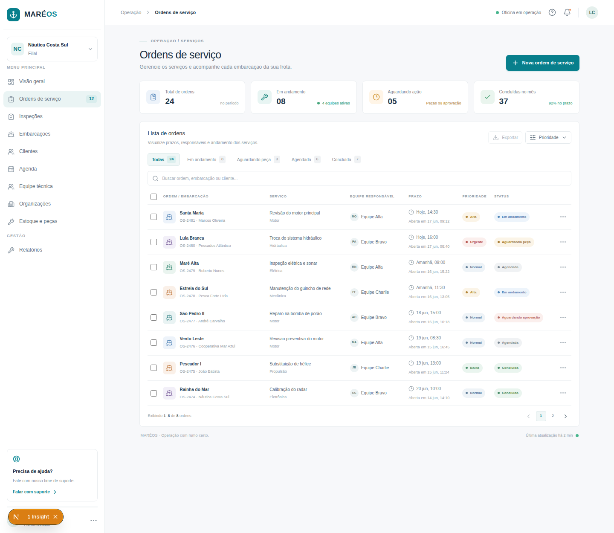 - binding - WorkOrder list, 1440x1250
- 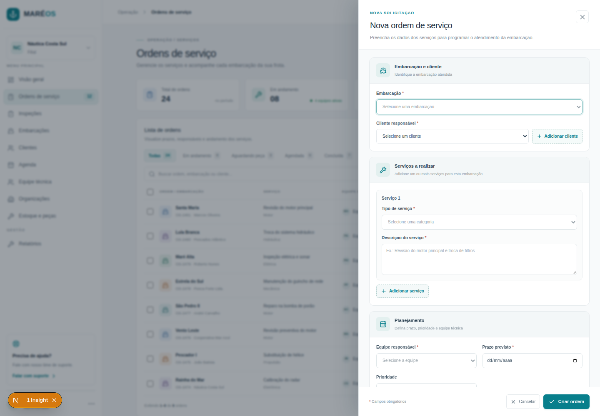 - binding - "Nova ordem de serviço" drawer
- 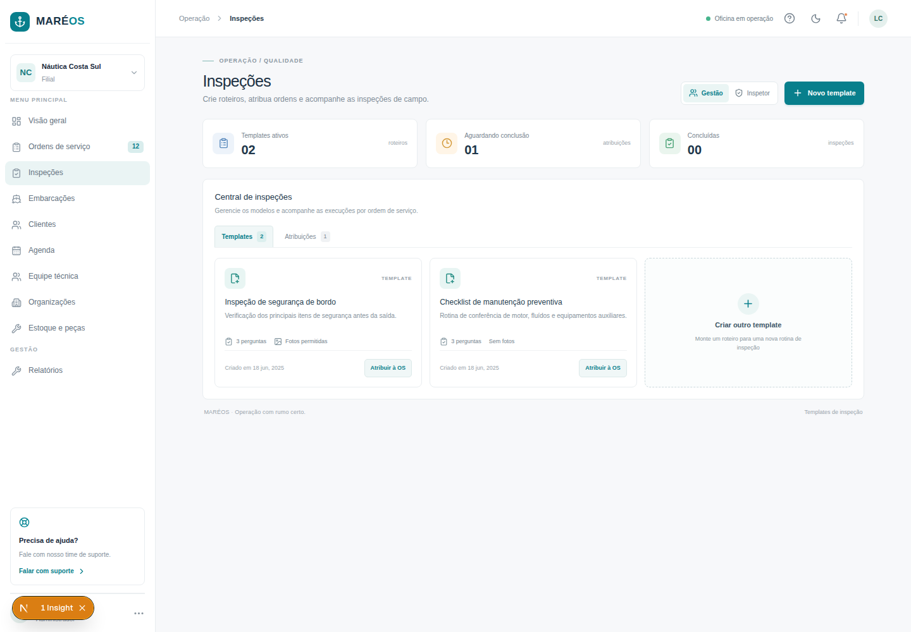 - binding - Inspections hub, "Templates" tab
- 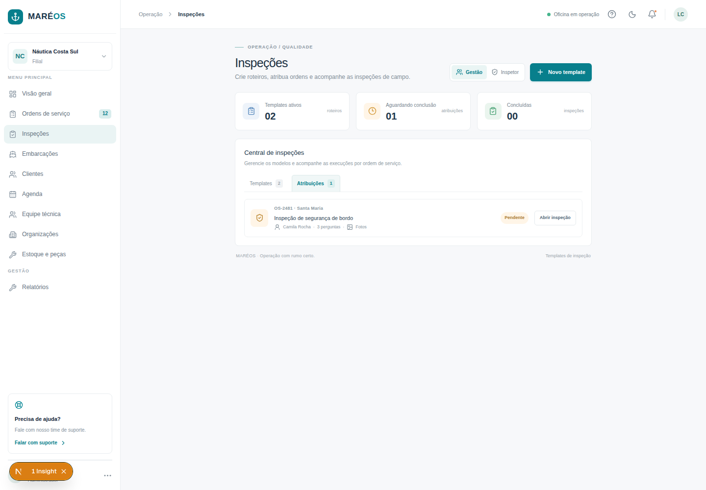 - binding - Inspections hub, "Atribuições" tab
- 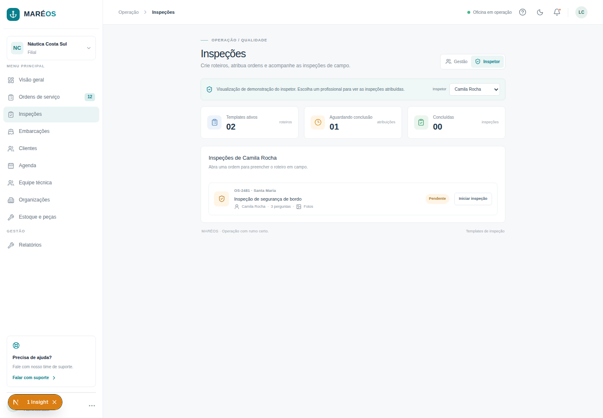 - binding - Inspections hub, "Inspetor" view
- 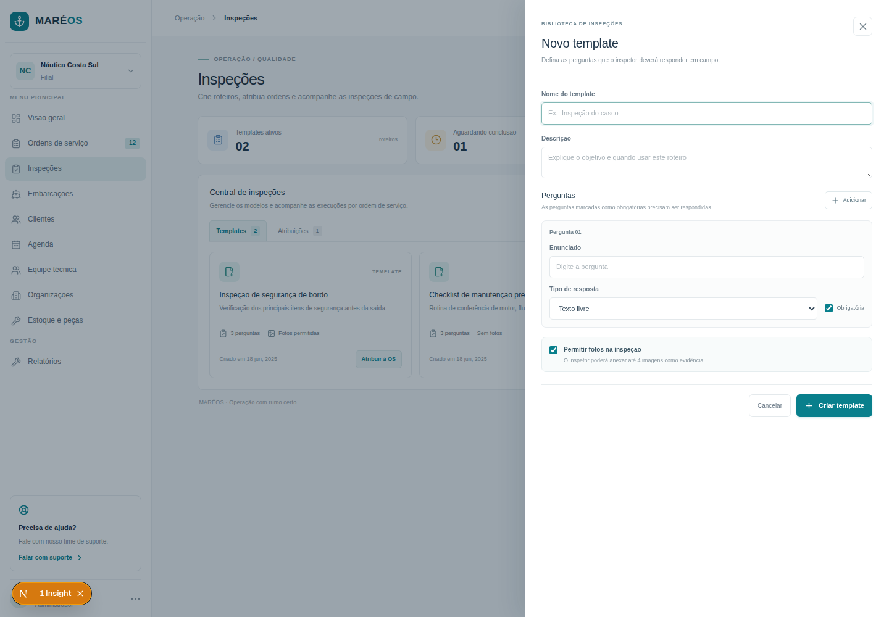 - binding - "Novo template" drawer
- 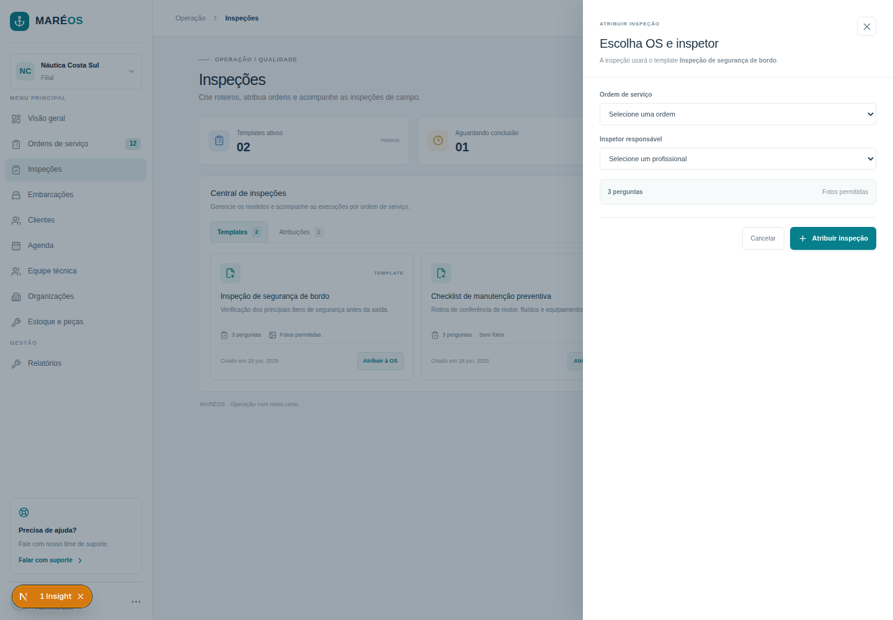 - binding - "Atribuir inspeção" drawer
- 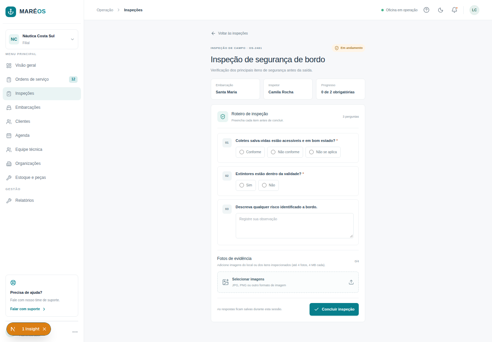 - binding - inspection answered on a full page
- 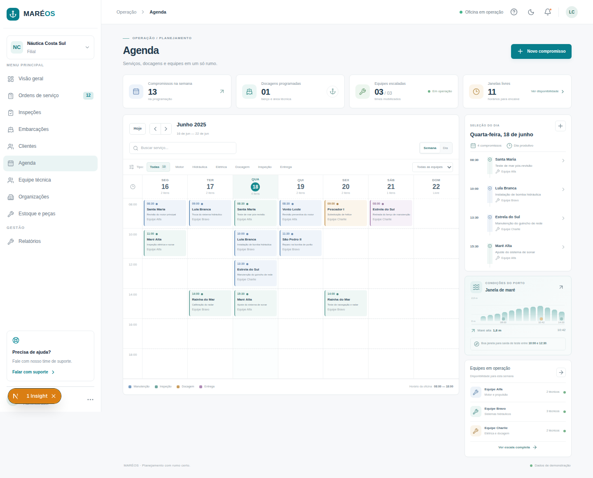 - binding - Agenda, week view, full page
- `.specs/features/customer-ui-redesign/plan.md` and `.specs/STATE.md` AD-020 to AD-031 - the shell, palette and patterns this conforms to; AD-032 to AD-043 - the answers of 2026-11-17
