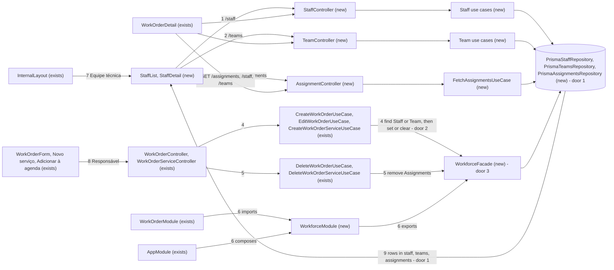
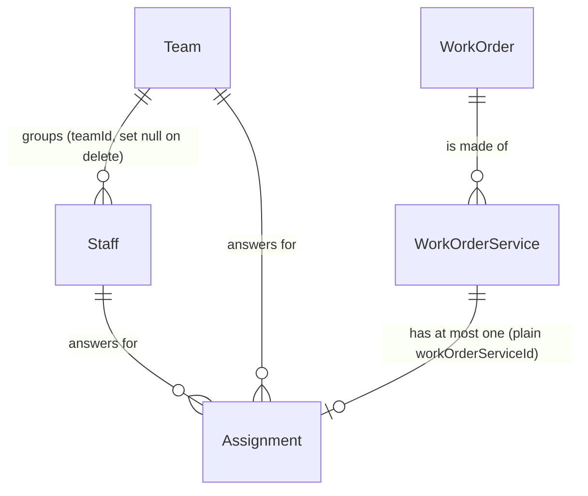
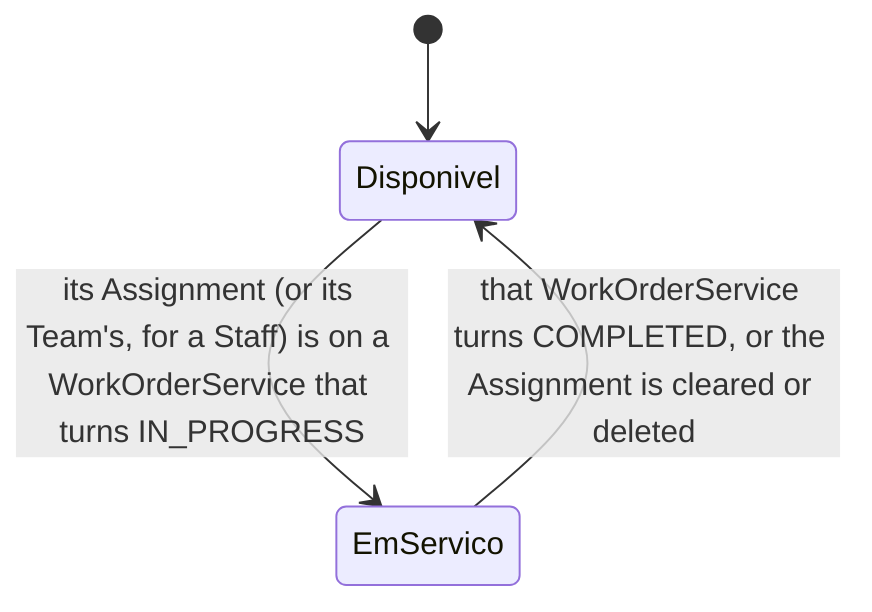
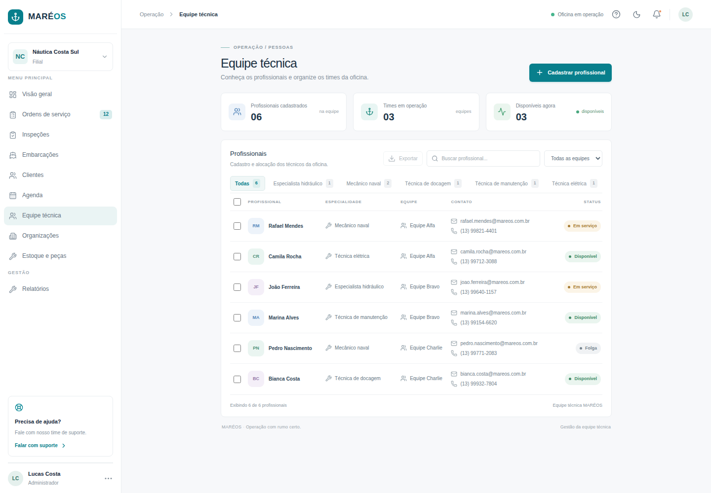
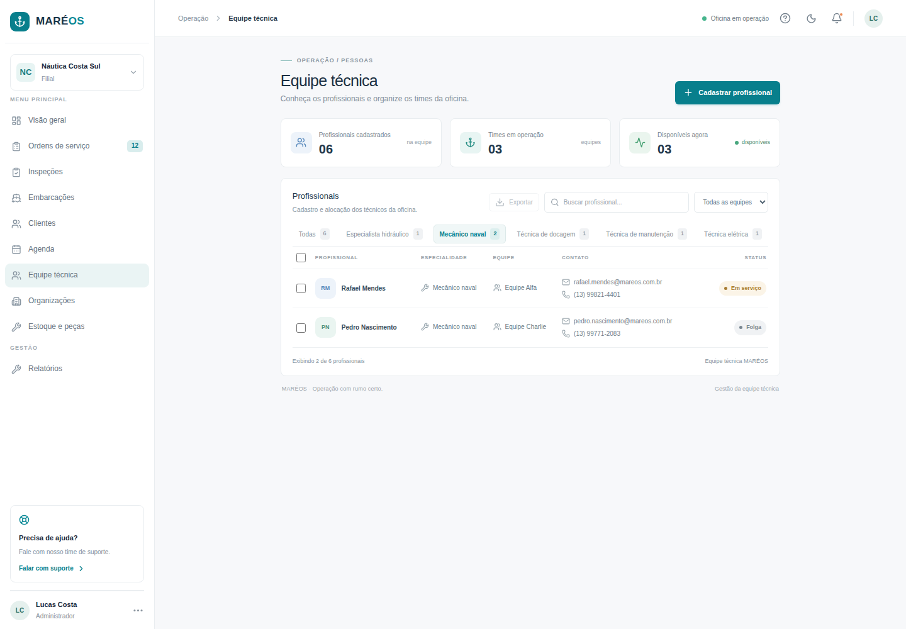
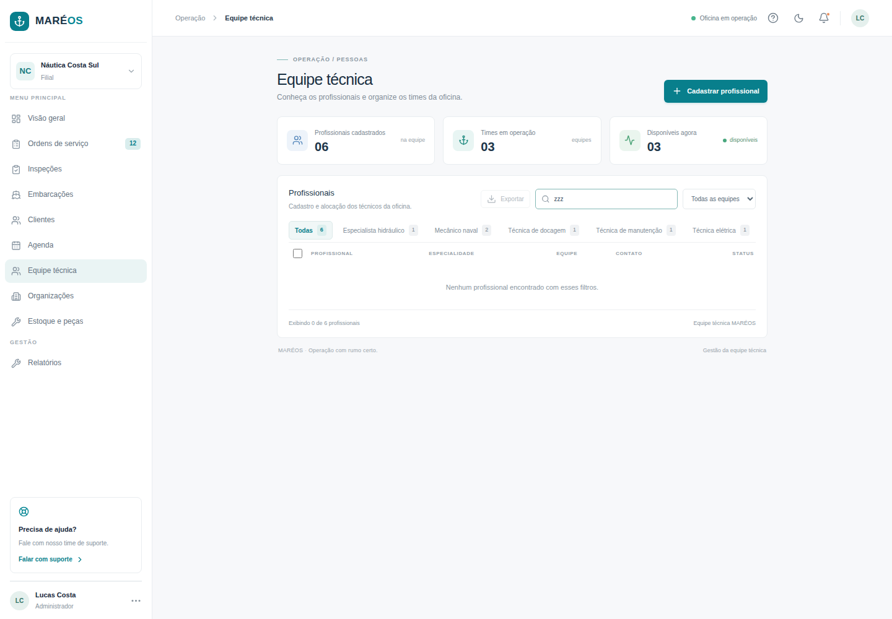
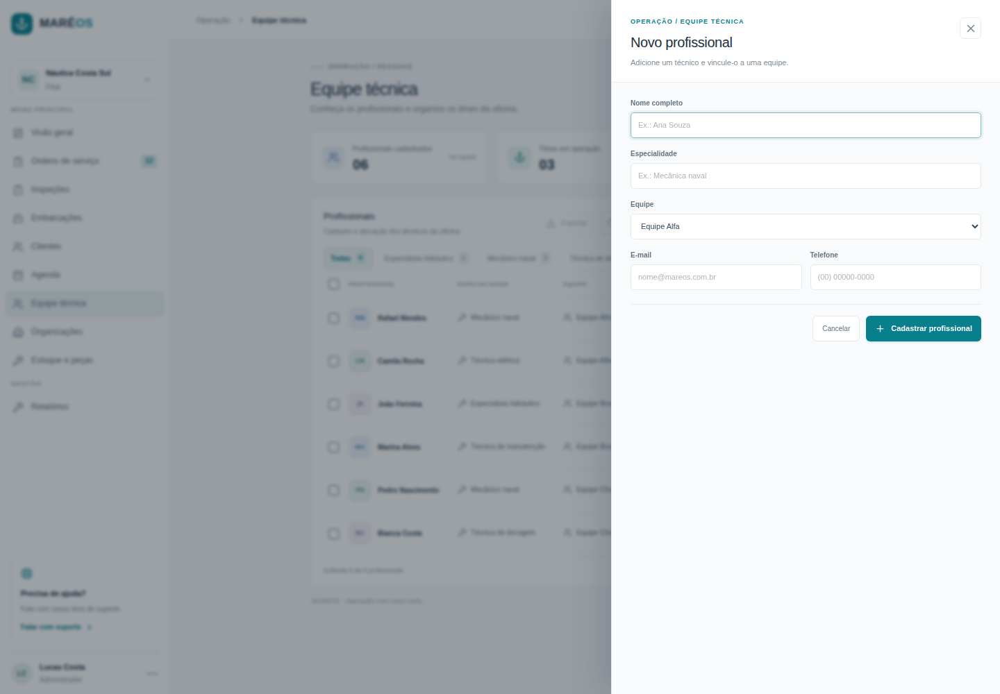
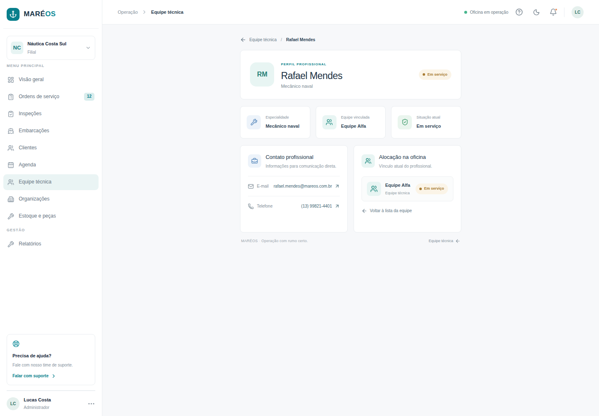
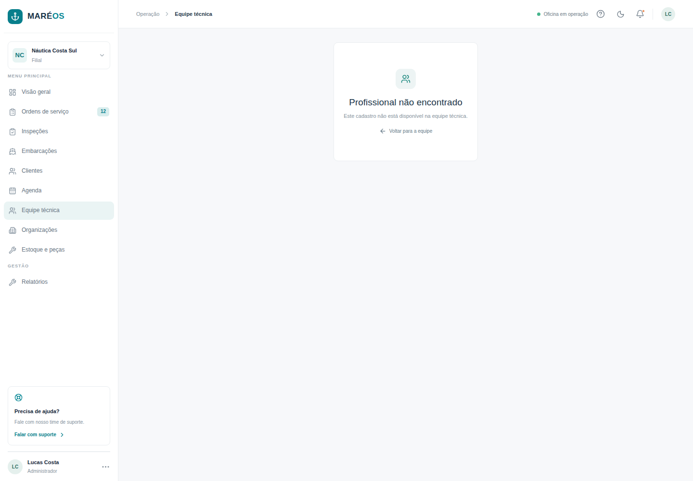

# Workforce: Staff, Team and Assignment

**Approved**: 2026-11-18 - user: "Aprovo o plano"

> Build this with **tlc-implement**. Every criterion becomes a check with a proof; nothing under
> the open questions is settled while building.

## Problem

Umbrielship records which services a WorkOrder holds but not who does them. There is no record of the
Organization's technicians, of the teams they form, or of who answers for a WorkOrderService, so an
administrator keeps that on paper or in chat, and nobody in the app can tell whether a technician is
busy. The mareos screens the web follows draw an "Equipe técnica" page with each professional's
specialty, team and contact (`app/equipe-tecnica`), and the mareos dashboard draws "Equipes em campo"
and an "EQUIPE" column; none of it can be built today, which is why AD-021, AD-034 and AD-047 omitted
teams ("no data behind them"). Acme, the sibling app whose standard umbrielship follows (AD-001 to
AD-003), has a `workforce` context with Staff and Assignment. The request gives no numbers.

When this ships, an administrator keeps the Organization's professionals (name, specialty, email,
phone, team) and teams (name, specialty) under "Equipe técnica", and names one professional or one team
as the "Responsável" of each WorkOrderService in the WorkOrder forms. Every Role sees whether each
professional and team is "Em serviço" or "Disponível", the services a professional answers for on
their profile, and the "Responsável" of each service on the WorkOrder detail.

## Shape

This reuses acme's `workforce` shape (Staff and Assignment aggregates, a facade, the delete refused
while an Assignment names the Staff), the mareos "Equipe técnica" screens, the existing WorkOrder use
cases, controllers and forms (`WorkOrderForm`, the "Novo serviço" and "Adicionar à agenda" drawers),
the drawer standard (`t-sheet`, AD-053), `t-confirmation`, `t-dropdown-menu`, `t-metric`, the CSV
writer and the toasts. The uniqueness of names and emails, the one Assignment per WorkOrderService, the
open-service rule, the 403 on an assignee sent by a non-administrator and the refused deletes run in use
cases with Vitest specs on in-memory fakes, and the Prisma repositories' writes are proven against real
PostgreSQL in `api/test/smoke/api-smoke.sh` (lesson L-029); the derived statuses, the search, the
filters, the specialty chips, the counts, the profile's open services and the CSV rows run in plain
functions under `web/src/package/workforce/**`, reached by its `__test__` specs (`npm test` in `web/`).

1. `POST /staff`, `GET /staff`, `GET /staff/:id`, `PUT /staff/:id`, `DELETE /staff/:id` -> `StaffController` (new) -> Staff use cases (new) -> `PrismaStaffRepository` (new) - name and email unique in the Organization, the Team of the Organization, delete refused while an Assignment names the Staff; persists `staff` (door 1)
2. `GET /teams`, `POST /teams`, `PUT /teams/:id`, `DELETE /teams/:id` -> `TeamController` (new) -> Team use cases (new) -> `PrismaTeamsRepository` (new) - name unique in the Organization, delete refused while an Assignment names the Team, otherwise its Staff lose the Team; persists `teams` (door 1)
3. `GET /assignments` -> `AssignmentController` (new) -> `FetchAssignmentsUseCase` (new) -> `PrismaAssignmentsRepository` (new) - every Assignment of the Organization
4. `POST /work-orders`, `PUT /work-orders/:id`, `POST /work-orders/:id/services` with an assignee -> `WorkOrderController`, `WorkOrderServiceController` (exist) - 403 unless `administrator` -> `CreateWorkOrderUseCase`, `EditWorkOrderUseCase`, `CreateWorkOrderServiceUseCase` (exist) - the open-service rule, the Staff or Team read through `WorkforceFacade` (new, door 3), the WorkOrder written as today, then each Assignment set or cleared through `WorkforceFacade` (door 2); persists `assignments` (door 1)
5. `DELETE /work-orders/:id`, `DELETE /work-orders/:id/services/:id` -> `DeleteWorkOrderUseCase`, `DeleteWorkOrderServiceUseCase` (exist) - after today's Inspection check, the Assignments removed through `WorkforceFacade`, then the record
6. `WorkforceModule` (new) exports only `WorkforceFacade`; `WorkOrderModule` (exists) imports it; `AppModule` (exists) composes it; `workforce` imports no context (door 3)
7. web `InternalLayout` (exists) - "Equipe técnica" after "Agenda"; `StaffList` page (new, tabs "Profissionais" and "Equipes") and `StaffDetail` page (new) -> `GET /api/staff`, `/api/staff/:id`, `/api/teams`, `/api/assignments`, `/api/work-orders`, `/api/vessels`; the drawers (new) -> the writes of hops 1 and 2
8. web `WorkOrderForm` (exists, create and edit), the "Novo serviço" and "Adicionar à agenda" drawers (exist) - "Responsável" for an `administrator` -> hop 4; `WorkOrderDetail` (exists) shows "Responsável" per service, reading `GET /api/assignments`, `/api/staff`, `/api/teams`
9. out: rows in `staff`, `teams` and `assignments`; the pages render the statuses and the "Responsável"

**Changes underneath**

| Front | What changes |
| --- | --- |
| domain | new terms Staff, Team and Assignment in `CONTEXT.md`; "assignment" alone now means the workforce Assignment, so the InspectionAssignment and Inspection entries say "InspectionAssignment" where they say "an assignment" today; nothing branches on the word |
| stored data | three new tables, no row to backfill; no existing table changes |
| contracts | `POST /work-orders`, `PUT /work-orders/:id` and `POST /work-orders/:id/services` accept optional assignee fields and answer as today when they are absent; the deletes also remove Assignments; the only consumer is the web |
| readers | `WorkOrderDetail` shows the "Responsável"; `WorkOrderForm` (opened from the WorkOrder list, the Vessel detail and the dashboard later) and the "Novo serviço" and "Adicionar à agenda" drawers carry it for an `administrator`; `AGENTS.md` names the new context and dependency |

New: Staff, Team, Assignment; Staff to Team; Assignment to Staff or Team; Assignment to
WorkOrderService and WorkOrder by plain ids. One-way constraints: Staff name and email, Team name,
`citext` unique per Organization; one Assignment per WorkOrderService; exactly one of `staffId` and
`teamId` (door 1).

The states are derived on every read and never stored (AD-067, AD-072); "Disponivel" reads
"Disponível" and "EmServico" reads "Em serviço".

## Surface

| Route | In | Out | Status | Who |
| --- | --- | --- | --- | --- |
| `GET /staff` | - | `{ staff: [{ id, name, specialty, email, phone, teamId }] }`, by name | `200`, `401` | every Role |
| `POST /staff` | `{ name, specialty, email, phone, teamId? }` | `{ staff: { id, name, specialty, email, phone, teamId } }` | `201`, `400`, `404` `Team not found`, `409` `Staff name already exists` / `Staff email already exists`, `401`, `403` | `administrator`; other Roles `403` |
| `GET /staff/:id` | - | `{ staff }` | `200`, `404` `Staff not found`, `401` | every Role |
| `PUT /staff/:id` | the `POST` body | `{ staff }` | `200`, `400`, `404` `Staff not found` / `Team not found`, `409`, `401`, `403` | `administrator` |
| `DELETE /staff/:id` | - | - | `204`, `404` `Staff not found`, `409` `Staff has Assignment`, `401`, `403` | `administrator` |
| `GET /teams` | - | `{ teams: [{ id, name, specialty, staffCount }] }`, by name | `200`, `401` | every Role |
| `POST /teams` | `{ name, specialty }` | `{ team: { id, name, specialty } }` | `201`, `400`, `409` `Team name already exists`, `401`, `403` | `administrator` |
| `PUT /teams/:id` | the `POST` body | `{ team }` | `200`, `400`, `404` `Team not found`, `409`, `401`, `403` | `administrator` |
| `DELETE /teams/:id` | - | - | `204`, `404` `Team not found`, `409` `Team has Assignment`, `401`, `403` | `administrator` |
| `GET /assignments` | - | `{ assignments: [{ id, workOrderId, workOrderServiceId, staffId, teamId }] }` | `200`, `401` | every Role |
| `POST /work-orders` (changed) | each `services[]` item may carry `staffId` or `teamId` | as today | as today, plus `400` (both given), `403` (an assignee from a non-administrator), `404` `Staff not found` / `Team not found`, `409` `Work order service is not open` | writers; an assignee only `administrator` |
| `PUT /work-orders/:id` (changed) | optional `services: [{ id, staffId?, teamId? }]`, neither id clearing the Assignment | as today | as today, plus `400`, `403`, `404` `Work order service not found` / `Staff not found` / `Team not found`, `409` `Work order service is not open` | writers; `services` only `administrator` |
| `POST /work-orders/:id/services` (changed) | optional `staffId` or `teamId` | as today | as today, plus `400`, `403`, `404`, `409` `Work order service is not open` | writers; an assignee only `administrator` |

## Landing

| One-way door | Literal shape | Alternative rejected |
| --- | --- | --- |
| 1. Three tables in one migration (`npx prisma migrate dev --name add_workforce`) | `staff(id, organizationId, name citext, specialty text, email citext, phone text, teamId -> teams.id ON DELETE SET NULL null, createdAt)`, unique `(organizationId, name)` and `(organizationId, email)`; `teams(id, organizationId, name citext, specialty text, createdAt)`, unique `(organizationId, name)`; `assignments(id, organizationId, workOrderId, workOrderServiceId, staffId -> staff.id ON DELETE RESTRICT null, teamId -> teams.id ON DELETE RESTRICT null, createdAt)`, unique `(workOrderServiceId)`, `CHECK (num_nonnulls("staffId", "teamId") = 1)`; every table indexed on `organizationId`, `assignments` also on `workOrderId`; `workOrderId` and `workOrderServiceId` are plain columns with no foreign key (AD-002) | assignee columns on `work_order_services` (one context's table holding another's record, against AD-002, and not the workforce Assignment the user asked for); acme's own period and one-Staff-per-day rule (AD-076 chose the service's period and no overlap check) |
| 2. Writing across contexts | the WorkOrder use case validates every assignee through `WorkforceFacade` before any write, writes the WorkOrder and its services in today's transaction, then sets or clears each Assignment through `WorkforceFacade`; a delete removes the Assignments after today's Inspection check and before the record. Not one transaction: only an infrastructure failure, or a Staff or Team deleted between the check and the write, leaves a WorkOrder with fewer Assignments, answered `500` | one Prisma transaction spanning `work_orders` and `assignments` (one context writing another's table); the web writing Assignments in separate requests after the WorkOrder (a partial save every time one request drops, visible to the user) |
| 3. Dependency direction | `work-order` -> `workforce` only: `WorkOrderModule` imports `WorkforceModule`, which exports `WorkforceFacade` (find a Staff or Team of the Organization; set, clear and remove Assignments, all returning plain data); `workforce` imports no context and never reads a WorkOrderService, so the open-service rule runs in `work-order` and the statuses run in the web | `workforce` reading WorkOrderServices through a new `WorkOrderFacade`: with door 2 it makes a cycle, which acme breaks only with lazy cross-context bindings, a pattern umbrielship does not have |
| 4. Contract | the routes and fields of `## Surface`, error messages in English as acme's | a nested `/work-orders/:id/services/:id/assignment` route in `workforce` (the forms save the WorkOrder and its assignees in one request, AD-073) |

- Nothing else in this change is hard to reverse

## Criteria

### S1: The administrator keeps the professionals and the teams (P1)

An administrator registers, edits and deletes professionals and teams on "Equipe técnica"; every Role
reads them.

**Acceptance Criteria**

1. WHEN an `administrator` calls `POST /staff` with `name` (1 to 120 characters after trimming), `specialty` (1 to 100), a valid `email` (up to 254), `phone` (1 to 30) and, optionally, `teamId` of a Team of the Organization THEN the system SHALL answer 201 `{ staff: { id, name, specialty, email, phone, teamId } }` with name, specialty and phone trimmed, the email trimmed and lower-cased, and `teamId` null when absent or null
2. IF `name` is used by another Staff of the Organization, compared without case after trimming, THEN `POST /staff` and `PUT /staff/:id` SHALL answer 409 `Staff name already exists` and store nothing; IF `email` is, THEN 409 `Staff email already exists`; IF `teamId` names a Team of another Organization or none THEN 404 `Team not found`; IF a field is missing or out of bounds THEN 400
   - "Rafael Mendes" exists → " rafael mendes" → 409; the same name in another Organization → 201; editing "Rafael Mendes" keeping his own name and email → 200
3. WHEN any Role calls `GET /staff` THEN the system SHALL answer every Staff of its Organization ordered by name and none of another; `GET /staff/:id` SHALL answer `{ staff }`, or 404 `Staff not found` for a Staff of another Organization or none
4. WHEN an `administrator` calls `PUT /staff/:id` with the `POST` body THEN the system SHALL answer 200 with the new values under the rules of criteria 1 and 2
5. WHEN an `administrator` calls `DELETE /staff/:id` for a Staff no Assignment names THEN the system SHALL answer 204 and remove it; IF an Assignment names it THEN 409 `Staff has Assignment` and keep it
6. WHEN an `administrator` calls `POST /teams` with `name` (1 to 120 after trimming) and `specialty` (1 to 100) THEN the system SHALL answer 201 `{ team: { id, name, specialty } }`; IF the name is used by another Team of the Organization, compared without case, THEN `POST` and `PUT /teams/:id` SHALL answer 409 `Team name already exists`; `GET /teams` SHALL answer `{ teams: [{ id, name, specialty, staffCount }] }` by name, `staffCount` being the Staff whose Team it is; a Team of another Organization or none SHALL answer 404 `Team not found`
7. WHEN an `administrator` calls `DELETE /teams/:id` for a Team no Assignment names THEN the system SHALL answer 204, remove it and leave each of its Staff with `teamId` null; IF an Assignment names it THEN 409 `Team has Assignment` and change nothing
   - "Equipe Alfa" with 2 Staff and no Assignment → 204, both Staff `teamId: null`; "Equipe Alfa" responsible for a `COMPLETED` service → 409
8. IF an `operator` or an `inspector` calls `POST`, `PUT` or `DELETE` on `/staff` or `/teams` THEN the system SHALL answer 403 and store nothing (AD-061)
9. WHEN a user opens "Equipe técnica" in the sidebar, listed after "Agenda", THEN the system SHALL open `/staff`, read "Operação > Equipe técnica" in the topbar, request `GET /api/staff`, `GET /api/teams`, `GET /api/assignments` and `GET /api/work-orders` once each, and show the tab "Profissionais" as `.specs/features/workforce/captures/staff-list.png` (`.specs/features/workforce/captures/staff-list.aria.yml`), minus what `## Differences from the source` lists
10. The metrics SHALL read "Profissionais cadastrados" (every Staff), "Equipes cadastradas" with the note "equipes" (every Team, AD-080) and "Disponíveis agora" (Staff "Disponível" by criterion 29), each padded to two digits
11. The professionals table SHALL show each Staff with its initials avatar and its name linking to `/staff/:id`, its specialty, its Team's name or "Sem equipe", its email and phone, and its status badge, ordered by name in `pt-BR`, with "Exibindo <n> de <total> profissionais" beneath
12. WHEN the user types in "Buscar profissional...", picks a team in "Filtrar por equipe" ("Todas as equipes", each Team by name, "Sem equipe" last, AD-075) or a specialty chip ("Todas <total>", then each specialty with its count, in `pt-BR` order) THEN the table SHALL keep the Staff matching all three, the search comparing name, specialty, team name and email without case, as `.specs/features/workforce/captures/staff-list-filtered.png`; IF nothing matches THEN it SHALL read "Nenhum profissional encontrado com esses filtros." as `.specs/features/workforce/captures/staff-list-empty.png`; IF the Organization has no Staff THEN "Ainda não há profissionais cadastrados."
    - chip "Mecânico naval" with 2 Staff, one in "Equipe Alfa" and one without a team, filter "Sem equipe" → 1 row; search "ALFA" → the Staff of "Equipe Alfa"
13. WHEN the user selects rows and uses "Exportar (<n>)" THEN the system SHALL download `equipe-tecnica.csv` with the header `Nome,Especialidade,Equipe,E-mail,Telefone,Status` and one line per selected Staff, "Sem equipe" for none; "Exportar" SHALL be disabled with none selected, labelled "Selecione profissionais para exportar", "Exportar 1 profissional selecionado em CSV" or "Exportar <n> profissionais selecionados em CSV"; "Selecionar todos os profissionais visíveis" selects or clears the rows the filters show
14. WHEN an `administrator` uses "Cadastrar profissional" THEN the system SHALL open the drawer "Novo profissional" with the fields of `.specs/features/workforce/captures/staff-drawer.png` (`.specs/features/workforce/captures/staff-drawer.aria.yml`) laid out as AD-082 and the drawer standard (AD-053) say, "Equipe" starting at "Sem equipe" followed by the Teams by name; WHEN they save with "Criar profissional" THEN the system SHALL `POST /api/staff`, close the drawer, show the toast "<nome> foi adicionado à equipe técnica." and the new row; IF the API answers 409 THEN the toast "Erro ao cadastrar profissional" with the API message and the drawer stays open
15. WHEN a user uses "Ações para <nome>" THEN the system SHALL offer "Ver perfil" (`/staff/:id`) and, for an `administrator`, "Editar", which opens "Editar profissional" filled and saves with "Salvar alterações" (`PUT /api/staff/:id`, toast "Profissional atualizado com sucesso"), and "Excluir", which asks in `t-confirmation` "Excluir profissional" and on confirming sends `DELETE /api/staff/:id` (toast "Profissional excluído com sucesso"); a 409 SHALL show the toast "Erro ao excluir profissional" with the API message and keep the row
16. WHEN the user picks the tab "Equipes" THEN the system SHALL show the Teams ordered by name with "Nome", "Especialidade", "Profissionais" (`staffCount`) and "Status" (criterion 30), "Ainda não há equipes cadastradas." when there is none, and keep the tab across a reload (`/staff?tab=equipes`)
17. WHEN an `administrator` uses "Nova equipe" THEN the system SHALL open the drawer "Nova equipe" of AD-082 and save with "Criar equipe" (`POST /api/teams`, toast "Equipe criada com sucesso"); "Ações para <equipe>" SHALL offer "Editar" ("Editar equipe", "Salvar alterações", toast "Equipe atualizada com sucesso") and "Excluir", whose confirmation "Excluir equipe" adds "Os <n> profissionais desta equipe ficarão sem equipe." when the Team has Staff ("O 1 profissional desta equipe ficará sem equipe." for one), then `DELETE /api/teams/:id` (toast "Equipe excluída com sucesso"); a 409 SHALL show "Erro ao excluir equipe" with the API message
18. WHILE the active Role is `operator` or `inspector` the page SHALL show no "Cadastrar profissional", "Nova equipe", "Editar" or "Excluir"; "Ver perfil", the filters and "Exportar" stay

### S2: A WorkOrderService gets its Responsável (P1)

An administrator names one professional or one team as the "Responsável" of a service while creating
or editing a WorkOrder, or creating a service.

**Acceptance Criteria**

19. WHEN an `administrator` calls `POST /work-orders` with a `services[]` item carrying `staffId` or `teamId` of its Organization THEN the system SHALL answer as today and store one Assignment for that WorkOrderService, listed by `GET /assignments` as `{ workOrderId, workOrderServiceId, staffId, teamId }` with the other id null
20. IF a service item carries both `staffId` and `teamId` THEN the system SHALL answer 400; IF either names a record of another Organization or none THEN 404 `Staff not found` or `Team not found`; IF the WorkOrder's `status` is `COMPLETED` or `CANCELLED`, or the service's `status` is `COMPLETED`, and the item carries an assignee THEN 409 `Work order service is not open`; in all three cases no WorkOrder, service or Assignment is stored
21. IF an `operator` sends `staffId` or `teamId` on `POST /work-orders`, `POST /work-orders/:id/services`, or `services` on `PUT /work-orders/:id` THEN the system SHALL answer 403 and store nothing; without them the operator's requests SHALL answer as today (AD-079)
22. WHEN an `administrator` calls `PUT /work-orders/:id` with `services: [{ id, staffId }]` or `[{ id, teamId }]` THEN that service's Assignment SHALL become that Staff or Team, replacing any other; `{ id }` with neither SHALL remove it; services not listed SHALL keep theirs; IF `id` is not a service of that WorkOrder THEN 404 `Work order service not found` and nothing changes
    - a `COMPLETED` service with Staff A: `{ id, staffId: A }` → 200, unchanged; `{ id, staffId: B }` → 409; `{ id }` → 200, removed; the WorkOrder sent with `status: CANCELLED` and a new `teamId` on any service → 409 and neither the status nor the Assignment changes
23. WHEN an `administrator` calls `POST /work-orders/:id/services` with `staffId` or `teamId` THEN the system SHALL store the Assignment with the service, under the rules of criterion 20 for the WorkOrder's stored status and the service's status
24. WHEN a writer deletes a WorkOrder or a WorkOrderService THEN `GET /assignments` SHALL no longer list its Assignments and the Staff or Team they named SHALL be deletable; IF the record has an Inspection THEN the delete SHALL answer 409 as today and the Assignments stay
25. WHILE the signed-in Role is `administrator` each service of "Serviços a realizar" in "Nova ordem de serviço" (opened from the WorkOrder list or the Vessel detail) SHALL carry "Responsável", a select of "Sem responsável", the group "Profissionais" ("<nome> · <especialidade>") and the group "Equipes" ("<nome> · <especialidade>"), starting at "Sem responsável" (AD-083); WHEN they save THEN the request SHALL carry `staffId` or `teamId` for each service that has one; WHILE the Role is `operator` the field SHALL not show (AD-079)
26. WHEN an `administrator` uses "Editar" on a WorkOrder THEN the drawer SHALL list its services under "Serviços a realizar", each name read only with "Responsável" set to its current Assignment; a `COMPLETED` service, or any service while "Status" reads "Concluído" or "Cancelado", SHALL offer only its current value and "Sem responsável"; saving SHALL send `services` with every listed service (AD-077); WHILE the Role is `operator` the drawer SHALL show no services, as today
27. WHILE the Role is `administrator` "Novo serviço" on the WorkOrder detail and "Adicionar à agenda" on the Agenda SHALL carry "Responsável" in their "Serviço" card, with the options of criterion 25, sent as `staffId` or `teamId` (AD-078)

### S3: Everyone sees who works where (P1)

Every Role sees each professional's and team's status, a professional's open services and each
service's Responsável.

**Acceptance Criteria**

28. The WorkOrder detail SHALL show for each service "Responsável: <nome do profissional>", "Responsável: Equipe <nome>" or "Sem responsável", for every Role (AD-083)
29. A Staff's status SHALL read "Em serviço" while its own Assignment, or its Team's Assignment, is on a WorkOrderService `IN_PROGRESS`, and "Disponível" otherwise (AD-067)
    - own Assignment on a `PENDING` service → "Disponível"; its Team responsible for an `IN_PROGRESS` service → "Em serviço"; that service turned `COMPLETED` → "Disponível"; no Team and no Assignment → "Disponível"
30. A Team's status SHALL read "Em serviço" while the Team's own Assignment is on a WorkOrderService `IN_PROGRESS`, and "Disponível" otherwise; a member's own Assignment SHALL not count (AD-072)
31. WHEN a user opens `/staff/:id` THEN the system SHALL show the profile as `.specs/features/workforce/captures/staff-detail.png` (`.specs/features/workforce/captures/staff-detail.aria.yml`), with "Equipe vinculada" reading the Team's name or "Sem equipe", "Situação atual" the status of criterion 29, the email as a `mailto:` link and the phone as a `tel:` link with only its digits and "+"
32. Under "Alocação na oficina" the profile SHALL list the open WorkOrderServices - WorkOrder `PENDING` or `IN_PROGRESS` and service not `COMPLETED` - whose Assignment names the Staff or its Team, ordered by the service's start, each with the service name, the WorkOrder's `#` code, the Vessel name and the period as "17/11/2026 09:00 – 18/11/2026 17:00", opening `/work-orders/:id`; IF there is none THEN "Nenhuma alocação em serviços abertos." (AD-071)
33. IF `/staff/:id` names a Staff of another Organization or none THEN the system SHALL show "Profissional não encontrado", "Este cadastro não está disponível na equipe técnica." and "Voltar para a equipe" to `/staff`, as `.specs/features/workforce/captures/staff-detail-not-found.png`
34. WHILE the window is 640, 768, 1024, 1280 or 1536px wide `/staff` and `/staff/:id` SHALL have no horizontal page scroll; only a table scrolls inside its panel
35. WHILE any request of a page is loading its metrics and tables SHALL show skeletons; IF one fails THEN the toast "Erro ao carregar a equipe técnica" with the API message, or "Não foi possível carregar a equipe técnica." when there is none

### S4: The documents say so (P2)

**Acceptance Criteria**

36. The system SHALL describe the workforce as built: `CONTEXT.md` defines Staff (not a User, the fields, unique name and email), Team (name, specialty, deleting it leaves its Staff with no Team) and Assignment (one Staff or one Team on one WorkOrderService, at most one per service, deleted with it, blocking the deletion of its Staff or Team) and says "InspectionAssignment" where the InspectionAssignment and Inspection entries say "an assignment"; `AGENTS.md` lists the `workforce` context (`staff`, `team`, `assignment`, facade `WorkforceFacade` with the Staff and Team reads and the Assignment writes), `AppModule` composing `WorkforceModule`, `work-order` reading Staff and Team only through `WorkforceFacade`, `workforce` importing no context, the three tenant tables and the `administrator`-only writes; `ROADMAP.md` records the item as built

## Out of scope

| Excluded | Why |
| --- | --- |
| "Equipes em campo", the "EQUIPE" column and the team in the Agenda panel of the dashboard | the `dashboard-redesign` plan, after this one (AD-059) |
| The team on Agenda items and on the WorkOrder list | not asked; AD-047 keeps the `#` code there |
| A Staff signing in or linked to a User | AD-060 |
| Overlap checks between WorkOrderServices, several Responsáveis per service | AD-076 |
| "Folga" or any absence | AD-067 |
| A page listing every Assignment; a Team page | AD-073, AD-074 |
| Editing a WorkOrderService's name, description or period on the web | AD-077 |
| Pagination of `/staff`, `/teams`, `/assignments` | the lists load every record, as AD-023 and AD-040 |

## Assumptions

| Assumption | Chosen default | Rationale | Confirmed? |
| --- | --- | --- | --- |
| How the request is cut | two plans: this one first, then `dashboard-redesign` | user chose "Dois planos" (AD-059) | y |
| What a Staff is | a person record that never signs in, not a User | user chose "Cadastro sem login" (AD-060) | y |
| Staff fields | name, specialty (free text), email, phone required; optional Team; name and email unique in the Organization; no "external" | user chose "Mareos, time opcional" (AD-060) | y |
| Who writes Staff, Teams and Assignments | `administrator` only; the other Roles read and get 403 on a write | user's request and "Só administrator" (AD-061) | y |
| What a Team holds; deleting a Team with Staff | name and specialty; its Staff are left with no Team | user chose "Nome + especialidade" and "Solta os membros" (AD-062) | y |
| Assignments per WorkOrderService | at most one: one Staff or one Team, or none; no period of its own; no overlap check | user chose "Um, opcional" (AD-076) | y |
| Deletes around an Assignment | a WorkOrder or WorkOrderService takes its Assignments; a Staff or Team with one → 409 | user chose "Serviço leva; pessoa bloqueia" (AD-064) | y |
| Where an Assignment is made | the WorkOrder form, each service of "Serviços a realizar"; also "Novo serviço" and "Adicionar à agenda"; the edit drawer lists the services with "Responsável" | user: "a alocação do time ou staff deve ser através do formulário de OS"; "Editar OS mostra responsáveis"; "Sim, nos dois" (AD-073, AD-077, AD-078) | y |
| What an operator sees | no "Responsável"; 403 when it sends one | user chose "Campo escondido" (AD-079) | y |
| Which services accept a new Responsável | WorkOrder `PENDING` or `IN_PROGRESS` and service not `COMPLETED`; clearing always | user chose "OS e serviço abertos" (AD-068) | y |
| Staff and Team screens | "Equipe técnica" after the mareos screens, tab "Equipes" (list, drawer, row menu), row menu on professionals, "Sem equipe" in the filter, word "Equipe" | user chose "Mareos + aba Times", "Lista simples", "Menu na linha", "Opção Sem equipe", "Equipe" (AD-066, AD-069, AD-070, AD-074, AD-075) | y |
| Statuses and the profile | derived Staff and Team statuses; the profile lists open services | user chose "Derivar das alocações", "Equipe alocada", "Listar alocações" (AD-067, AD-071, AD-072) | y |
| Copy and drawers | "Equipes cadastradas"; subtitle with "equipes"; footers omitted; the drawers, cards and buttons of AD-082; "Responsável" display of AD-083 | user accepted the four proposals (AD-080 to AD-083) | y |
| Web routes | `/staff` (tab `?tab=equipes`) and `/staff/:id` | the API's names, as the other modules | n |
| Team field limits | name 1 to 120, specialty 1 to 100 | the mareos limits for the Staff fields | n |
| Card icons | "Dados do profissional" `lucideUserRound`, "Contato" `lucidePhone`, "Dados da equipe" `lucideUsers` | AD-058 asks an icon per card | n |
| Toasts and confirmations | the sentences of criteria 14, 15, 17, 35 | the patterns of the Customer and WorkOrder screens | n |
| The tab's header button | "Cadastrar profissional" on "Profissionais", "Nova equipe" on "Equipes" | one primary action per tab, as the mareos header | n |
| Widths | 640, 768, 1024, 1280 and 1536px | the widths kept by every redesign so far | n |

**Open questions:** none - all resolved or logged above.

## Differences from the source

| Source shows | Product shows | Confirmed |
| --- | --- | --- |
| Drawer with a white form, the buttons after the fields and "Cadastrar profissional" with a plus | the drawer standard: cards, pinned footer, "Cancelar" with X and "Criar profissional" with a check | y - AD-053, AD-054, AD-082 |
| "Equipe" select starting at "Equipe Alfa" | "Sem equipe", then the Teams by name | y - AD-060, AD-070 |
| Status "Folga" | none; "Em serviço" and "Disponível" derived | y - AD-067 |
| Metric "Times em operação" | "Equipes cadastradas" | y - AD-080 |
| "Conheça os profissionais e organize os times da oficina." | "Conheça os profissionais e organize as equipes da oficina." | y - AD-081 |
| Footers "Equipe técnica MARÉOS", "Gestão da equipe técnica" and "MARÉOS · Operação com rumo certo." | nothing | y - AD-081, AD-025 |
| In-page notice "<nome> foi adicionado à equipe técnica." | the same sentence in a toast | y - AD-026 |
| No row actions | "Ações para <nome>": "Ver perfil", "Editar", "Excluir" | y - AD-069 |
| No screen for teams | the tab "Equipes" | y - AD-066, AD-074 |
| "Alocação na oficina" with only the team | the team and the open services | y - AD-071 |
| "Equipe vinculada" always a team | "Sem equipe" when there is none | y - AD-070 |
| "Oficina em operação", help, notifications | nothing | y - AD-025 |
| Menu items without a screen ("Estoque e peças", "Relatórios") | omitted | y - AD-024 |
| E-mail placeholder "nome@mareos.com.br" | "nome@empresa.com.br", as the Customer drawer | y - AD-025 |

## Sources

- The request: "vamos adicionar um domain módulo de workforce semelhante ao /home/luciano/workspace/development/apps/acme. porém vamos adicionar novas propriedades ao staff (especialidade, telefone e teamId). o admin poderá gerenciar os teams. um admin poderá vincular um staff ou um team a um serviço de uma ordem de serviço através dos assignments." - binding - the scope
- acme `workforce` (`/home/luciano/workspace/development/apps/acme/apps/api/src/package/workforce`, `.specs/features/workforce/plan.md`) - non-binding - user: "semelhante ao /home/luciano/workspace/development/apps/acme" - the context's shape, the facade and the refused delete
- mareos "Equipe técnica" (`/home/luciano/workspace/development/apps/mareos`, port 3100), captured 2026-11-17 with headless Chrome at 1440x1000, the Next.js dev overlay removed - binding (AD-066) - the professionals list, the drawer and the profile
- `captures/source/` - binding - `team-management.tsx`, `team-detail.tsx`, `team-store.tsx`, their CSS modules and `globals.css`: labels, aria-labels, limits, the search, filter, chip and CSV rules
-  - binding - the professionals list; structure in `captures/staff-list.aria.yml`
-  - binding - the chip "Mecânico naval" picked
-  - binding - a search with no match
-  - binding - "Novo profissional" (its layout replaced by AD-053); structure in `captures/staff-drawer.aria.yml`
-  - binding - the profile; structure in `captures/staff-detail.aria.yml`
-  - binding - a professional that does not exist
- `.specs/STATE.md` AD-059 to AD-083 - the answers of 2026-11-17; AD-017, AD-020, AD-023 to AD-026, AD-053, AD-054, AD-058 - the rules this conforms to
